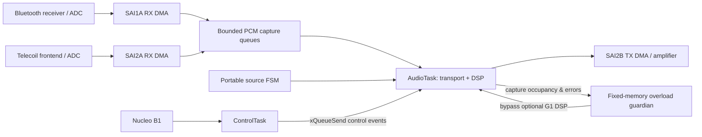

# Integrated firmware architecture and ownership

## Product vs MCU state

This repo contains two *different* notions of mode: the group requirement uses system-wide OFF / STARTUP / NORMAL / SLEEP / FAULT, whereas the portable connectivity policy names its own M1 initialisation, M2 active, M3 source idle, M4 source fault. **M3 source idle is not electrical STOP/SLEEP mode.** Until power-transition hardware is verified, keep those state machines separate.

## Signal flow (current Nucleo integration baseline)

Microphone DFSDM, USB audio, charger, custom PCB GPIO, and trained AI are **design candidates**, not running paths here.

## Concurrent responsibilities

| Owner | RTOS mechanism | Shared resource rules |
| --- | --- | --- |
| AudioTask, priority 7 | Audio buffers, time-critical route and optional DSP | Exclusive owner of profile and guardian state; never block on serial output |
| ControlTask, priority 6 | UART commands and `GroupEvent` queue writes | UI/commands send bounded events rather than changing audio state directly |
| Bluetooth supervision, priority 5 | Serial supervision/status | Bluetooth commands must not reconfigure audio DMA behind AudioTask |
| Background, CPULoadB priority 2 | Optional experiment | No real-time ownership; do not enable in production |
| HighLoad7 priority 7 | **20 s disruptive scheduler experiment** | Prohibited in normal hearing-aid use; may starve ControlTask |
| DMA IRQ callbacks | Signal capture/transfer completed | Keep short, bounded; do not do heavy DSP or blocking I/O in interrupts |

**Current limitation:** AudioTask still uses mixed queue-draining / yield logic inherited from R34. The proposed notification-driven architecture is not implemented just by drawing it here. Optimise only against measured CPU load, buffer depth and deadline data, without jeopardising playback.

## Engineering time budget

At `48,000 samples/s`, 128 frames correspond to **2.667 ms** of input time. This is a useful throughput scale, **not an assertion of the exact interrupt service deadline** because the actual buffering and DMA half/full transfers matter. Log worst-case AudioTask time, capture depth, outgoing queue depth, missed deadline counters and speaker underruns while operating the complete system.

## Truthful feature vocabulary

- **Verified:** C unit test, configuration invariant or instrumented hardware result has evidence with environment and thresholds.
- **Validated:** End-to-end user requirement tested on representative assembled hardware.
- **Pending:** Source exists but hardware behavior cannot yet be claimed.
- **Unavailable:** Schematic/PCB lacks the necessary hardware or circuit has unresolved electrical constraints.

Do not call the automatic three-level loudness heuristic 'trained TinyML.' Do not equate software PCM limiting with a safe acoustic SPL. See `Documentation/REQUIREMENTS_EVIDENCE.csv`.

## G5: event-driven PCM capture and physical UI

DMA ISR producers copy full PCM blocks, execute the publication memory barrier, advance their capture head, and only then call `vTaskNotifyGiveFromISR()`. The higher-priority AudioTask drains bounded queues and blocks with `ulTaskNotifyTake(pdTRUE,5ms)` when both are empty. This allows non-audio FSM servicing even in the absence of PCM; the actual IRQ-to-audio scheduling latency requires an STM32 test.

The Nucleo PC13 button is debounced by `group_ui.c` in ControlTask. A FreeRTOS `GroupEvent` queue moves profile and routing requests to AudioTask, which exclusively owns optional DSP and FSM controls. See [the scheduling guide](G5_RTOS_AND_PERFORMANCE.md) and [one-button user guide](G5_STANDALONE_USER_GUIDE.md).
