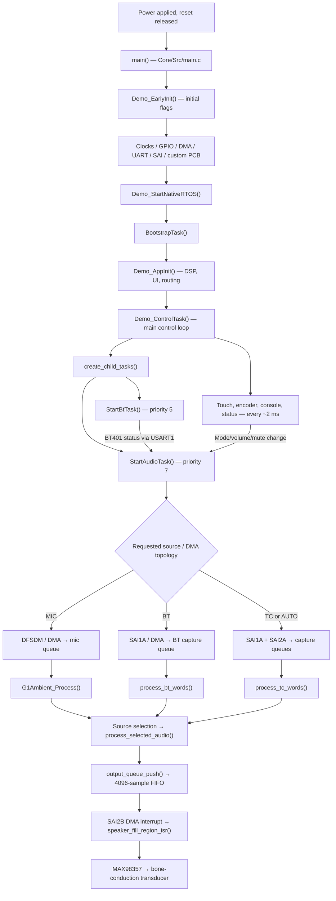

# Quiet Riot R26 — Firmware execution trace
### From battery power-on to the exact code that produces each audio sample

> **NEW: start with the [four-subsystem R26.10 guide](SUBSYSTEMS/README.md)** for the easiest navigation: [Anna](SUBSYSTEMS/ANNA_CONTROLS.md) · [Ryan](SUBSYSTEMS/RYAN_CONNECTIVITY.md) · [Mariya](SUBSYSTEMS/MARIYA_AUDIO_DSP.md) · [Naomi](SUBSYSTEMS/NAOMI_OUTPUT.md) · [cross-subsystem interface contracts](SUBSYSTEMS/INTERFACES.md). The pages describe how events trigger source functions, which data/flags are handed over and what calls run next. This long document retains its **QR261104.8** 39-event baseline; the new subsystem pages use **QR261104.10**, including the exposed DFSDM adapter and RTOS contract header. Read the release notes before comparing code from different versions.

**Documented baseline:** QR261104.8, using the *clean CubeIDE project ZIP*, with its active entry point at `Core/Src/main.c`. **Scope:** normal operating firmware, important events, interrupts, states, DSP functions and failure paths, with file/function references and annotated source excerpts.

> **Version integrity notice (important):** The repository's `main` branch has not yet been fully synchronized with the QR261104.8 clean firmware ZIP. In particular, the newer `tc_s24_recovery.c`, `tc_idle_squelch.c` and `qr_bt_volume.c` modules are in the QR261104.8 ZIP but are **not yet on GitHub main**. This guide is grounded in the QR261104.8 ZIP, not a claim that every code excerpt is already in the GitHub source browser. When navigating the current repository, treat missing files or changed line numbers as a release-sync issue, not a reason to search in Recovery folders. Do not deploy a mixed-source build.

This is a **run-time walkthrough**, not a list of modules in alphabetical order. Every numbered stage answers:
1. **What event causes this code to execute?**
2. **Where exactly is it?**
3. **What does the relevant code do?**
4. **What state/data changes?**
5. **What function or event executes next?**
6. **How can it be observed or debugged?**

**Source excerpt convention:** Code blocks marked *excerpt* are taken from the QR261104.8 source, shortened by omitting unrelated statements; `...` indicates an omitted portion. Comments beginning `// GUIDE:` are explanatory additions. Code blocks marked *call trace* or *pseudocode* are not intended to compile.

---

## Navigation

- [A. One-screen runtime map](#a-one-screen-runtime-map)
- [B. Boot: reset to first real task](#b-boot-reset-to-first-real-task)
- [C. Default listening mode and ongoing task loops](#c-default-listening-mode-and-ongoing-task-loops)
- [D. Input hardware and DMA events](#d-input-hardware-and-dma-events)
- [E. Bluetooth event story](#e-bluetooth-event-story)
- [F. Telecoil event story](#f-telecoil-event-story)
- [G. Microphone event story](#g-microphone-event-story)
- [H. Source choice, DSP and output](#h-source-choice-dsp-and-output)
- [I. User interaction, sleep and wake](#i-user-interaction-sleep-and-wake)
- [J. Diagnostics and fault handling](#j-diagnostics-and-fault-handling)
- [K. Function-by-function quick reference](#k-function-by-function-quick-reference)
- [L. Debugging a real example](#l-debugging-a-real-example)

## A. One-screen runtime map



**Ownership matters:** the peripherals generate interrupts; those interrupts publish completed data; **AudioTask** owns audio routing and filter state; **ControlTask** owns touch/encoder and optional diagnostic console; **BtTask** owns the Bluetooth UART command stream; the **speaker DMA interrupt** consumes already prepared PCM. These threads do not run in the vertical order above after startup: they execute concurrently and are synchronized by events.

### Important values / where defined

| Parameter | Value | Definition |
| --- | --- | --- |
| Audio rate | 48,000 samples/s | `Core/Inc/demo_app.h`: `DEMO_AUDIO_RATE_HZ` |
| Input DMA buffer | 512 × 32-bit words | `Core/Inc/demo_app.h`: `DEMO_DMA_WORDS` |
| One completed half | 256 words = 128 stereo frames | `DEMO_HALF_WORDS`, `DEMO_FRAMES_PER_HALF` |
| One block duration | 128 / 48,000 = **2.667 ms** | Derived from definitions |
| Output FIFO | 4,096 mono samples | `Core/Src/demo_app.c`: `OUTPUT_SAMPLE_FIFO_SAMPLES` |
| Typical BT/TC FIFO prime | 1,024 samples ≈ 21.3 ms | `OUTPUT_PRIME_SAMPLES_EXACT` |
| Mic asynchronous FIFO prime | 2,048 samples ≈ 42.7 ms | `OUTPUT_PRIME_SAMPLES_ASYNC` |
| Normal core frequency | 48 MHz | `SystemClock_Config()` |
| Local UI 100% gain cap | 24,576 / 32,768 = **0.75×** | `Core/Inc/g1_operating_config.h` |

**Critical correction to older diagrams:** normal firmware startup begins in **MIC mode** after `G1Ui_Init()`; `Demo_EarlyInit()` momentarily sets AUTO, but `Demo_AppInit()` applies the UI default MIC. MIC is therefore the useful scenario for the first post-boot audio event. The diagnostic UART can be compiled in or out; check `G1_DIAGNOSTICS_UART_ENABLE` in `Core/Inc/g1_operating_config.h` rather than assuming its state.

---

## B. Boot: reset to first real task

### Event 01 — Board receives power and the CPU reaches `main()`

**Trigger:** a cold start, reset-button event or other CPU reset. The Cortex-M4 executes the startup vector and C runtime initialization **before** calling `main()`. Those early actions are performed by STM32 startup code, not by `demo_app.c`.

**Where:** `Core/Src/main.c:41–112`.

```c
int main(void)
{
  s_g1_boot_reset_csr = RCC->CSR;
  s_g1_boot_debug_attached =
      (CoreDebug->DHCSR & CoreDebug_DHCSR_C_DEBUGEN_Msk) ? 1U : 0U;
  __HAL_RCC_CLEAR_RESET_FLAGS();
  HAL_Init();

  Demo_EarlyInit();
  SystemClock_Config();
  PeriphCommonClock_Config();

  MX_GPIO_Init();
  MX_DMA_Init();
#if G1_DIAGNOSTICS_UART_ENABLE
  MX_USART2_UART_Init();
#endif
  G1_BootCapture(/* reset and clock information: see source */);
  G1_BootReport();
  MX_USART1_UART_Init();
  MX_SAI1_Init();
  MX_SAI2_Init();
  G1_BoardInit();
  ...
  Demo_StartNativeRTOS();       // GUIDE: hand control to the scheduler
  Demo_ConsolePanic("NATIVE_RTOS_RETURN", 0xF007U);
  while (1) {}
}
```

**What each called function does:**

- `HAL_Init()` initializes HAL infrastructure and the timebase. Location: STM32 HAL in `Drivers/STM32L4xx_HAL_Driver/`.
- `Demo_EarlyInit()` zeroes `g_demo_control` / `g_demo_diag`, sets defaults and writes stage `0x10`. Location: `Core/Src/demo_app.c:4432`.
- `SystemClock_Config()` selects the main clock; `PeriphCommonClock_Config()` configures the SAI clock domain. Both: `Core/Src/main.c:114–180`.
- `MX_GPIO_Init()` configures CubeMX-managed pins; `MX_DMA_Init()` initializes generated DMA infrastructure. Locations: `Core/Src/gpio.c` and `Core/Src/dma.c`.
- `MX_USART1_UART_Init()` enables the Bluetooth command/status port. `MX_USART2_UART_Init()` enables the optional developer console. Both: `Core/Src/usart.c`.
- `MX_SAI1_Init()` and `MX_SAI2_Init()` configure the Bluetooth and telecoil ADC digital interfaces. Location: `Core/Src/sai.c`.
- `G1_BoardInit()` initializes application-owned encoder/touch and attempts microphone setup. Location: `Core/Src/g1_product_board.c:354`.
- `Demo_StartNativeRTOS()` creates the first FreeRTOS task and calls the scheduler. Location: `Core/Src/rtos_bootstrap.c`.

**State/outcome:** reset reason and debugger presence are captured *before* reset flags are cleared. Peripherals are configured, but normal microphone/BT/TC playback has not yet begun. **Next:** native RTOS bootstrap.

### Event 02 — External crystal startup succeeds or fails

**Trigger:** `SystemClock_Config()` tries the 16 MHz external crystal (HSE).

**Where:** `Core/Src/main.c:114–164`.

```c
osc.OscillatorType = RCC_OSCILLATORTYPE_HSE;
osc.HSEState = RCC_HSE_ON;
osc.PLL.PLLSource = RCC_PLLSOURCE_HSE;
...
st = HAL_RCC_OscConfig(&osc);
s_g1_boot_hse_attempt = (uint32_t)st;
if (st != HAL_OK) {
    s_g1_boot_clock_fallback = 1U;
    // GUIDE: retry the PLL using the internal HSI oscillator.
    hsi.OscillatorType = RCC_OSCILLATORTYPE_HSI;
    hsi.HSIState = RCC_HSI_ON;
    hsi.PLL.PLLSource = RCC_PLLSOURCE_HSI;
    ...
    if (HAL_RCC_OscConfig(&hsi) != HAL_OK) Error_Handler();
}
```

**Why:** the original HSE-only boot could appear dead before the console initialized. The HSI path gives a fallback when HSE startup fails. This is *clock recovery*, not a repair for a missing power rail, held reset or incorrectly populated board.

**Next:** `PeriphCommonClock_Config()` uses the selected oscillator source for the SAI clock. If both configurations fail, `Error_Handler()` records a fault and halts.

### Event 03 — Application defaults are established

**Trigger:** `main()` calls `Demo_EarlyInit()` (before peripherals).

**Where:** `Core/Src/demo_app.c:4432–4480`.

```c
void Demo_EarlyInit(void)
{
  memset((void *)&g_demo_control, 0, sizeof(g_demo_control));
  memset((void *)&g_demo_diag, 0, sizeof(g_demo_diag));
  g_demo_control.requested_source_mode = DEMO_MODE_AUTO;
  g_demo_control.audio_capture_enabled = 1U;
  g_demo_control.output_enabled = 1U;
  g_demo_control.output_gain_q15 = G1_OUTPUT_MAX_Q15;
  g_demo_control.dsp_enabled = 0U;       // GUIDE: optional dynamics OFF
  g_demo_control.bt_mono_mode = DEMO_BT_MONO_MIX;
  g_demo_control.pcm_decode_mode = PCM_DECODE_LOW24;
  g_demo_control.direct_source = DEMO_DIRECT_OFF;
  ...
  Demo_SetStage(0x10U);
}
```

**Why each setting matters:** capture and output are requested; the ordinary DSP compressor/EQ module is off by default; Bluetooth mixes stereo to mono; full 24-bit ADC decoding is selected; direct bench bypass is off. The application has not yet started hardware DMA or chosen its final user-facing startup source.

**Next:** clock, peripherals, board, RTOS.

### Event 04 — Physical board peripherals are attempted

**Trigger:** `main()` calls `G1_BoardInit()`.

**Where:** `Core/Src/g1_product_board.c:354–423`.

```c
void G1_BoardInit(void)
{
  ...
  // GUIDE: configure PA0/PA1 for rotary encoder GPIO interrupts.
  GroupEncoder_Init(&s_encoder, /* initial two pin levels */);
  s_encoder.transitions_per_step = 4U;
  ...
  (void)G1_MicReinit();   // GUIDE: attempt DFSDM before touch I2C
  ...
  if (HAL_I2C_Init(&hi2c1_product) != HAL_OK) {
      g_g1_board.init_error_bits |= 1U;
      touch_fail(HAL_GetTick());
  } else {
      HAL_Delay(100U);
      touch_init(HAL_GetTick());
  }
}
```

**Why this order:** a stuck MPR121 touch I²C bus must not prevent the independent microphone from being initialized. The encoder uses GPIO EXTI edges, not TIM2 encoder mode: TIM2 is used for runtime profiling.

**State:** `g_g1_board.mic_ready`, `mic_init_attempts` and `init_error_bits` distinguish a successful microphone bring-up from a failure. `main()` reports the result; a reported success reflects HAL initialization, **not verified microphone sound quality**.

**Next:** `Demo_RuntimeStatsTimerInit()` checks the TIM2 counter, then `Demo_StartNativeRTOS()`.

### Event 05 — First task starts; application initialises

**Trigger:** `Demo_StartNativeRTOS()` creates `BootstrapTask` then calls `vTaskStartScheduler()`.

**Where:** `Core/Src/rtos_bootstrap.c`.

```c
void Demo_StartNativeRTOS(void)
{
  Demo_SetStage(0x40U);
  BaseType_t rc = xTaskCreate(BootstrapTask, "ControlTask",
                             1024U, NULL, 3U, &g_bootstrap_task);
  if (rc != pdPASS || g_bootstrap_task == NULL) {
    Demo_SetError(0xF004U);
    ... // GUIDE: fatal bootstrap task creation failure
  }
  vTaskStartScheduler();  // GUIDE: control switches to scheduled tasks
}
static void BootstrapTask(void *argument)
{
  Demo_SetStage(0x48U);
  Demo_AppInit();
  if (g_demo_diag.error_code != 0U) {
    Demo_ConsolePanic("APP_INIT", g_demo_diag.error_code);
    taskDISABLE_INTERRUPTS();
    for (;;) {}
  }
  Demo_ControlTask(NULL); // GUIDE: same task becomes the control loop
}
```

**Crucial distinction:** the bootstrap does **not** create and start all tasks before initialising the product. It starts one task; that task executes `Demo_AppInit()` and then becomes the long-running ControlTask. The bootstrap task is created at priority 3; the control loop later raises itself to priority 6.

**Failure conditions:** task-creation failure `0xF004`, scheduler failure `0xF005`, app-init errors and a theoretically unexpected return from ControlTask all cause recorded panic paths.

### Event 06 — Audio filters, UI, routing and feedback are initialized

**Trigger:** `BootstrapTask()` calls `Demo_AppInit()`.

**Where:** `Core/Src/demo_app.c:~4490–4570`.

```c
void Demo_AppInit(void)
{
  AudioDynamicsConfig_t cfg = AudioDynamics_DefaultConfig();
  GroupFeatures_Init(&g_group_features);
  G1Pref_Init(&s_product_preferences);
  G1Ambient_Init(&s_ambient);
  G1Ui_Init(&s_product_ui);
  QrSleep_Init(&s_qr_sleep);
  DhaEffects_Init();
  DhaFeedback_Request(DHA_CUE_BOOT);

  g_demo_control.requested_source_mode = s_product_ui.source;
  ...
  s_tc_pcm_decode_mode = PCM_DECODE_LOW24;
  s_tc24_level_enabled = 1U;
  s_tc24_level_cap_q16 = 4U * 65536U;
  TcS24Recovery_Init(&s_tc24_level);
  g_r27_tc_clean_enabled = 1U;
  TcCleanup_Reset(&g_r27_tc_filter);
  TcIdleSquelch_Init(&s_tc_idle);
  s_tc_idle_enabled = 1U;

  ConnectivityService_Init(&g_service, DEMO_AUDIO_RATE_HZ, HAL_GetTick());
  AudioDynamics_Init(&g_dynamics, &cfg);
  Demo_SetStage(0x30U);
}
```

**Why:** this step creates the *software states*, not DMA sample streams. `G1Ui_Init()` sets `s_product_ui.source = G1_UI_MIC`; then `requested_source_mode` is assigned from that state, so the final user-facing boot mode is MIC. `DhaFeedback_Request(DHA_CUE_BOOT)` queues an audible feedback cue to be rendered later by the output callback.

**Telecoil initialized here:** 24-bit recovery enabled with 4× cap, conservative cleanup enabled, static notch initially disabled, idle squelch enabled. **Next:** ControlTask creates the audio and Bluetooth workers.

### Event 07 — Three persistent task loops begin

**Trigger:** `Demo_ControlTask()` starts and calls `create_child_tasks()`.

**Where:** `Core/Src/demo_app.c:~4560–4692`.

```c
static void create_child_tasks(void)
{
  if (g_children_started) return;
  BaseType_t a = xTaskCreate(StartAudioTask, "AudioTask",
                            1024U, NULL, 7U, &g_audio_task);
  BaseType_t b = xTaskCreate(StartBtTask, "BtTask",
                            512U, NULL, 5U, &g_bt_task);
  ...
}
void Demo_ControlTask(void *argument)
{
  Demo_SetStage(0x50U);
  vTaskPrioritySet(NULL, 6U);
  start_uart_rx_interrupts();
  ...
  create_child_tasks();
  for (;;) {
      uint32_t now = HAL_GetTick();
      ...
      product_ui_poll(now);
      update_task_rates(now);
      ...
      vTaskDelay(pdMS_TO_TICKS(2U));
  }
}
```

| Thread / priority | When it runs | What it owns | What it must not do |
| --- | --- | --- | --- |
| `StartAudioTask`, 7 | DMA notification or bounded timeout; regular housekeeping | PCM queues, DMA topology, source routing, filter state and output FIFO producer | Slow console printing inside an ISR |
| `Demo_ControlTask`, 6 | Polls controls about every 2 ms | MPR121, encoder, mode commands, telemetry and optional console | Manipulate filter memory or DMA buffers while AudioTask is processing |
| `StartBtTask`, 5 | Bluetooth UART data and periodic checks | BT401 AT configuration and connection state, paired/discovery requests | Generate or modify the PCM audio samples |
| Peripheral ISR | Hardware completion/error event | Publish/consume data and counters | Blocking file/console operations |

**Next:** AudioTask considers the requested MIC source, builds the needed speaker topology, and starts DFSDM microphone capture.

---

## C. Default listening mode and ongoing task loops

### Event 08 — AudioTask wakes and decides which peripherals should run

**Trigger:** the scheduler executes `StartAudioTask()`. Later it wakes from an audio DMA notification or its bounded 5 ms timeout.

**Where:** `Core/Src/demo_app.c:4693–4836`.

```c
static void StartAudioTask(void *argument)
{
  uint32_t last_control_opportunity_ms = HAL_GetTick();
  for (;;) {
    uint32_t now = HAL_GetTick();
    group_audio_update();

    if (g_r28_route_restart_pending) {
        g_r28_route_restart_pending = 0U;
        if (g_dma_started) stop_dma();
        ConnectivityService_Init(&g_service, DEMO_AUDIO_RATE_HZ, now);
        g_last_requested_mode = UINT32_MAX;
    }
    if (g_demo_control.direct_source == DEMO_DIRECT_OFF) {
        apply_requested_mode(now);
        apply_pending_command(now);
    }
    ...
    if (g_dma_started && g_dma_topology_mask != dma_desired_topology())
        stop_dma();
    if (g_demo_control.audio_capture_enabled && !g_dma_started)
        start_dma();
    ...
    // GUIDE: drain completed BT, TC or MIC blocks and process selected audio
    ...
    if (g_bt_cap_head != g_bt_cap_tail ||
        g_tc_cap_head != g_tc_cap_tail) {
        ...
    } else {
        ulTaskNotifyTake(pdTRUE, pdMS_TO_TICKS(5U));
    }
  }
}
```

**Why:** an audio task is more than an FFT/DSP loop. Every pass first applies pending routing changes, ensures the correct DMA topology, advances the service state machine, processes completed data and then sleeps/yields. **It does not continuously reinitialize the hardware in a healthy steady state.**

**Where state changes:** `g_r28_route_restart_pending` is a request from controls. AudioTask consumes it, resets service state, and re-establishes capture. `g_dma_topology_mask` records what DMA configuration is running.

### Event 09 — Determine the required input topology

**Trigger:** each relevant change of requested mode, test tone or direct-debug source.

**Where:** `Core/Src/demo_app.c:2182`, function `dma_desired_topology()`.

```c
static uint32_t dma_desired_topology(void)
{
  if (!g_demo_control.audio_capture_enabled ||
      g_demo_control.test_tone_step != 0U) return 0U;
  if (g_demo_control.requested_source_mode == DEMO_MODE_MIC_ONLY &&
      g_demo_control.direct_source == DEMO_DIRECT_OFF) return 0U;
  if (g_demo_control.requested_source_mode == DEMO_MODE_OFF &&
      g_demo_control.direct_source == DEMO_DIRECT_OFF) return 0U;
  if (g_demo_control.requested_source_mode == DEMO_MODE_BT_ONLY ||
      g_demo_control.direct_source == DEMO_DIRECT_BT) return 1U;
  return 3U;
}
```

**Interpret bit mask:** `0` = neither Bluetooth nor telecoil SAI receiver (MIC/OFF/bench tone); `1` = SAI1A Bluetooth master; `3` = SAI1A master **plus** SAI2A telecoil receiver. This is intentional because SAI1A also supplies timing for the telecoil ADC. The output speaker is handled separately and can be running while input mask is zero.

**Next:** `start_dma()` executes if the desired topology is not already running.

### Event 10 — The speaker starts as silence, then input DMA begins

**Trigger:** `StartAudioTask()` finds capture enabled and `g_dma_started == 0`.

**Where:** `Core/Src/demo_app.c:2195` (`start_dma()`), `Core/Src/speaker_output.c`.

```c
static HAL_StatusTypeDef start_dma(void)
{
  const uint32_t topology = dma_desired_topology();
  const bool need_bt = (topology & 1U) != 0U;
  const bool need_tc = (topology & 2U) != 0U;
  if (g_dma_started) return HAL_OK;

  memset(g_bt_dma_words, 0, sizeof(g_bt_dma_words));
  memset(g_tc_dma_words, 0, sizeof(g_tc_dma_words));
  memset(g_speaker_tx_dma, 0, sizeof(g_speaker_tx_dma));
  output_queue_reset();

  HAL_StatusTypeDef c =
      SpeakerOutput_StartDma(g_speaker_tx_dma, DEMO_OUTPUT_DMA_SAMPLES);
  if (need_bt) {
      HAL_SAI_Receive_DMA(&hsai_BlockA1, (uint8_t *)g_bt_dma_words, DEMO_DMA_WORDS);
  }
  if (need_tc) {
      HAL_SAI_Receive_DMA(&hsai_BlockA2, (uint8_t *)g_tc_dma_words, DEMO_DMA_WORDS);
  }
  ...
}
```

**Why the output starts first:** the speaker DMA buffer is prefilled with zero, so starting hardware does not immediately transmit arbitrary RAM contents. The FIFO needs enough real PCM to prime before normal playback.

**If only one input fails:** the implementation records the respective SAI error and can continue with a healthy input and speaker. Failure of all required streams or the speaker initialization prevents successful start. Do not infer that a failed SAI input is producing valid silence: inspect the input DMA callback counters.

**Next:** (a) MIC path starts its own DFSDM DMA, or (b) hardware begins filling BT and/or TC DMA buffers.

### Event 11 — When a source changes, old audio is discarded

**Trigger:** touch/console mode change sets a pending restart; AudioTask sees it or detects that topology changed.

**Where:** `Core/Src/demo_app.c:2259` (`stop_dma()`) and `~4699` (AudioTask loop).

```c
static void stop_dma(void)
{
  if (g_bt_dma_started) HAL_SAI_DMAStop(&hsai_BlockA1);
  if (g_tc_dma_started) HAL_SAI_DMAStop(&hsai_BlockA2);
  if (g_speaker_dma_started) SpeakerOutput_StopDma();
  output_queue_reset();
  memset(g_speaker_tx_dma, 0, sizeof(g_speaker_tx_dma));
  g_dma_started = 0U;
  g_dma_topology_mask = 0U;
  ...
}
```

**Effect:** the old PCM queue and playback priming are reset. Bluetooth samples should not continue being replayed after a TC/MIC mode switch. A transition may briefly be silent while the new FIFO primes; the buffer reset is deliberate.

---

## D. Input hardware and DMA events

### Event 12 — An ADC completes exactly half a buffer

**Trigger:** SAI DMA reaches its half-transfer point. Roughly every 2.667 ms per half for a 48 kHz stereo receiver.

**Where:** `Core/Src/demo_app.c:5165–5190`.

```c
void HAL_SAI_RxHalfCpltCallback(SAI_HandleTypeDef *hsai)
{
  if (hsai == NULL) return;
  if (hsai->Instance == SAI1_Block_A) {
    g_demo_diag.bt_half_callbacks++;
    if (g_demo_control.direct_source != DEMO_DIRECT_TC)
      capture_push_bt_from_isr(&g_bt_dma_words[0]);
  } else if (hsai->Instance == SAI2_Block_A) {
    g_demo_diag.tc_half_callbacks++;
    capture_push_tc_from_isr(&g_tc_dma_words[0]);
  }
}
void HAL_SAI_RxCpltCallback(SAI_HandleTypeDef *hsai)
{
  ...
  // GUIDE: identical idea, using &g_*_dma_words[DEMO_HALF_WORDS].
}
```

**Why both callbacks exist:** circular DMA alternates buffer halves. The completed half can be read without racing the DMA engine filling the other half. Counters distinguish an interrupt that **fired** from a capture block that **was queued**.

**Next:** `capture_push_bt_from_isr()` / `capture_push_tc_from_isr()`.

### Event 13 — ISR publishes immutable PCM snapshot and wakes AudioTask

**Trigger:** the above callback passes a completed half-buffer pointer.

**Where:** `Core/Src/demo_app.c:732` and `:757`.

```c
static void capture_push_tc_from_isr(const uint32_t *words)
{
  const uint8_t head = g_tc_cap_head;
  const uint8_t next = (head + 1U) & CAPTURE_RING_MASK;
  if (next == g_tc_cap_tail) {
      g_demo_diag.tc_dma_overruns++;  // GUIDE: queue full, sample block lost
      return;
  }
  memcpy(g_tc_capture[head].words, words,
         sizeof(g_tc_capture[head].words));
  __DMB();                            // GUIDE: publish contents before head
  g_tc_cap_head = next;
  if (g_audio_task != NULL) {
      BaseType_t higher = pdFALSE;
      vTaskNotifyGiveFromISR(g_audio_task, &higher);
      portYIELD_FROM_ISR(higher);
  }
  ...
}
```

`capture_push_bt_from_isr()` is the analogous BT routine. Both are short and bounded; the interrupt **copies and notifies**, it does not run a low-pass filter or auto gain controller.

**State:** `head` is advanced; when a ring is full, the appropriate overrun counter increments. `capture_pop_bt()` and `capture_pop_tc()` in AudioTask copy the oldest block into a work buffer and advance `tail`.

**Next:** source-specific decoder (`process_bt_words()` or `process_tc_words()`).

---

## E. Bluetooth event story

### Event 14 — Bluetooth module becomes discoverable after boot

**Trigger:** BtTask has run for approximately 2 s, the module is not already reported connected and the discoverability setup has not been requested.

**Where:** `Core/Src/demo_app.c:4837` (`StartBtTask()`), `Core/Src/bt_profile.c` (`BtProfile_Apply()`).

```c
if (!bluetooth_auto_discoverable_sent &&
    HAL_GetTick() - bluetooth_boot_ms >= 2000U) {
    bluetooth_auto_discoverable_sent = 1U;
    if (s_bt_status_code < 2U) {
        g_demo_control.apply_bt_profile_request = 1U;
        s_bt_pair_request = 1U;
    }
}
if (g_demo_control.apply_bt_profile_request) {
    BtProfileConfig_t cfg = BtProfile_DefaultConfig();
    BtProfile_Apply(&cfg, bt_tx, bt_delay, NULL, &sent);
    // GUIDE: successful UART sending does NOT confirm module acceptance
}
```

**Hardware:** phone → BT401 over Bluetooth radio; UART1 carries commands to BT401; BT401 analogue L/R outputs go into PCM1808 → SAI1A. **No audio PCM travels over the module's AT-command UART.**

**Next:** a TS status message arrives over USART1, or a periodic `AT+TS` poll requests it.

### Event 15 — Bluetooth UART receives a character

**Trigger:** USART1 hardware completes the previously armed one-byte interrupt receive.

**Where:** `Core/Src/demo_app.c:5114` (`HAL_UART_RxCpltCallback()`); initial arming in `start_uart_rx_interrupts()` at `:804`.

```c
else if (huart->Instance == USART1) {
  uint16_t head = g_bt_rx_head;
  uint16_t next = (head + 1U) & (UART_RX_RING_SIZE - 1U);
  if (next == g_bt_rx_tail) {
      g_demo_diag.bt_uart_overruns++;
  } else {
      g_bt_rx_ring[head] = g_bt_rx_irq_byte;
      g_bt_rx_head = next;
      g_demo_diag.bt_uart_rx_bytes++;
  }
  HAL_UART_Receive_IT(&huart1, &g_bt_rx_irq_byte, 1U);
}
```

**Why:** the ISR stores one byte in a ring buffer and immediately re-arms reception. It does **not** parse a whole status message. Parsing is delegated to BtTask.

**Next:** `poll_bt_uart()` assembles a text line ending in CR/LF.

### Event 16 — A BT401 `TS+01` / `TS+02` status triggers a connection edge

**Trigger:** BtTask drains received UART bytes and recognizes a TS response. `TS+00` is treated as disconnected/waiting; `TS+01` and `TS+02` as connected/playing states in this implementation.

**Where:** `Core/Src/demo_app.c:2300` (`poll_bt_uart()`) and `:4837` (`StartBtTask()`); `Core/Src/qr_bt_volume.c` (`QrBtVolume_ConnectedEdge()`).

```c
if (g_bt_line_len >= 5U &&
    g_bt_line[0] == 'T' && g_bt_line[1] == 'S' &&
    g_bt_line[2] == '+') {
    if (g_bt_line[3] == '0' && g_bt_line[4] == '0')
        s_bt_status_code = 1U;
    else if (g_bt_line[3] == '0' && g_bt_line[4] == '1')
        s_bt_status_code = 2U;
    else if (g_bt_line[3] == '0' && g_bt_line[4] == '2')
        s_bt_status_code = 3U;
}
...
const uint8_t linked = (uint8_t)(s_bt_status_code >= 2U);
if (QrBtVolume_ConnectedEdge(&volume_tracker, linked)) {
    if (bt_tx(QR_BT_CONNECT_VOLUME_COMMAND,
              sizeof(QR_BT_CONNECT_VOLUME_COMMAND)-1U, NULL)) {
        bt_tx(QR_BT_VOLUME_QUERY_COMMAND,
              sizeof(QR_BT_VOLUME_QUERY_COMMAND)-1U, NULL);
    }
}
```

**State transition example:** `TS+00` → `TS+01` sets `linked` from false to true, so the edge detector sends `AT+CA100` (defined in `Core/Inc/qr_bt_volume.h`) and then queries the setting. Disconnect → reconnect triggers another edge.

**Very important distinction:** `AT+CA100` is user-requested; the available BT401 published documentation describes a more limited CA range. A successful UART transmit does not prove the module accepted 100, nor does it set the phone's media slider.

**Other periodic event:** BtTask sends `AT+TS` about every 3 s even without unsolicited status messages. ControlTask can request a connected/disconnected feedback cue when the observed link status changes.

### Event 17 — Actual Bluetooth audio arrives over SAI1A

**Trigger:** the PCM1808 ADC produces a completed SAI DMA half-buffer; see Events 12–13.

**Where:** `Core/Src/demo_app.c:2041` (`process_bt_words()`), `Core/Src/pcm_transport.c`.

```c
static void process_bt_words(const uint32_t *words, uint32_t now)
{
  if (PcmTransport_DecodeStereoWordsMode(
        words, DEMO_FRAMES_PER_HALF, g_left, g_right,
        (PcmTransportDecodeMode_t)g_demo_control.pcm_decode_mode)
      != PCM_TRANSPORT_OK) return;

  // GUIDE: compute left/right RMS and process direct-mode bypass if active.
  uint32_t mode = g_demo_control.bt_mono_mode;
  ...
  for (size_t i = 0U; i < DEMO_FRAMES_PER_HALF; ++i) {
      if (mode == DEMO_BT_MONO_LEFT) g_mono[i] = g_left[i];
      else if (mode == DEMO_BT_MONO_RIGHT) g_mono[i] = g_right[i];
      else g_mono[i] = Audio_MixStereoToMono(g_left[i], g_right[i]);
  }
  process_bt_pcm(g_mono, now);
}
```

**Why:** the ADC transports stereo 24-bit values in 32-bit containers. `PcmTransport_DecodeStereoWordsMode()` interprets the configured alignment and produces signed 16-bit L/R. The default is stereo MIX to mono; AUTO may select one channel if its level is much stronger.

**Next:** `process_bt_pcm()` computes level, source-presence hysteresis and routing.

### Event 18 — A Bluetooth programme is recognized and permitted to reach DSP

**Trigger:** a decoded 128-frame mono block is available.

**Where:** `Core/Src/demo_app.c:1859` (`update_bt_presence()`), `:1975` (`process_bt_pcm()`), `Core/Src/connectivity_service.c:364`.

```c
static void process_bt_pcm(const int16_t *mono, uint32_t now)
{
  metrics_s16(mono, DEMO_FRAMES_PER_HALF, &rms, &pp, NULL);
  g_demo_diag.bt_rms = rms;
  g_demo_diag.bt_peak_to_peak = pp;
  update_bt_presence(rms, pp);
  step_service(now);
  memcpy(g_r27_pre_source, mono, sizeof(g_r27_pre_source));
  ConnectivityService_ProcessBluetoothBlock(
      &g_service, mono, g_routed, DEMO_FRAMES_PER_HALF, now, now);
  if (g_demo_diag.active_source == 2U)
      process_selected_audio(g_routed, 2U);
}
```

**Presence logic:** 24 successive qualifying blocks (about 64 ms) set `bt_audio_present`; 75 non-qualifying blocks (about 200 ms) clear it. This is audio activity detection, **not the same as phone pairing/link status**. Routing uses `ConnectivityService_Step()` and the controller. If another source is active, Bluetooth samples may still be observed but are not rendered.

**Next:** shared `process_selected_audio()` (Event 25), then the output FIFO (Event 26).

---

## F. Telecoil event story

### Event 19 — User selects telecoil; AudioTask rebuilds the capture route

**Trigger:** touch pad E9, `SOURCE TC` diagnostic command, or AUTO routing detecting TC activity.

**Files/functions:** `Core/Src/g1_user_controls.c:G1Ui_Touch()` → `Core/Src/demo_app.c:product_ui_commit()` → `StartAudioTask()` → `apply_requested_mode()` → `stop_dma()` / `start_dma()`.

```c
// Excerpt from product_ui_commit(): ControlTask sets flags only.
if (changed & G1_UI_SOURCE_CHANGED) {
    g_demo_control.requested_source_mode = s_product_ui.source;
    s_tc_filter_reset_requested = 1U;
    g_r28_route_restart_pending = 1U;
    g_demo_control.audio_capture_enabled = 1U;
    g_demo_control.test_tone_step = 0U;
}
// Later, in AudioTask:
if (g_r28_route_restart_pending) {
    g_r28_route_restart_pending = 0U;
    if (g_dma_started) stop_dma();
    ConnectivityService_Init(&g_service, DEMO_AUDIO_RATE_HZ, now);
    g_last_requested_mode = UINT32_MAX;
}
```

**Why this handoff matters:** touch/console events do not reset filters while a sample is being processed. The AudioTask owns that state and performs the restart. The TC topology is mask `3`: SAI1A master plus SAI2A TC receiver.

**Next:** hardware DMA interrupts deliver actual TC PCM words.

### Event 20 — Telecoil full-precision 24-bit recovery

**Trigger:** TC capture block removed from queue by AudioTask.

**Where:** `Core/Src/demo_app.c:2081` (`process_tc_words()`); `Core/Src/tc_s24_recovery.c`.

```c
if (s_tc24_level_reset_requested) {
    s_tc24_level_reset_requested = 0U;
    TcS24Recovery_Init(&s_tc24_level);
}
if (s_tc_pcm_decode_mode == PCM_DECODE_LOW24 &&
    s_tc24_level_enabled) {
    TcS24Recovery_SetCap(&s_tc24_level, s_tc24_level_cap_q16);
    if (!TcS24Recovery_Process(&s_tc24_level, words,
                              DEMO_FRAMES_PER_HALF, g_left, g_right))
        return;
} else {
    PcmTransport_DecodeStereoWordsMode(...);
}
```

**How `TcS24Recovery_Process()` works, internally:**

1. `sign_extend_s24()` reconstructs signed 24-bit values (including negative sign bits) from each 32-bit transport word.
2. It measures raw left/right RMS and peak; ordinary 24→16 bit shifting would crush extremely weak values.
3. It chooses desired gain from a target RMS (1,600 counts), only when level is above `TC24_MIN_TRACK_RMS = 64`.
4. `TcS24Recovery_SetCap()` enforces a configured 4× gain cap (the function itself bounds acceptable caps between 1× and 8×).
5. A peak headroom guard prevents output above approximately 27,000 before converting to signed 16-bit.
6. Gain decreases quickly for suddenly strong signals and rises gradually for weak ones; within a block it interpolates gain rather than jumping.
7. Diagnostics record `left_rms24`, `right_rms24`, `max_peak24`, `out_rms16`, clip count and processed block count.

**Crucial engineering limit:** amplifying a small telecoil sample does not distinguish useful induction-loop audio from input noise. This step preserves numeric resolution; it does **not** automatically increase signal-to-noise ratio.

**Next:** channel decision, optional filtering and idle suppression.

### Event 21 — Choose telecoil left/right channel and protect against cancellation

**Trigger:** after TC 24-bit recovery has filled `g_left[]` and `g_right[]`.

**Where:** `Core/Src/demo_app.c:~2140–2180`.

```c
uint32_t tc_channel = s_tc_channel_mode;
if (tc_channel == 0U) {
    uint32_t candidate = 3U; // GUIDE: 3 means MIX
    int64_t correlation = 0;
    for (size_t i = 0U; i < DEMO_FRAMES_PER_HALF; ++i)
        correlation += (int64_t)g_left[i] * g_right[i];
    if (correlation < 0)
        candidate = (lrms >= rrms) ? 1U : 2U;
    else if ((uint64_t)lrms > (uint64_t)rrms * 2ULL + 16ULL)
        candidate = 1U;
    ...
    if (s_tc_candidate_blocks >= 96U &&
        (lrms > 32U || rrms > 32U))
        s_tc_auto_channel = candidate;
    tc_channel = s_tc_auto_channel;
}
```

**Why:** averaging opposite-phase channels can cancel the wanted signal; selecting a much stronger channel can avoid some mismatch. The 96-block hold is roughly 256 ms, so the selection does not oscillate on short transients.

**Weakness to understand:** the stronger channel can be stronger *because it has more interference*. This is a level/correlation heuristic, not a programme-to-noise ratio estimator.

**Next:** `TcHumCal_Feed()` optionally collects calibration data, then `process_tc_pcm()` handles filtering and route choice.

### Event 22 — Manual TC and AUTO TC take different routes

**Trigger:** `process_tc_pcm()` receives a mono TC block.

**Where:** `Core/Src/demo_app.c:1992–2040`, `Core/Src/connectivity_service.c:309`.

```c
ConnectivityService_ProcessTelecoilBlock(
    &g_service, mono, g_routed, DEMO_FRAMES_PER_HALF, now);
sync_status_from_service();

if (g_demo_control.requested_source_mode == DEMO_MODE_TC_ONLY &&
    g_demo_control.direct_source == DEMO_DIRECT_OFF) {
    g_demo_diag.active_source = 1U;
    g_demo_diag.muted = s_product_ui.muted ? 1U : 0U;
    if (g_r27_tc_clean_enabled) {
        TcCleanup_Block(&g_r27_tc_filter, mono, g_r27_tc_clean,
                        DEMO_FRAMES_PER_HALF);
        TcIdleSquelch_Process(&s_tc_idle, g_r27_tc_clean,
                              DEMO_FRAMES_PER_HALF);
        process_selected_audio(g_r27_tc_clean, 1U);
    } else process_selected_audio(mono, 1U);
} else if (g_demo_diag.active_source == 1U) {
    if (g_r27_tc_clean_enabled) {
        TcCleanup_Block(&g_r27_tc_filter, g_routed, g_r27_tc_clean,
                        DEMO_FRAMES_PER_HALF);
        TcIdleSquelch_Process(&s_tc_idle, g_r27_tc_clean,
                              DEMO_FRAMES_PER_HALF);
        process_selected_audio(g_r27_tc_clean, 1U);
    } else process_selected_audio(g_routed, 1U);
}
```

**Manual TC:** bypasses AUTO signal qualification so the user can hear a genuinely weak programme. The dedicated cleanup runs on `mono`, not the service's filtered `g_routed` block.

**AUTO TC:** the service calls `TelecoilDetector_Process()`, qualifies the signal, selects TC if appropriate and calls `TelecoilFilter_ProcessSample()` before the later cleanup. That means AUTO TC has a **different effective frequency response** than manual TC.

**Preconditions:** `g_r27_tc_clean_enabled` controls whether the newer `TcCleanup_Block()` and squelch execute. When disabled, this branch bypasses **both**. The diagnostic `TC FILTER ON/OFF` therefore changes more than an isolated low-pass stage.

**Next:** continuous telecoil filter if enabled.

### Event 23 — Telecoil speech-band filter, optional stationary notch

**Trigger:** `TcCleanup_Block()` called for the current TC block.

**Where:** `Core/Src/tc_cleanup.c:32–94`.

```c
void TcCleanup_Block(TcCleanup *st,
                     const int16_t *in, int16_t *out, size_t n)
{
  for (size_t i = 0; i < n; ++i) {
    float x = (float)in[i];
    st->hp_lp += TC_HP_A * (x - st->hp_lp);
    float baseline = x - st->hp_lp;  // GUIDE: remove DC / low rumble
    for (unsigned stage = 0; stage < 2U; ++stage) {
        // GUIDE: each section is a second-order IIR;
        // two in series = fourth-order 3.4 kHz low-pass.
        const float y = speech_b[stage][0] * baseline +
                        speech_b[stage][1] * st->speech_x1[stage] +
                        speech_b[stage][2] * st->speech_x2[stage] -
                        speech_a[stage][0] * st->speech_y1[stage] -
                        speech_a[stage][1] * st->speech_y2[stage];
        ...
        baseline = y;
    }
    // GUIDE: optional narrow Q≈18 notch, only when previously calibrated.
    ...
    out[i] = clip16(y, st);
  }
}
```

**Filter behavior:**
- Approximately **123 Hz high-pass** reduces low-frequency rumble while preserving more of a 240 Hz programme.
- Fourth-order **3.4 kHz Butterworth low-pass** reduces hiss above the intended voice band; it cannot reject in-band interference.
- `TcCleanup_SetNotchFrequency()` can lock a stationary tone from an **explicit source-off calibration**. It should not continuously chase frequencies during speech.
- `TcCleanup_Reset()` initializes IIR memory. `TcCleanup_SetNotchAuto()` enables/disables the fixed notch behavior.
- `clip16()` bounds processed PCM around ±28,000 to prevent a filter transient from reaching full 16-bit rails.

**Next:** `TcIdleSquelch_Process()` decides whether to attenuate the whole block during actual idle conditions.

### Event 24 — Silence is present, then the telecoil programme starts

**Trigger:** every filtered TC block reaches `TcIdleSquelch_Process()`; its state persists between blocks.

**Where:** `Core/Src/tc_idle_squelch.c:59–181`.

```c
#define TC_IDLE_MIN_GAIN      1024U  // GUIDE: ~-30.1 dB
#define TC_IDLE_CAL_BLOCKS      94U  // GUIDE: ~0.25 s baseline
#define TC_IDLE_HOLD_BLOCKS   150U  // GUIDE: ~0.4 s programme tail
#define TC_IDLE_OPEN_STREAK     5U  // GUIDE: ~13.3 ms

void TcIdleSquelch_Process(TcIdleSquelch *s,
                          int16_t *samples, size_t n)
{
    ...
    const uint32_t rms = root_u64(sum / n);
    const int32_t c16 = coherence(samples, n, 16U);
    const int32_t c48 = coherence(samples, n, 48U);
    ...
    const bool energy =
        (rms > baseline + baseline / 3U + 24U);
    const bool weak_tone =
        tone && rms > baseline + baseline / 12U + 4U;
    const bool candidate = energy || weak_tone;
    ...
    const uint32_t desired =
        (!s->learned || s->hold_blocks > 0U) ?
        TC_IDLE_FULL_GAIN : TC_IDLE_MIN_GAIN;
    ...
    // GUIDE: smoothly interpolate the scalar gain across this block.
}
```

**Normal sequence:** (1) upon entering TC, `TcIdleSquelch_Relearn()` resets the noise reference; (2) collect noise-like baseline blocks while excluding coherent tones where possible; (3) when the input is judged inactive, ramp toward ~−30 dB over ~0.4 s; (4) when programme-like energy/coherence persists, open toward full gain; (5) hold through short pauses for ~0.4 s, then attenuate again.

**Why it sounds clean when idle but still noisy during speech:** the squelch multiplies the *entire* signal by one gain. When open, both wanted sound and same-band interference return. There is no spectral speech separator here.

**Where its commands are applied:** ControlTask or console publishes `s_tc_idle_relearn_requested` / `s_tc_idle_enabled`; AudioTask consumes them in `process_tc_pcm()`. This prevents filter resets from racing sample processing.

---

## G. Microphone event story

### Event 25 — Boot MIC mode starts DFSDM capture

**Trigger:** `StartAudioTask()` sees `requested_source_mode == DEMO_MODE_MIC_ONLY` and audio capture enabled. This is the normal user-interface default after `Demo_AppInit()`.

**Where:** `Core/Src/demo_app.c:~4765`; `Core/Src/g1_product_board.c:425` (`G1_MicReinit()`), `:528` (`G1_MicStart()`).

```c
if (g_demo_control.requested_source_mode == DEMO_MODE_MIC_ONLY &&
    g_demo_control.audio_capture_enabled) {
    if (!g_g1_board.mic_running && now >= s_mic_next_start_ms) {
        if (!g_g1_board.mic_ready)
            G1_MicReinit();
        if (g_g1_board.mic_ready)
            G1_MicStart();
        s_mic_next_start_ms = now + 1000U;
    }
} else if (g_g1_board.mic_running) {
    G1_MicStop();
}
```

**Why:** microphone PDM → DFSDM is independent of the two PCM1808 SAI receivers. A failed microphone bring-up is retried with a **1 s backoff**, not on every 2.667 ms audio block. When changing away from MIC, the DFSDM capture is stopped.

**DFSDM parameters:** nominal 1.92 MHz PDM clock; decimation factor 40 → 48 kHz PCM. These are firmware settings that still require physical pin/clock verification on the PCB.

### Event 26 — DFSDM DMA half/full interrupt publishes MIC samples

**Trigger:** the DFSDM conversion DMA reaches half/full completion.

**Where:** `Core/Src/g1_product_board.c:550–604`.

```c
static void mic_push(const int32_t *raw)
{
  uint8_t next = (s_head + 1U) & (G1_MIC_DEPTH - 1U);
  if (next == s_tail) { ++g_g1_board.mic_overflow; return; }
  for (unsigned i = 0; i < G1_MIC_FRAMES; ++i) {
      int32_t v = raw[i] >> 10; // GUIDE: DFSDM 32-bit to 16-bit
      if (v > 32767) v = 32767;
      if (v < -32768) v = -32768;
      s_mic_queue[s_head][i] = (int16_t)v;
  }
  __DMB();
  s_head = next;
  g_g1_board.mic_blocks++;
  Demo_NotifyMicReadyFromISR();
}
void HAL_DFSDM_FilterRegConvHalfCpltCallback(
    DFSDM_Filter_HandleTypeDef *h)
{
  if (h->Instance == DFSDM1_Filter0)
      mic_push(s_pdm_dma);
}
```

**Why:** the interrupt performs bounded conversion and queue insertion, then wakes AudioTask. `HAL_DFSDM_FilterRegConvCpltCallback()` does the same for the second half. `HAL_DFSDM_FilterErrorCallback()` increments `mic_errors`.

**Next:** `G1_MicTakeBlock()` returns a completed 128-sample PCM block to AudioTask.

### Event 27 — Microphone features and AGC are applied

**Trigger:** `G1_MicTakeBlock(g_mono)` succeeds in the MIC-mode branch of AudioTask.

**Where:** `Core/Src/g1_product_board.c:~565`; `Core/Src/demo_app.c:157` (`product_mic_condition()`); `Core/Src/g1_ambient_dsp.c:35` (`G1Ambient_Process()`).

```c
while (handled++ < 6U && G1_MicTakeBlock(g_mono)) {
    g_demo_diag.active_source = 3U;
    g_demo_diag.muted = s_product_ui.muted ? 1U : 0U;
    memcpy(g_r27_pre_source, g_mono, sizeof(g_r27_pre_source));
    product_mic_condition(g_mono);
    process_selected_audio(g_mono, 3U);
}
```

`G1_MicTakeBlock()` copies a queued block and applies a lightweight DC blocker. `G1Ambient_Process()` then:
- estimates RMS, peak and zero crossings;
- removes DC/sub-bass using another lightweight high-pass stage;
- applies bounded AGC to make quieter environmental sounds more audible;
- enforces a peak ceiling rather than multiplying quiet noise indefinitely;
- updates low-cost scene-cluster/feature state.

**What it is not:** these scene features and gain preferences are not full speech separation or a trained noise-cancelling neural network.

**Next:** the same shared `process_selected_audio()` and speaker FIFO used by Bluetooth and telecoil.

---

## H. Source choice, DSP and output

### Event 28 — The connectivity state machine accepts or rejects a candidate source

**Trigger:** `step_service(now)` is called periodically (about every 20 ms when appropriate) or while evaluating incoming BT/TC blocks.

**Where:** `Core/Src/demo_app.c:1892–1974`; `Core/Src/connectivity_service.c`; `Core/Src/connectivity_controller.c`.

```c
static void step_service(uint32_t now)
{
  ConnectivityLinkState_t link = {0};
  link.now_ms = now;
  link.interfaces_ready = g_demo_control.interfaces_ready != 0U;
  link.bluetooth_connected = bt_connected_now();
  link.paired_device_available = link.bluetooth_connected;
  ConnectivityService_Step(&g_service, &link);
  sync_status_from_service();
}
```

**Useful distinction:** `bt_connected_now()` in the *routing policy* uses detected PCM audio presence (unless force modes are enabled); BtTask separately records real BT401 `TS+` link status. Thus a phone connected but not playing may show a connected module without active BT PCM in the AUTO routing policy.

**Key methods and roles:**
- `ConnectivityService_Init()`: configure detector, filter, gain and controller states.
- `ConnectivityService_Step()`: advance the state machine as time and link inputs change.
- `ConnectivityService_ApplyCommand()`: apply BT-only, TC-only, both-enabled or disabled policy.
- `ConnectivityService_ProcessBluetoothBlock()`: pass BT samples only if BT is selected and output is not muted.
- `ConnectivityService_ProcessTelecoilBlock()`: detect and qualify TC signal and filter it when AUTO routing chooses TC.
- `Connectivity_Update()`: underlying controller state transition.
- `Connectivity_GetOutputs()` / `ConnectivityService_GetStatus()`: retrieve mode, selected source, mute and fault state.
- `sync_status_from_service()`: copy decisions into `g_demo_diag`, reset the speaker FIFO when the active source changes.

**Next:** selected audio is permitted into `process_selected_audio()`, or a non-selected source is ignored/zeroed at the service boundary.

### Event 29 — Selected block enters shared DSP

**Trigger:** a source-specific handler calls `process_selected_audio(pre, source)` with source ID BT=2, TC=1 or MIC=3.

**Where:** `Core/Src/demo_app.c:1422–1482`.

```c
static void process_selected_audio(const int16_t *pre, uint32_t source)
{
  if (pre == NULL) return;
  if (source != g_last_output_source) {
      output_queue_reset();
      (void)AudioDynamics_Reset(&g_dynamics);
      g_last_output_source = source;
  }
  metrics_s16(pre, DEMO_FRAMES_PER_HALF, &in_rms, NULL, &in_peak);
  if (g_demo_control.dsp_enabled) {
      AudioDynamics_ProcessBlock(&g_dynamics, pre,
          g_demo_processed_mono, DEMO_FRAMES_PER_HALF,
          g_demo_diag.muted != 0U);
  } else if (g_demo_diag.muted) {
      memset(g_demo_processed_mono, 0, sizeof(g_demo_processed_mono));
  } else {
      memcpy(g_demo_processed_mono, pre, sizeof(g_demo_processed_mono));
  }
  if (!g_group_guard_bypass)
      GroupFeatures_Process(&g_group_features,
          g_demo_processed_mono, g_demo_processed_mono,
          DEMO_FRAMES_PER_HALF);
  ...
  DhaEffects_Process(g_demo_processed_mono, DEMO_FRAMES_PER_HALF,
                     (uint8_t)source);
  output_queue_push(g_demo_processed_mono);
  plot_accumulate(g_r27_pre_source, g_demo_processed_mono);
}
```

**Function responsibilities in order:**
1. Detect a **source change** and clear old output/filter history.
2. Measure the incoming block using `metrics_s16()`. Its RMS, peak and zero-crossing features are also used for adaptive preference context.
3. If enabled, run `AudioDynamics_ProcessBlock()` (optional high-pass, resonance EQ, compression and limiter). Otherwise copy the input or mute. **Default is dynamics OFF**.
4. Run `GroupFeatures_Process()` unless guard bypass is active; optional listening profile affects the PCM.
5. Update `g_demo_diag.dsp_*` counters and cycle/time measurements.
6. Apply allowed source-specific feedback/effects with `DhaEffects_Process()`.
7. Push exactly 128 mono samples into FIFO and store pre/post diagnostic scope snapshots.

**Next:** the speaker output callback independently removes the oldest prepared samples.

### Event 30 — PCM producer writes one block to the output FIFO

**Trigger:** `process_selected_audio()` calls `output_queue_push()`.

**Where:** `Core/Src/demo_app.c:1022–1059`.

```c
static void output_queue_push(const int16_t *mono)
{
  if (mono == NULL || !g_demo_control.output_enabled ||
      !g_demo_diag.speaker_dma_running ||
      g_demo_control.test_tone_step != 0U) return;
  ...
  if ((OUTPUT_SAMPLE_FIFO_SAMPLES - used) < DEMO_FRAMES_PER_HALF) {
      g_demo_diag.speaker_queue_overruns++;
      return;   // GUIDE: don't overwrite data not yet played
  }
  for (uint32_t i = 0; i < DEMO_FRAMES_PER_HALF; ++i)
      g_output_samples[(w + i) & OUTPUT_SAMPLE_FIFO_MASK] = mono[i];
  __DMB();
  g_output_write_count = w + DEMO_FRAMES_PER_HALF;
}
```

**Why a FIFO:** input sampling and DSP processing are not tied to the exact instant the speaker consumes each sample. An independent FIFO gives some scheduling/jitter tolerance. The producer never overwrites unread audio; if full, it counts an overrun.

### Event 31 — Speaker DMA needs a new half-buffer

**Trigger:** SAI2B transmit DMA finishes one half of its circular transfer. This occurs regardless of which input source is selected.

**Where:** `Core/Src/demo_app.c:5191–5206` → `speaker_fill_region_isr()` at `:1190`; hardware setup in `Core/Src/speaker_output.c`.

```c
void HAL_SAI_TxHalfCpltCallback(SAI_HandleTypeDef *hsai)
{
  if (hsai != NULL && hsai->Instance == SAI2_Block_B) {
      g_demo_diag.speaker_half_callbacks++;
      speaker_fill_region_isr(0U);
  }
}
void HAL_SAI_TxCpltCallback(SAI_HandleTypeDef *hsai)
{
  if (hsai != NULL && hsai->Instance == SAI2_Block_B) {
      g_demo_diag.speaker_full_callbacks++;
      speaker_fill_region_isr(DEMO_OUTPUT_HALF_SAMPLES);
  }
}
```

**Why in the DMA callback:** the buffer half that just finished transmitting can immediately be refilled while the other half remains live. The speaker does **not** wait for ControlTask to be scheduled.

### Event 32 — Speaker FIFO primes, gains are applied, and mono becomes stereo

**Trigger:** `speaker_fill_region_isr()` runs after a speaker DMA half/full event.

**Where:** `Core/Src/demo_app.c:940–1259`.

```c
if (!g_output_playback_primed) {
    const uint32_t prime = output_clock_locked_path() ?
        OUTPUT_PRIME_SAMPLES_EXACT : OUTPUT_PRIME_SAMPLES_ASYNC;
    if (output_sample_depth() >= prime) {
        g_output_phase_q16 = 0U;
        g_output_fade_q15 = 0U;
        g_output_playback_primed = 1U;
    }
}
if (g_output_playback_primed)
    have = output_queue_pop_isr(dst);
```

The selected renderer is:
- `output_queue_pop_exact_isr()`: one-in/one-out samples for clock-locked BT/TC, no fractional interpolation;
- `output_queue_pop_async_isr()`: adaptive fractional read for the independently clocked microphone, or optional TC elastic diagnostic mode;
- `output_clock_locked_path()`: decides between the two.

In the ordinary exact path:

```c
for (uint32_t i = 0U; i < DEMO_FRAMES_PER_HALF; ++i) {
    int16_t y = scale_output_sample(
        g_output_samples[(r + i) & OUTPUT_SAMPLE_FIFO_MASK]);
    y = apply_output_fade(y);
    stereo_dst[2U * i] = y;        // GUIDE: left I²S slot
    stereo_dst[2U * i + 1U] = y;   // GUIDE: right I²S slot
}
```

**Why:** one bone-conduction programme is duplicated into two 16-bit stereo slots for the amplifier's I²S interface. `scale_output_sample()` applies bounded user digital gain and a soft peak knee; `apply_output_fade()` avoids an abrupt start.

**Hardware after this point:** `SAI2B` → `MAX98357` digital-input amplifier → bone-conduction transducer. `SpeakerOutput_StartDma()` configures a circular DMA on **DMA1 Channel 7**; this output setup is application-owned in `Core/Src/speaker_output.c`, not wholly generated by the root `.ioc`.

### Event 33 — Producer misses the deadline: conceal, then re-prime

**Trigger:** `speaker_fill_region_isr()` is called but not enough queued PCM is available.

**Where:** `Core/Src/demo_app.c:1190–1259`.

```c
if (!have) {
    if (g_output_playback_primed &&
        g_r21_have_last_good_output &&
        g_r21_conceal_streak < 2U &&
        g_demo_diag.active_source != 0U &&
        g_demo_diag.muted == 0U) {
        // GUIDE: replay recent audio with decreasing amplitude;
        // no more than two half-buffers of concealment.
        ...
        g_demo_diag.speaker_underruns++;
        return;
    }
    memset(dst, 0, DEMO_OUTPUT_HALF_SAMPLES * sizeof(int16_t));
    if (g_output_playback_primed && g_demo_diag.active_source != 0U) {
        g_demo_diag.speaker_underruns++;
        g_output_playback_primed = 0U; // GUIDE: wait for prime level
    }
}
```

**Why:** an underrun otherwise produces an abrupt gap/click. The algorithm permits only very short concealment, then fades/re-primes rather than fabricating sustained audio. Monitor `speaker_underruns`, `speaker_queue_overruns`, `speaker_refill_misses` and capture overruns to diagnose rough/choppy playback.

---

## I. User interaction, sleep and wake

### Event 34 — Touchpad E9 is tapped: change to TC mode

**Trigger:** the MPR121 reports a rising touch event.

**Where:** `Core/Src/g1_product_board.c:G1_BoardPoll()` → `Core/Src/demo_app.c:3049` (`product_ui_poll()`) → `Core/Src/g1_user_controls.c:69` (`G1Ui_Touch()`) → `Core/Src/demo_app.c:2926` (`product_ui_commit()`).

```c
// In G1Ui_Touch(), the real four physical touch assignments:
if (e & (1U << 8)) flags |= source(s, G1_UI_BT);
if (e & (1U << 9)) flags |= source(s, G1_UI_TC);
if (e & (1U << 10)) flags |= mute(s, !s->muted);
if (e & (1U << 11)) flags |= source(s, G1_UI_MIC);
...
// In product_ui_poll():
uint32_t changed = G1Ui_Touch(&s_product_ui, e);
product_ui_commit(changed, "TOUCH", 0);
```

**Why two separate functions:** `G1Ui_Touch()` maps a physical event to changes in pure UI state, returning a bitmask of what changed. `product_ui_commit()` translates those changes into firmware requests, feedback cues and safe publication to AudioTask.

**Timing subtlety:** E9 held for around 1 s toggles a *1 kHz bench test* instead of being treated merely as a short TC tap. E10 similarly distinguishes short mute from long chirp. E8/E11 also have long-press secondary functions. These gestures are interpreted by `product_ui_poll()`, not by an interrupt that directly changes DMA.

### Event 35 — Rotary encoder moves: local volume changes

**Trigger:** GPIO edge changes on PA0/PA1; a completed detent is subsequently consumed during control polling.

**Where:** `Core/Src/g1_product_board.c:G1_EncoderEdgeIRQ()` and `G1_BoardPoll()`; `Core/Src/g1_user_controls.c:G1Ui_Encoder()`; `Core/Src/demo_app.c:product_ui_commit()`.

```c
uint32_t G1Ui_Encoder(G1UiState *s, int detents)
{
    if (!s || detents == 0) return 0U;
    if (detents > 128) detents = 128;
    if (detents < -128) detents = -128;
    int32_t v = s->gain_q15 +
                detents * (int32_t)G1_UI_STEP_Q15;
    if (v < 0) v = 0;
    return gain(s, (uint32_t)v);
}
```

**Why:** actual detents accumulate; volume is clamped to `G1_UI_MAX_GAIN_Q15`, not a guessed analog amplifier power. Local 100% uses a bounded digital maximum (0.75×). The optional preferences system records explicit volume-up/down feedback against current signal features, but it cannot override the output cap.

**Next:** the next speaker DMA refill reads the updated `g_demo_control.output_gain_q15` via `scale_output_sample()`.

### Event 36 — Mute or source OFF

**Trigger:** E10 short tap or a command changes mute/source.

**Where:** `G1Ui_Touch()` / `G1Ui_Command()` → `product_ui_commit()` → `speaker_fill_region_isr()`.

```c
if (changed & (G1_UI_SOURCE_CHANGED | G1_UI_MUTE_CHANGED)) {
    g_demo_control.output_enabled =
        (uint32_t)(!s_product_ui.muted &&
                   s_product_ui.source != G1_UI_OFF);
}
...
if (!g_demo_control.output_enabled) {
    memset(dst, 0, DEMO_OUTPUT_HALF_SAMPLES * sizeof(int16_t));
    DhaFeedback_Render(dst, DEMO_FRAMES_PER_HALF);
    return;
}
```

**Why:** digital zero volume, mute and source OFF are separate concepts. This branch silences normal programme immediately at the output DMA boundary, with only bounded control feedback permitted where implemented. On a source change, AudioTask also resets routing and buffers.

### Event 37 — Sleep chord, then proximity wake

**Trigger:** E8 + E11 held together for approximately 1.5 s enters logical sleep. A valid MPR121 proximity-cleared/stable-high event later permits wake.

**Where:** `Core/Src/demo_app.c:3022` (`qr_sleep_enter()`), `:3037` (`qr_sleep_wake()`), `:3049` (`product_ui_poll()`); `Core/Src/qr_sleep_policy.c`.

```c
static void qr_sleep_enter(void)
{
  if (s_qr_sleep.asleep) return;
  QrSleep_Enter(&s_qr_sleep);
  s_audio_sleep_active = 1U;      // GUIDE: ISR immediately emits silence
  g_demo_control.output_enabled = 0U;
  g_demo_control.audio_capture_enabled = 0U;
  g_demo_control.requested_source_mode = DEMO_MODE_OFF;
  s_bt_sleep_transition = 1U;     // GUIDE: BtTask handles module commands
}
static void qr_sleep_wake(void)
{
  s_audio_sleep_active = 0U;
  g_demo_control.requested_source_mode = s_product_ui.source;
  g_demo_control.audio_capture_enabled = 1U;
  g_r28_route_restart_pending = 1U;
  s_tc_filter_reset_requested = 1U;
  s_bt_sleep_transition = 2U;
}
```

**Why:** setting the ISR-visible sleep fence prevents a transient audio burst before AudioTask has stopped DMA. BtTask sends separate disconnect/restore/discovery AT commands, and wake requests a fresh audio-route initialization. This is **logical firmware sleep**, not proof that the PCB battery current meets a low-power specification.

---

## J. Diagnostics and fault handling

### Event 38 — A bench command arrives (only if USART2 diagnostics are enabled)

**Trigger:** UART2 receives a byte; an end-of-line arrives; ControlTask polls buffered console characters.

**Where:** `Core/Src/demo_app.c:HAL_UART_RxCpltCallback()`, `poll_console()`, `process_console_line()`; `Core/Inc/g1_operating_config.h`.

```c
#if G1_DIAGNOSTICS_UART_ENABLE
    poll_console(); // GUIDE: executed by ControlTask, not SAI IRQ
#endif
...
// USART2 interrupt appends one received byte to g_console_rx_ring.
// poll_console() assembles complete lines before dispatching commands.
```

**How to follow a command through the code:** receive interrupt → ring buffer → `console_rx_pop()` → `poll_console()` → `process_console_line()` → mode/control flag(s) → AudioTask consumes the change. A command that prints `UART_SENT` confirms transmission, not an external BT401 acknowledgment.

**Useful checks:** `AUDIO PATH` (routing, DMA), `BT CHECK`, `TC CHECK`, `TC PROBE`, `TC 24 STATUS`, `TC CLEAN`, `TC IDLE STATUS`, `MIC STATUS` and `SCOPE`. The scope/FFT/waterfall dashboard shows telemetry; it is not evidence that an FFT denoiser is always active.

### Event 39 — A hardware or processing error occurs

| Failure/event | Entry point | State/counter | Likely next behavior |
| --- | --- | --- | --- |
| Cannot initialize main clock | `SystemClock_Config()` → `Error_Handler()` | `g_demo_diag.error_code`; panic | Fatal stop, no audio |
| Bootstrap task/scheduler cannot start | `Demo_StartNativeRTOS()` | `0xF004` / `0xF005` | Fatal stop |
| Required audio DMA start fails | `start_dma()` | `sai1_errors` / `sai2_errors` / result | May continue partially, or return error |
| RX queue full | `capture_push_bt_from_isr()` / `capture_push_tc_from_isr()` | `bt_dma_overruns` / `tc_dma_overruns` | Drops one completed input block |
| Microphone DMA/DFSDM failure | `HAL_DFSDM_FilterErrorCallback()` | `mic_errors` / `mic_ready` | Check `MIC STATUS`, controlled retry |
| Output FIFO empty | `speaker_fill_region_isr()` | `speaker_underruns` | Very short concealment, then mute/re-prime |
| Output FIFO full | `output_queue_push()` | `speaker_queue_overruns` | Reject producer block; never overwrite unread |
| UART RX error | `HAL_UART_ErrorCallback()` | `bt_uart_errors` / `console_uart_errors` | Clear flags and attempt RX re-arm |
| Task allocation/assert failure | `vApplicationMallocFailedHook()` / `Demo_FreeRTOSAssert()` | Error code/panic | Fatal diagnostic stop |
| On-device background TC hiss | Analogue front-end → `TcS24Recovery_Process()` | Raw PCM SNR / TC metrics | **Not necessarily a firmware fault**; measure source-off/on inputs |

**Boot stage landmarks:** `0x10` early defaults, `0x20` post-initialization startup, `0x40` RTOS bootstrap, `0x48` first task entered, `0x30` application initialized, `0x50` ControlTask running. Stage numbers are diagnostic markers, not a linear increasing progress percentage.

---

## K. Function-by-function quick reference

Use **Ctrl+Shift+R** in CubeIDE to open the file by name; **Ctrl+O** inside an editor to jump to a function; **Ctrl+H** or **Ctrl+Shift+F** to search all sources. Paths below refer to the **single active CubeIDE project in QR261104.8**. Headers for project-owned functions are generally in `Core/Inc/<module>.h` and implementations in `Core/Src/<module>.c`, unless noted.

| Function(s) | File | When / individual responsibility |
| --- | --- | --- |
| `main()` | `Core/Src/main.c` | First application C function after reset; starts HAL/peripherals and RTOS |
| `SystemClock_Config()` | `Core/Src/main.c` | At boot; HSE first, HSI fallback; system PLL |
| `PeriphCommonClock_Config()` | `Core/Src/main.c` | At boot; shared SAI peripheral clock source |
| `HAL_TIM_PeriodElapsedCallback()` | `Core/Src/main.c` | TIM6 periodic interrupt; HAL tick + task profiler sample |
| `Error_Handler()` | `Core/Src/main.c` | On fatal initialization failure; records/panics and halts |
| `Demo_EarlyInit()` | `Core/Src/demo_app.c` | Pre-peripheral defaults and diagnostic magic |
| `G1_BootCapture()` / `G1_BootReport()` | `Core/Src/demo_app.c` | Report real reset/clock/debug startup evidence |
| `MX_GPIO_Init()` | `Core/Src/gpio.c` | Configure CubeMX-managed GPIO |
| `MX_DMA_Init()` | `Core/Src/dma.c` | Configure DMA controller/interrupt infrastructure |
| `MX_USART1_UART_Init()` / `MX_USART2_UART_Init()` | `Core/Src/usart.c` | BT401 UART and optional developer console |
| `MX_SAI1_Init()` / `MX_SAI2_Init()` | `Core/Src/sai.c` | PCM1808 SAI receive peripheral configuration |
| `G1_BoardInit()` | `Core/Src/g1_product_board.c` | Physical board: encoder/touch and microphone init |
| `G1_MicReinit()` | `Core/Src/g1_product_board.c` | Configure DFSDM mic and DMA; fail if already running |
| `Demo_RuntimeStatsTimerInit()` | `Core/Src/rtos_stats_timer.c` | Configure TIM2 runtime profiling, separately from audio sample clock |
| `Demo_StartNativeRTOS()` | `Core/Src/rtos_bootstrap.c` | Create bootstrap task, start native scheduler |
| `BootstrapTask()` | `Core/Src/rtos_bootstrap.c` | First task; initialize app and become ControlTask |
| `Demo_AppInit()` | `Core/Src/demo_app.c` | Build UI, source service, preference, effect and DSP state |
| `G1Ui_Init()` | `Core/Src/g1_user_controls.c` | Initialize user UI; MIC default mode |
| `TcS24Recovery_Init()` / `TcS24Recovery_SetCap()` | `Core/Src/tc_s24_recovery.c` | Reset TC precision state and bound gain cap |
| `TcCleanup_Reset()` / `TcCleanup_SetNotchAuto()` / `TcCleanup_SetNotchFrequency()` | `Core/Src/tc_cleanup.c` | Reset filter history, enable/disable static notch and set frequency |
| `TcIdleSquelch_Init()` / `TcIdleSquelch_Relearn()` / `TcIdleSquelch_Enable()` | `Core/Src/tc_idle_squelch.c` | Initialize, recalibrate and bypass-enable idle attenuation |
| `AudioDynamics_Init()` / `AudioDynamics_Reset()` | `Core/Src/audio_dynamics.c` | Allocate/reset optional dynamics state (no heap in sample loop) |
| `ConnectivityService_Init()` | `Core/Src/connectivity_service.c` | Initialize detectors, filter, routing controller and gains |
| `Demo_ControlTask()` | `Core/Src/demo_app.c` | Long-lived control loop, hardware polls, optional console |
| `create_child_tasks()` | `Core/Src/demo_app.c` | Spawn AudioTask and BtTask; stress tasks only behind lab macro |
| `start_uart_rx_interrupts()` | `Core/Src/demo_app.c` | Arm USART1 and optional USART2 byte receive |
| `StartAudioTask()` | `Core/Src/demo_app.c` | Main real-time dispatcher/owner for all PCM and DMA topology |
| `dma_desired_topology()` | `Core/Src/demo_app.c` | Resolve MIC/OFF=0, BT=1, TC/AUTO=3 |
| `start_dma()` / `stop_dma()` | `Core/Src/demo_app.c` | Start/stop speaker SAI2B and active input receivers safely |
| `SpeakerOutput_Init()` / `SpeakerOutput_StartDma()` / `SpeakerOutput_StopDma()` | `Core/Src/speaker_output.c` | Configure/start/stop I²S to MAX98357 on DMA1 Ch7 |
| `StartBtTask()` | `Core/Src/demo_app.c` | BT401 commands, status polling, connection edges and recovery |
| `BtProfile_DefaultConfig()` / `BtProfile_Apply()` | `Core/Src/bt_profile.c` | UART command profile setup; sending ≠ acknowledgment |
| `poll_bt_uart()` | `Core/Src/demo_app.c` | Parse TS status lines from UART1 ring |
| `QrBtVolume_Init()` / `QrBtVolume_ConnectedEdge()` | `Core/Src/qr_bt_volume.c` | Track disconnect/reconnect edges; request module gain |
| `HAL_UART_RxCpltCallback()` / `HAL_UART_ErrorCallback()` | `Core/Src/demo_app.c` | IRQ byte handoff, RX rearm, error counters |
| `HAL_SAI_RxHalfCpltCallback()` / `HAL_SAI_RxCpltCallback()` | `Core/Src/demo_app.c` | BT/TC DMA half/full completion events |
| `capture_push_bt_from_isr()` / `capture_push_tc_from_isr()` | `Core/Src/demo_app.c` | Snapshot 128 stereo frames and wake AudioTask |
| `capture_pop_bt()` / `capture_pop_tc()` | `Core/Src/demo_app.c` | Copy oldest queued sample block into task work buffer |
| `process_bt_words()` | `Core/Src/demo_app.c` | Decode stereo BT, select/mix mono |
| `PcmTransport_DecodeStereoWordsMode()` | `Core/Src/pcm_transport.c` | Interpret signed ADC word format |
| `process_bt_pcm()` / `update_bt_presence()` | `Core/Src/demo_app.c` | Measure audio, debounce BT activity, route selected programme |
| `process_tc_words()` | `Core/Src/demo_app.c` | Inspect ADC alignment, recover TC 24-bit PCM, select channel |
| `TcS24Recovery_Process()` | `Core/Src/tc_s24_recovery.c` | Bounded TC full-precision gain and S16 rendering |
| `TcHumCal_Feed()` | `Core/Src/tc_hum_cal.c` | Accumulate explicit stationary-interference calibration material |
| `process_tc_pcm()` | `Core/Src/demo_app.c` | Consume filter control requests; decide manual vs AUTO TC path |
| `TcCleanup_Block()` | `Core/Src/tc_cleanup.c` | Continuous high-/low-pass, optional notch and PCM limiting |
| `TcIdleSquelch_Process()` | `Core/Src/tc_idle_squelch.c` | Noise baseline, activity/hold and smooth idle gain |
| `TelecoilDetector_Process()` | `Core/Src/telecoil_detector.c` | TC activity/validity metrics for automatic routing |
| `TelecoilFilter_ProcessSample()` | `Core/Src/telecoil_filter.c` | Additional service-level TC filtering on AUTO route |
| `G1_MicStart()` / `G1_MicStop()` | `Core/Src/g1_product_board.c` | Arm/stop microphone DFSDM DMA |
| `HAL_DFSDM_FilterRegConvHalfCpltCallback()` / `HAL_DFSDM_FilterRegConvCpltCallback()` | `Core/Src/g1_product_board.c` | MIC DMA half/full events |
| `mic_push()` / `G1_MicTakeBlock()` | `Core/Src/g1_product_board.c` | DFSDM-to-PCM queue and consumer DC blocker |
| `product_mic_condition()` | `Core/Src/demo_app.c` | Entrypoint for MIC ambient conditioning |
| `G1Ambient_Process()` | `Core/Src/g1_ambient_dsp.c` | Mic AGC, high-pass, RMS/peaks, scene features |
| `apply_requested_mode()` / `apply_pending_command()` | `Core/Src/demo_app.c` | Translate published UI policy into service commands |
| `step_service()` / `sync_status_from_service()` | `Core/Src/demo_app.c` | Update active source/mute and reset output on source switch |
| `Connectivity_Update()` | `Core/Src/connectivity_controller.c` | State-machine decision based on configured mode and activity |
| `ConnectivityService_ProcessBluetoothBlock()` / `ConnectivityService_ProcessTelecoilBlock()` | `Core/Src/connectivity_service.c` | Check selected source, permission to route and service filtering |
| `process_selected_audio()` | `Core/Src/demo_app.c` | Shared DSP, optional group profiles, effects and output producer |
| `AudioDynamics_ProcessBlock()` | `Core/Src/audio_dynamics.c` | Optional HPF/EQ/compressor/limiter |
| `GroupFeatures_Process()` | `Core/Src/group_features.c` | Optional NEUTRAL/VOICE/MUSIC/WIND processing |
| `DhaEffects_Process()` | `Core/Src/dha_effects.c` | Source-appropriate final effect stage |
| `output_queue_reset()` / `output_queue_push()` | `Core/Src/demo_app.c` | Flush old PCM or enqueue new 128-frame mono block |
| `output_queue_pop_exact_isr()` / `output_queue_pop_async_isr()` | `Core/Src/demo_app.c` | Clock-locked vs drift-compensating output reader |
| `scale_output_sample()` / `apply_output_fade()` | `Core/Src/demo_app.c` | Bounded final volume and smooth fade |
| `HAL_SAI_TxHalfCpltCallback()` / `HAL_SAI_TxCpltCallback()` | `Core/Src/demo_app.c` | Speaker DMA asks for next half-buffer |
| `speaker_fill_region_isr()` | `Core/Src/demo_app.c` | Fill speaker buffer, prime, mute, conceal underrun |
| `product_ui_poll()` | `Core/Src/demo_app.c` | Resolve touch gestures, encoder, proximity and preference observations |
| `G1_BoardPoll()` | `Core/Src/g1_product_board.c` | Read physical input and touch state |
| `G1Ui_Touch()` / `G1Ui_Encoder()` / `G1Ui_Command()` | `Core/Src/g1_user_controls.c` | Pure UI state transformations and changed flags |
| `product_ui_commit()` | `Core/Src/demo_app.c` | Translate UI flags into safe AudioTask requests and feedback |
| `qr_sleep_enter()` / `qr_sleep_wake()` | `Core/Src/demo_app.c` | Logical sleep fence, stop/restart request, BT transition |
| `poll_console()` / `process_console_line()` | `Core/Src/demo_app.c` | Optional diagnostic UART command handling |
| `plot_accumulate()` | `Core/Src/demo_app.c` | Pre/post audio snapshots for scope/FFT/waterfall tooling |

### File organisation rules

- **Active app:** `Core/Src/main.c`, `Core/Src/demo_app.c` and related `Core/Src/*.c`, with corresponding API headers under `Core/Inc/`.
- **Vendor code:** `Drivers/` and `Middlewares/`.
- **Generated project/import metadata:** one root `.ioc`, `.project`, `.cproject`, linker scripts and any required generated configuration.
- **Repository-only:** `Documentation/`, website, validation scripts, development utilities, workflows and documentation images.
- **Do not import:** old Recovery snapshots or prototype projects; they are removed from the active GitHub tree. **Do not copy only a handful of R26.8 files into an older repository firmware tree** and assume compatibility.

---

## L. Debugging a real example

### Example A — Telecoil sounds noisy when programme plays

Follow the *real data*, not just the printed `TC mode` text:

1. **Is the receiver producing valid data?** Select TC; inspect `tc_half_callbacks` and `tc_full_callbacks`. If counters are frozen, start at `start_dma()` and the SAI2A/PCM1808 pins.
2. **Did the ISR lose blocks?** Inspect `tc_dma_overruns` and `tc_capture_depth`; trace `capture_push_tc_from_isr()` / `capture_pop_tc()`.
3. **Is the ADC format right?** Use `TC PROBE`; inspect `s_tc_probe_rms` and which of LOW24/LOW16/other interpretations produces a plausible waveform.
4. **Are we amplifying analogue interference?** Inspect `TcS24Recovery_Process()` diagnostics: raw 24-bit L/R RMS, peak, gain, clipped samples. Compare **source OFF** against **source ON** recordings; do not confuse digital gain with better SNR.
5. **Is a noisy channel being selected?** Inspect `s_tc_channel_mode`, `s_tc_auto_channel`, left/right RMS, correlation and candidate hold counters.
6. **Is filtering enabled?** Trace `g_r27_tc_clean_enabled` through `process_tc_pcm()`. Compare manual TC with AUTO TC; their chain is different.
7. **Does the idle detector only suppress idle noise?** Observe `TcIdleSquelch_Process()` state `noise_rms`, `hold_blocks`, `gain_q15`. Expect noise to reappear if programme opens the gate and the ADC contains in-band interference.
8. **Could it be an output underrun instead?** Check `speaker_underruns`, `speaker_queue_overruns`, `tc_dma_overruns`. Chopping is not necessarily analogue hiss.
9. **Only then edit algorithms.** A source-off/on ADC capture plus pre/post-DSP snapshots distinguishes a hardware SNR problem from processing artifacts.

### Example B — Tap BT but hear nothing

`G1_BoardPoll()` → `G1Ui_Touch()` → `product_ui_commit()` → `g_r28_route_restart_pending` → AudioTask `stop_dma()/start_dma()` → SAI1A half/full callbacks → BT queue → `process_bt_words()` → `update_bt_presence()` → `ConnectivityService_ProcessBluetoothBlock()` → `process_selected_audio()` → output queue → speaker DMA ISR.

At each link check its status: **BT401 `TS+` link**, **BT SAI callbacks**, **actual ADC RMS**, **BT activity qualified**, **active_source==2**, **output_enabled**, **speaker DMA running**, **FIFO primed**. Bluetooth pairing is *not* proof that the PCM1808 audio path is receiving real samples.

### Example C — Touch changes source, but audio stops

`product_ui_commit()` publishes the new source and restart flag → AudioTask drains/stops prior DMA → `dma_desired_topology()` chooses 0/1/3 → `start_dma()` launches only needed receivers → new input callbacks and FIFO priming resume. If control remains responsive but audio is silent, inspect `g_dma_topology_mask`, `speaker_dma_running`, input queue counters and `g_output_playback_primed`. If ControlTask freezes under sustained load, inspect AudioTask's one-tick fairness delay and task stack high-water marks.

---

## Reading and editing notes

1. Use **the exact QR261104.8 ZIP** as the reference for this guide until GitHub source synchronization completes. Line numbers were taken from that release and can change after refactors.
2. The snippets teach the runtime behavior; **the full source is authoritative** for conditions omitted by `...`.
3. **Do not treat software source review as validation of analogue audio quality, electrical safety, calibrated output or performance on the PCB.** Real-board scope/ADC measurements and native CubeIDE compilation remain separate acceptance checks.
4. Keep new firmware code physically near the component that owns it: source-specific DSP in named `Core/Src` modules, hardware config in drivers, service state machine in connectivity modules and only orchestration in `demo_app.c`. Add direct links here rather than copying runtime code into documentation.
