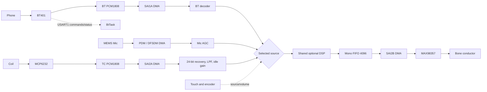

# QR261104.8 — Power-on-to-speaker firmware walkthrough

**This document lives in GitHub, outside the importable STM32CubeIDE firmware.** There is one canonical application at `Core/Src/main.c`; `Core/Inc` contains declarations and state types, `Drivers` contains STM32 HAL/CMSIS and `Middlewares` contains FreeRTOS. Source links below resolve to the actual active project files. Code excerpts are original source lines, not pseudocode; view the linked function for its complete body.

## Physical system



The STM32L476 core runs at nominal **48 MHz**, processes **128 frames at 48 kHz** (about **2.667 ms**), and receives 24-bit stereo SAI ADC samples as 32-bit DMA words. AudioTask runs at priority **7**, ControlTask at **6**, BtTask at **5**. Only one selected mono stream is duplicated into both 16-bit I²S output slots. The telecoil input has intrinsically weaker analogue SNR than BT401's analogue audio output; digital gain cannot remove overlapping in-band noise.

## Methodology and function-by-function execution

## 00 — Power applied, reset and clocks

### [`main()`](../Core/Src/main.c#L41)

**Location:** [`Core/Src/main.c`](../Core/Src/main.c), **line 41**. **Purpose:** Captures reset-cause flags, initializes HAL, establishes clocks/GPIO/DMA/USART/SAI, initializes custom board peripherals, then starts the FreeRTOS scheduler.

```c
int main(void)
{
  s_g1_boot_reset_csr=RCC->CSR;
  s_g1_boot_debug_attached=(CoreDebug->DHCSR & CoreDebug_DHCSR_C_DEBUGEN_Msk)?1U:0U;
  __HAL_RCC_CLEAR_RESET_FLAGS();
  HAL_Init();

  /* USER CODE BEGIN Init */
  Demo_EarlyInit();
  /* USER CODE END Init */
```

### [`SystemClock_Config()`](../Core/Src/main.c#L114)

**Location:** [`Core/Src/main.c`](../Core/Src/main.c), **line 114**. **Purpose:** Configures the CPU PLL for 48 MHz with HSE oscillator and HSI fallback.

```c
void SystemClock_Config(void)
{
  RCC_OscInitTypeDef osc = {0};
  RCC_ClkInitTypeDef clk = {0};
  HAL_StatusTypeDef st;

  if (HAL_PWREx_ControlVoltageScaling(PWR_REGULATOR_VOLTAGE_SCALE1) != HAL_OK)
    Error_Handler();

  /* Product normally runs from its populated 16-MHz HSE crystal. When the
```

### [`PeriphCommonClock_Config()`](../Core/Src/main.c#L166)

**Location:** [`Core/Src/main.c`](../Core/Src/main.c), **line 166**. **Purpose:** Configures PLLSAI1 clocks for audio interfaces.

```c
void PeriphCommonClock_Config(void)
{
  RCC_PeriphCLKInitTypeDef pclk={0};
  pclk.PeriphClockSelection=RCC_PERIPHCLK_SAI1|RCC_PERIPHCLK_SAI2;
  pclk.Sai1ClockSelection=RCC_SAI1CLKSOURCE_PLLSAI1;
  pclk.Sai2ClockSelection=RCC_SAI2CLKSOURCE_PLLSAI1;
  pclk.PLLSAI1.PLLSAI1Source=s_g1_boot_clock_fallback?RCC_PLLSOURCE_HSI:RCC_PLLSOURCE_HSE;
  pclk.PLLSAI1.PLLSAI1M=4;
  pclk.PLLSAI1.PLLSAI1N=43;
  pclk.PLLSAI1.PLLSAI1P=RCC_PLLP_DIV7;
```

## 01 — Peripheral configuration and RTOS

### [`MX_SAI1_Init()`](../Core/Src/sai.c#L9)

**Location:** [`Core/Src/sai.c`](../Core/Src/sai.c), **line 9**. **Purpose:** Initializes SAI1 input peripheral for Bluetooth.

```c
void MX_SAI1_Init(void)
{
  hsai_BlockA1.Instance = SAI1_Block_A;
  hsai_BlockA1.Init.AudioMode = SAI_MODEMASTER_RX;
  hsai_BlockA1.Init.Synchro = SAI_ASYNCHRONOUS;
  hsai_BlockA1.Init.OutputDrive = SAI_OUTPUTDRIVE_ENABLE;
  hsai_BlockA1.Init.NoDivider = SAI_MASTERDIVIDER_ENABLE;
  hsai_BlockA1.Init.FIFOThreshold = SAI_FIFOTHRESHOLD_HF;
  hsai_BlockA1.Init.AudioFrequency = SAI_AUDIO_FREQUENCY_48K;
  /* Share the already-proven SAI1 master frame/bit timing internally with SAI2A.
```

### [`MX_SAI2_Init()`](../Core/Src/sai.c#L26)

**Location:** [`Core/Src/sai.c`](../Core/Src/sai.c), **line 26**. **Purpose:** Initializes SAI2 telecoil input and I2S speaker output.

```c
void MX_SAI2_Init(void)
{
  hsai_BlockA2.Instance = SAI2_Block_A;
  hsai_BlockA2.Init.AudioMode = SAI_MODESLAVE_RX;
  /* U3/U4 PCM1808s share clocks.  SAI2A receives its timing from SAI1A
   * through STM32 cross-SAI synchronisation; PB15 is the separate U4 data. */
  hsai_BlockA2.Init.Synchro = SAI_SYNCHRONOUS_EXT_SAI1;
  hsai_BlockA2.Init.OutputDrive = SAI_OUTPUTDRIVE_DISABLE;
  hsai_BlockA2.Init.FIFOThreshold = SAI_FIFOTHRESHOLD_HF;
  hsai_BlockA2.Init.SynchroExt = SAI_SYNCEXT_DISABLE;
```

### [`G1_BoardInit()`](../Core/Src/g1_product_board.c#L354)

**Location:** [`Core/Src/g1_product_board.c`](../Core/Src/g1_product_board.c), **line 354**. **Purpose:** Initializes DFSDM microphone and custom PCB controls.

```c
void G1_BoardInit(void)
{
  GPIO_InitTypeDef p={0};
  if(s_board_init_count!=0U)return; /* one-time hardware setup */
  s_board_init_count++;
  memset(&g_g1_board,0,sizeof(g_g1_board));
  __HAL_RCC_GPIOA_CLK_ENABLE();__HAL_RCC_GPIOB_CLK_ENABLE();
  __HAL_RCC_GPIOC_CLK_ENABLE();__HAL_RCC_I2C1_CLK_ENABLE();
  __HAL_RCC_DMA1_CLK_ENABLE();__HAL_RCC_DFSDM1_CLK_ENABLE();
  /* PA0/PA1 are encoder GPIO. TIM2 counts internal cycles only; never
```

### [`Demo_StartNativeRTOS()`](../Core/Src/rtos_bootstrap.c#L38)

**Location:** [`Core/Src/rtos_bootstrap.c`](../Core/Src/rtos_bootstrap.c), **line 38**. **Purpose:** Creates and starts the native FreeRTOS task scheduler.

```c
void Demo_StartNativeRTOS(void)
{
  BaseType_t rc;

  Demo_SetStage(0x40U);
  Demo_ConsoleRaw("RTOS A: native FreeRTOS bootstrap (CMSIS osKernelStart bypassed)\r\n");
  Demo_ConsoleRaw("RTOS B: creating one bootstrap task\r\n");

  rc = xTaskCreate(BootstrapTask,
                   "ControlTask",
```

### [`StartAudioTask()`](../Core/Src/demo_app.c#L4693)

**Location:** [`Core/Src/demo_app.c`](../Core/Src/demo_app.c), **line 4693**. **Purpose:** Highest-priority application audio loop; consumes captured PCM, owns filter state and fills output queues.

```c
static void StartAudioTask(void *argument)
{
  (void)argument;
  uint32_t last_control_opportunity_ms=HAL_GetTick();
  for (;;) {
    uint32_t now = HAL_GetTick();
    group_audio_update();
    if (g_r28_route_restart_pending) {
      /* One clean application FSM session. No simulated packets/link bits.
       * Input validity must be rebuilt from real PCM after both RX DMAs start. */
```

### [`StartBtTask()`](../Core/Src/demo_app.c#L4837)

**Location:** [`Core/Src/demo_app.c`](../Core/Src/demo_app.c), **line 4837**. **Purpose:** Controls BT401 on USART1, separate from SAI PCM reception.

```c
static void StartBtTask(void *argument)
{
  (void)argument;
  uint32_t bluetooth_boot_ms=HAL_GetTick();
  uint8_t bluetooth_auto_discoverable_sent=0U;
  QrBtVolume volume_tracker;
  QrBtVolume_Init(&volume_tracker);
  uint32_t last_bt_status_poll_ms=0U;
  for (;;) {
    poll_bt_uart();
```

### [`start_dma()`](../Core/Src/demo_app.c#L2195)

**Location:** [`Core/Src/demo_app.c`](../Core/Src/demo_app.c), **line 2195**. **Purpose:** Arms the required receive DMA topology and SAI2B output, resetting stale capture state.

```c
static HAL_StatusTypeDef start_dma(void)
{
  HAL_StatusTypeDef a = HAL_OK, b = HAL_OK, c = HAL_OK;
  const uint32_t topology=dma_desired_topology();
  const bool need_bt=(topology&1U)!=0U;
  const bool need_tc=(topology&2U)!=0U;

  if (g_dma_started) return HAL_OK;
  memset(g_bt_dma_words, 0, sizeof(g_bt_dma_words));
  memset(g_tc_dma_words, 0, sizeof(g_tc_dma_words));
```

## 02 — Bluetooth audio capture, conversion and routing

### [`capture_push_bt_from_isr()`](../Core/Src/demo_app.c#L732)

**Location:** [`Core/Src/demo_app.c`](../Core/Src/demo_app.c), **line 732**. **Purpose:** Copies completed 128-frame SAI1A Bluetooth DMA half-buffer into capture ring in IRQ context.

```c
static void capture_push_bt_from_isr(const uint32_t *words)
{
  const uint8_t head = g_bt_cap_head;
  const uint8_t next = (uint8_t)((head + 1U) & CAPTURE_RING_MASK);
  if (next == g_bt_cap_tail) {
    g_demo_diag.bt_dma_overruns++;
    return;
  }
  memcpy(g_bt_capture[head].words, words, sizeof(g_bt_capture[head].words));
  __DMB();
```

### [`capture_pop_bt()`](../Core/Src/demo_app.c#L782)

**Location:** [`Core/Src/demo_app.c`](../Core/Src/demo_app.c), **line 782**. **Purpose:** Dequeues completed Bluetooth PCM words in task context.

```c
static bool capture_pop_bt(uint32_t *dst)
{
  uint8_t tail = g_bt_cap_tail;
  if (tail == g_bt_cap_head || dst == NULL) return false;
  memcpy(dst, g_bt_capture[tail].words, sizeof(g_bt_capture[tail].words));
  __DMB();
  g_bt_cap_tail = (uint8_t)((tail + 1U) & CAPTURE_RING_MASK);
  g_demo_diag.bt_capture_depth = capture_depth(g_bt_cap_head, g_bt_cap_tail);
  return true;
}
```

### [`process_bt_words()`](../Core/Src/demo_app.c#L2041)

**Location:** [`Core/Src/demo_app.c`](../Core/Src/demo_app.c), **line 2041**. **Purpose:** Decodes stereo 24-bit BT PCM to 16-bit and chooses the mono channel mix.

```c
static void process_bt_words(const uint32_t *words, uint32_t now)
{
  uint32_t lrms = 0U, rrms = 0U;
  uint32_t mode;
  raw_capture_append(RAW_CAPTURE_SOURCE_BT, words, DEMO_FRAMES_PER_HALF);
  if (PcmTransport_DecodeStereoWordsMode(words, DEMO_FRAMES_PER_HALF, g_left, g_right,
                                         (PcmTransportDecodeMode_t)g_demo_control.pcm_decode_mode) != PCM_TRANSPORT_OK) return;

  listen_capture_append(RAW_CAPTURE_SOURCE_BT, g_left, g_right, DEMO_FRAMES_PER_HALF);
  metrics_s16(g_left, DEMO_FRAMES_PER_HALF, &lrms, NULL, NULL);
```

### [`process_bt_pcm()`](../Core/Src/demo_app.c#L1975)

**Location:** [`Core/Src/demo_app.c`](../Core/Src/demo_app.c), **line 1975**. **Purpose:** Updates Bluetooth presence and service routing; forwards audio if selected.

```c
static void process_bt_pcm(const int16_t *mono, uint32_t now)
{
  uint32_t rms, pp;
  metrics_s16(mono, DEMO_FRAMES_PER_HALF, &rms, &pp, NULL);
  g_demo_diag.bt_rms = rms;
  g_demo_diag.bt_peak_to_peak = pp;
  update_bt_presence(rms, pp);
  step_service(now);
  memcpy(g_r27_pre_source,mono,sizeof(g_r27_pre_source));
  (void)ConnectivityService_ProcessBluetoothBlock(&g_service, mono, g_routed,
```

## 03 — Telecoil acquisition and noise reduction

### [`capture_push_tc_from_isr()`](../Core/Src/demo_app.c#L757)

**Location:** [`Core/Src/demo_app.c`](../Core/Src/demo_app.c), **line 757**. **Purpose:** Copies completed SAI2A telecoil DMA half-buffer into TC capture ring.

```c
static void capture_push_tc_from_isr(const uint32_t *words)
{
  const uint8_t head = g_tc_cap_head;
  const uint8_t next = (uint8_t)((head + 1U) & CAPTURE_RING_MASK);
  if (next == g_tc_cap_tail) {
    g_demo_diag.tc_dma_overruns++;
    return;
  }
  memcpy(g_tc_capture[head].words, words, sizeof(g_tc_capture[head].words));
  __DMB();
```

### [`capture_pop_tc()`](../Core/Src/demo_app.c#L793)

**Location:** [`Core/Src/demo_app.c`](../Core/Src/demo_app.c), **line 793**. **Purpose:** Dequeues completed telecoil PCM words in task context.

```c
static bool capture_pop_tc(uint32_t *dst)
{
  uint8_t tail = g_tc_cap_tail;
  if (tail == g_tc_cap_head || dst == NULL) return false;
  memcpy(dst, g_tc_capture[tail].words, sizeof(g_tc_capture[tail].words));
  __DMB();
  g_tc_cap_tail = (uint8_t)((tail + 1U) & CAPTURE_RING_MASK);
  g_demo_diag.tc_capture_depth = capture_depth(g_tc_cap_head, g_tc_cap_tail);
  return true;
}
```

### [`TcS24Recovery_Process()`](../Core/Src/tc_s24_recovery.c#L43)

**Location:** [`Core/Src/tc_s24_recovery.c`](../Core/Src/tc_s24_recovery.c), **line 43**. **Purpose:** Processes weak telecoil samples before 24-to-16-bit precision loss, with bounded automatic gain.

```c
int TcS24Recovery_Process(TcS24Recovery *s, const uint32_t *words,
                          size_t n, int16_t *left, int16_t *right) {
    if (!s || !words || !left || !right || n == 0U || n > INT32_MAX) return 0;
    uint64_t l2 = 0U, r2 = 0U, rendered2 = 0U;
    uint32_t peak = 0U, clips = 0U;
    for (size_t i = 0U; i < n; i++) {
        int32_t l = sign_extend_s24(words[i * 2U]);
        int32_t r = sign_extend_s24(words[i * 2U + 1U]);
        uint32_t al = l < 0 ? (uint32_t)(-(int64_t)l) : (uint32_t)l;
        uint32_t ar = r < 0 ? (uint32_t)(-(int64_t)r) : (uint32_t)r;
```

### [`process_tc_words()`](../Core/Src/demo_app.c#L2081)

**Location:** [`Core/Src/demo_app.c`](../Core/Src/demo_app.c), **line 2081**. **Purpose:** Recovers low-level 24-bit telecoil PCM and selects its mono channel.

```c
static void process_tc_words(const uint32_t *words, uint32_t now)
{
  uint32_t lrms = 0U, rrms = 0U;
  /* R22: periodically inspect all four container alignments, never only the
   * selected PCM mode.  An RMS of 1 means near-zero decoded audio, not merely
   * detector threshold rejection. A 2-kHz test should change the bitstream. */
  if ((g_demo_diag.tc_blocks_processed & 31U) == 0U && words != NULL) {
    uint64_t sq[4][2] = {{0U}};
    uint32_t word_or=0U, word_and=UINT32_MAX, nonzero=0U, varying=0U;
    uint32_t hi_nonzero=0U, hi_ones=0U, big_jumps=0U;
```

### [`process_tc_pcm()`](../Core/Src/demo_app.c#L1992)

**Location:** [`Core/Src/demo_app.c`](../Core/Src/demo_app.c), **line 1992**. **Purpose:** Performs fixed speech-band cleanup, optional notch and newly learned idle attenuation.

```c
static void process_tc_pcm(const int16_t *mono, uint32_t now)
{
  memcpy(g_r27_pre_source,mono,sizeof(g_r27_pre_source));
  /* ControlTask only publishes settings; never touches AudioTask DSP memory.
   * This avoids a reset/data race during touch-driven source switching. */
  if (s_tc_filter_reset_requested) {
    s_tc_filter_reset_requested=0U;
    TcCleanup_Reset(&g_r27_tc_filter);
    if(s_tc_notch_auto_enabled && s_tc_hum_last_hz)
      TcCleanup_SetNotchFrequency(&g_r27_tc_filter,s_tc_hum_last_hz);
```

### [`TcCleanup_Reset()`](../Core/Src/tc_cleanup.c#L32)

**Location:** [`Core/Src/tc_cleanup.c`](../Core/Src/tc_cleanup.c), **line 32**. **Purpose:** Resets filter/notch history after source transitions.

```c
void TcCleanup_Reset(TcCleanup *st){
 if(!st)return;
 memset(st,0,sizeof(*st));
 st->gate_gain=1.0f;st->signal_gain=1.0f;
 st->notch_b0=1.0f;
}
void TcCleanup_SetNotchAuto(TcCleanup *st,bool enabled){
 if(st)st->notch_auto_enabled=enabled?1U:0U;
}
void TcCleanup_SetNotchFrequency(TcCleanup *st,uint32_t hz){
```

### [`TcCleanup_SetNotchFrequency()`](../Core/Src/tc_cleanup.c#L41)

**Location:** [`Core/Src/tc_cleanup.c`](../Core/Src/tc_cleanup.c), **line 41**. **Purpose:** Configures an optional user-calibrated stationary interference notch.

```c
void TcCleanup_SetNotchFrequency(TcCleanup *st,uint32_t hz){
 if(!st)return;
 if(hz<75U || hz>4500U){
   st->notch_auto_enabled=0U;st->notch_hz=0U;
   return;
 }
 /* Narrow fixed-frequency notch, Q=18; no coefficient updates while
  * program audio is playing, no reset of HP/LP history. */
 const float w=2.0f*TC_PI*(float)hz/TC_RATE;
 const float alpha=sinf(w)/36.0f;
```

### [`TcCleanup_Block()`](../Core/Src/tc_cleanup.c#L59)

**Location:** [`Core/Src/tc_cleanup.c`](../Core/Src/tc_cleanup.c), **line 59**. **Purpose:** Runs gentle high-pass, fixed fourth-order Butterworth 3.4-kHz low-pass and optional notch.

```c
void TcCleanup_Block(TcCleanup *st,const int16_t *in,int16_t *out,size_t n){
 if(!st || !in || !out || !n)return;
 uint64_t input_energy=0,output_energy=0;
 const float target=(st->notch_auto_enabled && st->notch_hz)?1.0f:0.0f;
 for(size_t i=0;i<n;i++){
    const float x=(float)in[i];
    input_energy+=(uint64_t)((int64_t)in[i]*(int64_t)in[i]);
    st->hp_lp+=TC_HP_A*(x-st->hp_lp);
    const float hp=x-st->hp_lp;
    float baseline=hp;
```

### [`TcIdleSquelch_Init()`](../Core/Src/tc_idle_squelch.c#L59)

**Location:** [`Core/Src/tc_idle_squelch.c`](../Core/Src/tc_idle_squelch.c), **line 59**. **Purpose:** Initializes the noise level reference and scalar gain.

```c
void TcIdleSquelch_Init(TcIdleSquelch *s)
{
    if(!s)return;
    memset(s,0,sizeof(*s));
    s->enabled=1U;
    s->gain_q15=TC_IDLE_FULL_GAIN;
    s->quiet_min_rms=UINT32_MAX;
}

void TcIdleSquelch_Relearn(TcIdleSquelch *s)
```

### [`TcIdleSquelch_Relearn()`](../Core/Src/tc_idle_squelch.c#L68)

**Location:** [`Core/Src/tc_idle_squelch.c`](../Core/Src/tc_idle_squelch.c), **line 68**. **Purpose:** Restarts background learning without changing the enable setting.

```c
void TcIdleSquelch_Relearn(TcIdleSquelch *s)
{
    if(!s)return;
    const uint8_t enabled=s->enabled;
    const uint32_t previous=s->calibration_count;
    TcIdleSquelch_Init(s);
    s->enabled=enabled;
    s->calibration_count=previous+1U;
}

```

### [`TcIdleSquelch_Enable()`](../Core/Src/tc_idle_squelch.c#L78)

**Location:** [`Core/Src/tc_idle_squelch.c`](../Core/Src/tc_idle_squelch.c), **line 78**. **Purpose:** Enables or bypasses the idle attenuation control.

```c
void TcIdleSquelch_Enable(TcIdleSquelch *s,bool enabled)
{
    if(!s)return;
    s->enabled=enabled?1U:0U;
    if(!enabled){s->gain_q15=TC_IDLE_FULL_GAIN;s->hold_blocks=0U;s->activity_streak=0U;}
}

void TcIdleSquelch_Process(TcIdleSquelch *s,int16_t *samples,size_t n)
{
    if(!s||!samples||n==0U)return;
```

### [`TcIdleSquelch_Process()`](../Core/Src/tc_idle_squelch.c#L85)

**Location:** [`Core/Src/tc_idle_squelch.c`](../Core/Src/tc_idle_squelch.c), **line 85**. **Purpose:** Uses RMS plus lag-16/48 correlation to preserve weak tones while softly attenuating true idle noise to about -30 dB.

```c
void TcIdleSquelch_Process(TcIdleSquelch *s,int16_t *samples,size_t n)
{
    if(!s||!samples||n==0U)return;
    if(!s->enabled){s->gain_q15=TC_IDLE_FULL_GAIN;return;}
    uint64_t sum=0U;
    for(size_t i=0U;i<n;++i){const int64_t v=samples[i];sum+=(uint64_t)(v*v);}
    const uint32_t rms=root_u64(sum/n);
    const int32_t c16=coherence(samples,n,TC_IDLE_CORRELATION_LAG1);
    const int32_t c48=coherence(samples,n,TC_IDLE_CORRELATION_LAG2);
    /* Correlation averages prevent sporadic noise blocks opening the path. */
```

## 04 — Microphone PDM capture

### [`G1_MicTakeBlock()`](../Core/Src/g1_product_board.c#L570)

**Location:** [`Core/Src/g1_product_board.c`](../Core/Src/g1_product_board.c), **line 570**. **Purpose:** Dequeues PDM-decimated microphone PCM into the audio-processing context.

```c
uint8_t G1_MicTakeBlock(int16_t dest[G1_MIC_FRAMES])
{
  if (dest==NULL||s_tail==s_head)return 0U;
  memcpy(dest,s_mic_queue[s_tail],sizeof(s_mic_queue[0]));
  /* May25 prototype used microphone high-pass signal conditioning. Apply a
   * lightweight DC blocker in AudioTask, never in the DFSDM/DMA ISR. */
  for(unsigned i=0U;i<G1_MIC_FRAMES;++i){
    int32_t input=dest[i];
    s_mic_hp_state=((s_mic_hp_state*32604L)>>15) + input - s_mic_hp_prev_input;
    s_mic_hp_prev_input=(int16_t)input;
```

## 05 — Shared processing and speaker TX

### [`process_selected_audio()`](../Core/Src/demo_app.c#L1422)

**Location:** [`Core/Src/demo_app.c`](../Core/Src/demo_app.c), **line 1422**. **Purpose:** Shared selected-source DSP, effects, metrics and output FIFO writer.

```c
static void process_selected_audio(const int16_t *pre, uint32_t source)
{
  uint32_t in_rms = 0U, in_peak = 0U, out_rms = 0U, out_peak = 0U;
  uint32_t start_cycles, elapsed_us;
  if (pre == NULL) return;
  /* Context is from actual latest PCM, not an assumed environment.
   * Approximate spectral bucket via 128-sample zero-crossing rate. */
  if (source != 3U) { /* mic supplied its raw pre-AGC features */
    unsigned crossings=0U;
    for (size_t i=1U;i<DEMO_FRAMES_PER_HALF;++i)
```

### [`output_queue_push()`](../Core/Src/demo_app.c#L1022)

**Location:** [`Core/Src/demo_app.c`](../Core/Src/demo_app.c), **line 1022**. **Purpose:** Adds 128 mono PCM samples to the 4096-sample FIFO.

```c
static void output_queue_push(const int16_t *mono)
{
  uint32_t w, r, used;
  if ((mono == NULL) || !g_demo_control.output_enabled ||
      !g_demo_diag.speaker_dma_running || g_demo_control.test_tone_step != 0U) return;

  w = g_output_write_count;
  r = g_output_read_count;
  used = (uint32_t)(w - r);
  if (used > OUTPUT_SAMPLE_FIFO_SAMPLES) {
```

### [`scale_output_sample()`](../Core/Src/demo_app.c#L940)

**Location:** [`Core/Src/demo_app.c`](../Core/Src/demo_app.c), **line 940**. **Purpose:** Applies local output volume, headroom and soft peak limiting.

```c
static int16_t scale_output_sample(int16_t sample)
{
  /* R26: transparent gain with a cheap soft knee.  R25 hard-clipped any
   * transient above full scale, which can sound gritty when the automatic
   * level rises on quiet material.  The knee starts at ~-2 dBFS and limits
   * gracefully before the int16 rails. */
  int64_t y = ((int64_t)sample * (int64_t)g_demo_control.output_gain_q15) >> 15;
  int64_t a = (y < 0) ? -y : y;
  if (a > 26000LL) {
    a = 26000LL + ((a - 26000LL) >> 2);
```

### [`speaker_fill_region_isr()`](../Core/Src/demo_app.c#L1190)

**Location:** [`Core/Src/demo_app.c`](../Core/Src/demo_app.c), **line 1190**. **Purpose:** Refills I2S transmit DMA from FIFO, applying bounded underrun concealment/fades.

```c
static void speaker_fill_region_isr(uint32_t start_sample)
{
  int16_t *dst = &g_speaker_tx_dma[start_sample];
  bool have = false;

  if (s_audio_sleep_active) {
    memset(dst,0,DEMO_OUTPUT_HALF_SAMPLES*sizeof(int16_t));
    return; /* no cue or audio can escape while soft-asleep */
  }
  if (!g_demo_control.output_enabled) {
```

## Source index — boot, audio routing and TC modules

Source paths are authoritative; do not look for copies in a Recovery folder.

| Function | Source | What to inspect |
| --- | --- | --- |
| `main()` | [`Core/Src/main.c:41`](../Core/Src/main.c#L41) | Captures reset-cause flags, initializes HAL, establishes clocks/GPIO/DMA/USART/SAI, initializes custom board peripherals, then starts the FreeRTOS scheduler. |
| `SystemClock_Config()` | [`Core/Src/main.c:114`](../Core/Src/main.c#L114) | Configures the CPU PLL for 48 MHz with HSE oscillator and HSI fallback. |
| `PeriphCommonClock_Config()` | [`Core/Src/main.c:166`](../Core/Src/main.c#L166) | Configures PLLSAI1 clocks for audio interfaces. |
| `HAL_TIM_PeriodElapsedCallback()` | [`Core/Src/main.c:182`](../Core/Src/main.c#L182) | Implementation helper: read full function to inspect input/output, state, calls and timing |
| `Error_Handler()` | [`Core/Src/main.c:192`](../Core/Src/main.c#L192) | Implementation helper: read full function to inspect input/output, state, calls and timing |
| `assert_failed()` | [`Core/Src/main.c:201`](../Core/Src/main.c#L201) | Implementation helper: read full function to inspect input/output, state, calls and timing |
| `G1_BootCapture()` | [`Core/Src/demo_app.c:52`](../Core/Src/demo_app.c#L52) | Implementation helper: read full function to inspect input/output, state, calls and timing |
| `G1_BootReport()` | [`Core/Src/demo_app.c:64`](../Core/Src/demo_app.c#L64) | Implementation helper: read full function to inspect input/output, state, calls and timing |
| `product_mic_condition()` | [`Core/Src/demo_app.c:153`](../Core/Src/demo_app.c#L153) | Implementation helper: read full function to inspect input/output, state, calls and timing |
| `product_mic_condition()` | [`Core/Src/demo_app.c:156`](../Core/Src/demo_app.c#L156) | Implementation helper: read full function to inspect input/output, state, calls and timing |
| `Demo_NotifyMicReadyFromISR()` | [`Core/Src/demo_app.c:351`](../Core/Src/demo_app.c#L351) | Implementation helper: read full function to inspect input/output, state, calls and timing |
| `raw_capture_source_name()` | [`Core/Src/demo_app.c:489`](../Core/Src/demo_app.c#L489) | Implementation helper: read full function to inspect input/output, state, calls and timing |
| `raw_capture_source_name()` | [`Core/Src/demo_app.c:493`](../Core/Src/demo_app.c#L493) | Implementation helper: read full function to inspect input/output, state, calls and timing |
| `raw_capture_arm()` | [`Core/Src/demo_app.c:500`](../Core/Src/demo_app.c#L500) | Implementation helper: read full function to inspect input/output, state, calls and timing |
| `raw_capture_append()` | [`Core/Src/demo_app.c:523`](../Core/Src/demo_app.c#L523) | Implementation helper: read full function to inspect input/output, state, calls and timing |
| `crc16_update()` | [`Core/Src/demo_app.c:543`](../Core/Src/demo_app.c#L543) | Implementation helper: read full function to inspect input/output, state, calls and timing |
| `raw_capture_send()` | [`Core/Src/demo_app.c:554`](../Core/Src/demo_app.c#L554) | Implementation helper: read full function to inspect input/output, state, calls and timing |
| `listen_channel_name()` | [`Core/Src/demo_app.c:602`](../Core/Src/demo_app.c#L602) | Implementation helper: read full function to inspect input/output, state, calls and timing |
| `listen_capture_arm()` | [`Core/Src/demo_app.c:609`](../Core/Src/demo_app.c#L609) | Implementation helper: read full function to inspect input/output, state, calls and timing |
| `select_channel_sample()` | [`Core/Src/demo_app.c:629`](../Core/Src/demo_app.c#L629) | Implementation helper: read full function to inspect input/output, state, calls and timing |
| `listen_capture_append()` | [`Core/Src/demo_app.c:636`](../Core/Src/demo_app.c#L636) | Implementation helper: read full function to inspect input/output, state, calls and timing |
| `listen_capture_send()` | [`Core/Src/demo_app.c:659`](../Core/Src/demo_app.c#L659) | Implementation helper: read full function to inspect input/output, state, calls and timing |
| `console_rx_pop()` | [`Core/Src/demo_app.c:705`](../Core/Src/demo_app.c#L705) | Implementation helper: read full function to inspect input/output, state, calls and timing |
| `bt_rx_pop()` | [`Core/Src/demo_app.c:716`](../Core/Src/demo_app.c#L716) | Implementation helper: read full function to inspect input/output, state, calls and timing |
| `capture_depth()` | [`Core/Src/demo_app.c:727`](../Core/Src/demo_app.c#L727) | Implementation helper: read full function to inspect input/output, state, calls and timing |
| `capture_push_bt_from_isr()` | [`Core/Src/demo_app.c:732`](../Core/Src/demo_app.c#L732) | Copies completed 128-frame SAI1A Bluetooth DMA half-buffer into capture ring in IRQ context. |
| `capture_push_tc_from_isr()` | [`Core/Src/demo_app.c:757`](../Core/Src/demo_app.c#L757) | Copies completed SAI2A telecoil DMA half-buffer into TC capture ring. |
| `capture_pop_bt()` | [`Core/Src/demo_app.c:782`](../Core/Src/demo_app.c#L782) | Dequeues completed Bluetooth PCM words in task context. |
| `capture_pop_tc()` | [`Core/Src/demo_app.c:793`](../Core/Src/demo_app.c#L793) | Dequeues completed telecoil PCM words in task context. |
| `start_uart_rx_interrupts()` | [`Core/Src/demo_app.c:804`](../Core/Src/demo_app.c#L804) | Implementation helper: read full function to inspect input/output, state, calls and timing |
| `uabs32()` | [`Core/Src/demo_app.c:831`](../Core/Src/demo_app.c#L831) | Implementation helper: read full function to inspect input/output, state, calls and timing |
| `console_write()` | [`Core/Src/demo_app.c:837`](../Core/Src/demo_app.c#L837) | Implementation helper: read full function to inspect input/output, state, calls and timing |
| `uart2_send_binary_chunked()` | [`Core/Src/demo_app.c:872`](../Core/Src/demo_app.c#L872) | Implementation helper: read full function to inspect input/output, state, calls and timing |
| `console_u32()` | [`Core/Src/demo_app.c:897`](../Core/Src/demo_app.c#L897) | Implementation helper: read full function to inspect input/output, state, calls and timing |
| `console_hex8()` | [`Core/Src/demo_app.c:906`](../Core/Src/demo_app.c#L906) | Implementation helper: read full function to inspect input/output, state, calls and timing |
| `dwt_enable()` | [`Core/Src/demo_app.c:916`](../Core/Src/demo_app.c#L916) | Implementation helper: read full function to inspect input/output, state, calls and timing |
| `dwt_cycles()` | [`Core/Src/demo_app.c:925`](../Core/Src/demo_app.c#L925) | Implementation helper: read full function to inspect input/output, state, calls and timing |
| `cycles_to_us()` | [`Core/Src/demo_app.c:934`](../Core/Src/demo_app.c#L934) | Implementation helper: read full function to inspect input/output, state, calls and timing |
| `scale_output_sample()` | [`Core/Src/demo_app.c:940`](../Core/Src/demo_app.c#L940) | Applies local output volume, headroom and soft peak limiting. |
| `output_sample_depth()` | [`Core/Src/demo_app.c:958`](../Core/Src/demo_app.c#L958) | Implementation helper: read full function to inspect input/output, state, calls and timing |
| `output_queue_reset()` | [`Core/Src/demo_app.c:963`](../Core/Src/demo_app.c#L963) | Implementation helper: read full function to inspect input/output, state, calls and timing |
| `output_clock_locked_path()` | [`Core/Src/demo_app.c:986`](../Core/Src/demo_app.c#L986) | Implementation helper: read full function to inspect input/output, state, calls and timing |
| `apply_output_fade()` | [`Core/Src/demo_app.c:998`](../Core/Src/demo_app.c#L998) | Implementation helper: read full function to inspect input/output, state, calls and timing |
| `output_depth_track()` | [`Core/Src/demo_app.c:1013`](../Core/Src/demo_app.c#L1013) | Implementation helper: read full function to inspect input/output, state, calls and timing |
| `output_queue_push()` | [`Core/Src/demo_app.c:1022`](../Core/Src/demo_app.c#L1022) | Adds 128 mono PCM samples to the 4096-sample FIFO. |
| `output_queue_pop_exact_isr()` | [`Core/Src/demo_app.c:1060`](../Core/Src/demo_app.c#L1060) | Implementation helper: read full function to inspect input/output, state, calls and timing |
| `output_queue_pop_async_isr()` | [`Core/Src/demo_app.c:1091`](../Core/Src/demo_app.c#L1091) | Implementation helper: read full function to inspect input/output, state, calls and timing |
| `output_queue_pop_isr()` | [`Core/Src/demo_app.c:1174`](../Core/Src/demo_app.c#L1174) | Implementation helper: read full function to inspect input/output, state, calls and timing |
| `speaker_fill_tone_isr()` | [`Core/Src/demo_app.c:1180`](../Core/Src/demo_app.c#L1180) | Implementation helper: read full function to inspect input/output, state, calls and timing |
| `speaker_fill_region_isr()` | [`Core/Src/demo_app.c:1190`](../Core/Src/demo_app.c#L1190) | Refills I2S transmit DMA from FIFO, applying bounded underrun concealment/fades. |
| `plot_accumulate()` | [`Core/Src/demo_app.c:1266`](../Core/Src/demo_app.c#L1266) | Implementation helper: read full function to inspect input/output, state, calls and timing |
| `direct_process_block()` | [`Core/Src/demo_app.c:1312`](../Core/Src/demo_app.c#L1312) | Implementation helper: read full function to inspect input/output, state, calls and timing |
| `process_selected_audio()` | [`Core/Src/demo_app.c:1422`](../Core/Src/demo_app.c#L1422) | Shared selected-source DSP, effects, metrics and output FIFO writer. |
| `crc16_ccitt()` | [`Core/Src/demo_app.c:1483`](../Core/Src/demo_app.c#L1483) | Implementation helper: read full function to inspect input/output, state, calls and timing |
| `put_u16_le()` | [`Core/Src/demo_app.c:1488`](../Core/Src/demo_app.c#L1488) | Implementation helper: read full function to inspect input/output, state, calls and timing |
| `put_u32_le()` | [`Core/Src/demo_app.c:1493`](../Core/Src/demo_app.c#L1493) | Implementation helper: read full function to inspect input/output, state, calls and timing |
| `update_task_rates()` | [`Core/Src/demo_app.c:1499`](../Core/Src/demo_app.c#L1499) | Implementation helper: read full function to inspect input/output, state, calls and timing |
| `print_evidence()` | [`Core/Src/demo_app.c:1515`](../Core/Src/demo_app.c#L1515) | Implementation helper: read full function to inspect input/output, state, calls and timing |
| `__attribute__()` | [`Core/Src/demo_app.c:1578`](../Core/Src/demo_app.c#L1578) | Implementation helper: read full function to inspect input/output, state, calls and timing |
| `upper_ascii()` | [`Core/Src/demo_app.c:1632`](../Core/Src/demo_app.c#L1632) | Implementation helper: read full function to inspect input/output, state, calls and timing |
| `line_eq()` | [`Core/Src/demo_app.c:1638`](../Core/Src/demo_app.c#L1638) | Implementation helper: read full function to inspect input/output, state, calls and timing |
| `source_name()` | [`Core/Src/demo_app.c:1652`](../Core/Src/demo_app.c#L1652) | Implementation helper: read full function to inspect input/output, state, calls and timing |
| `Demo_SetStage()` | [`Core/Src/demo_app.c:1660`](../Core/Src/demo_app.c#L1660) | Implementation helper: read full function to inspect input/output, state, calls and timing |
| `Demo_ConsoleEarly()` | [`Core/Src/demo_app.c:1663`](../Core/Src/demo_app.c#L1663) | Implementation helper: read full function to inspect input/output, state, calls and timing |
| `panic_puts()` | [`Core/Src/demo_app.c:1678`](../Core/Src/demo_app.c#L1678) | Implementation helper: read full function to inspect input/output, state, calls and timing |
| `Demo_ConsoleRaw()` | [`Core/Src/demo_app.c:1684`](../Core/Src/demo_app.c#L1684) | Implementation helper: read full function to inspect input/output, state, calls and timing |
| `Demo_ConsolePanic()` | [`Core/Src/demo_app.c:1689`](../Core/Src/demo_app.c#L1689) | Implementation helper: read full function to inspect input/output, state, calls and timing |
| `refresh_clocks()` | [`Core/Src/demo_app.c:1699`](../Core/Src/demo_app.c#L1699) | Implementation helper: read full function to inspect input/output, state, calls and timing |
| `print_clock()` | [`Core/Src/demo_app.c:1719`](../Core/Src/demo_app.c#L1719) | Implementation helper: read full function to inspect input/output, state, calls and timing |
| `print_status()` | [`Core/Src/demo_app.c:1734`](../Core/Src/demo_app.c#L1734) | Implementation helper: read full function to inspect input/output, state, calls and timing |
| `print_help()` | [`Core/Src/demo_app.c:1784`](../Core/Src/demo_app.c#L1784) | Implementation helper: read full function to inspect input/output, state, calls and timing |
| `isqrt_u64()` | [`Core/Src/demo_app.c:1823`](../Core/Src/demo_app.c#L1823) | Implementation helper: read full function to inspect input/output, state, calls and timing |
| `metrics_s16()` | [`Core/Src/demo_app.c:1841`](../Core/Src/demo_app.c#L1841) | Implementation helper: read full function to inspect input/output, state, calls and timing |
| `update_bt_presence()` | [`Core/Src/demo_app.c:1859`](../Core/Src/demo_app.c#L1859) | Implementation helper: read full function to inspect input/output, state, calls and timing |
| `bt_connected_now()` | [`Core/Src/demo_app.c:1892`](../Core/Src/demo_app.c#L1892) | Implementation helper: read full function to inspect input/output, state, calls and timing |
| `sync_status_from_service()` | [`Core/Src/demo_app.c:1899`](../Core/Src/demo_app.c#L1899) | Implementation helper: read full function to inspect input/output, state, calls and timing |
| `step_service()` | [`Core/Src/demo_app.c:1934`](../Core/Src/demo_app.c#L1934) | Implementation helper: read full function to inspect input/output, state, calls and timing |
| `apply_pending_command()` | [`Core/Src/demo_app.c:1945`](../Core/Src/demo_app.c#L1945) | Implementation helper: read full function to inspect input/output, state, calls and timing |
| `apply_requested_mode()` | [`Core/Src/demo_app.c:1955`](../Core/Src/demo_app.c#L1955) | Implementation helper: read full function to inspect input/output, state, calls and timing |
| `process_bt_pcm()` | [`Core/Src/demo_app.c:1975`](../Core/Src/demo_app.c#L1975) | Updates Bluetooth presence and service routing; forwards audio if selected. |
| `process_tc_pcm()` | [`Core/Src/demo_app.c:1992`](../Core/Src/demo_app.c#L1992) | Performs fixed speech-band cleanup, optional notch and newly learned idle attenuation. |
| `process_bt_words()` | [`Core/Src/demo_app.c:2041`](../Core/Src/demo_app.c#L2041) | Decodes stereo 24-bit BT PCM to 16-bit and chooses the mono channel mix. |
| `process_tc_words()` | [`Core/Src/demo_app.c:2081`](../Core/Src/demo_app.c#L2081) | Recovers low-level 24-bit telecoil PCM and selects its mono channel. |
| `dma_desired_topology()` | [`Core/Src/demo_app.c:2182`](../Core/Src/demo_app.c#L2182) | Implementation helper: read full function to inspect input/output, state, calls and timing |
| `start_dma()` | [`Core/Src/demo_app.c:2195`](../Core/Src/demo_app.c#L2195) | Arms the required receive DMA topology and SAI2B output, resetting stale capture state. |
| `stop_dma()` | [`Core/Src/demo_app.c:2259`](../Core/Src/demo_app.c#L2259) | Stops DMA before mode/topology changes. |
| `bt_tx()` | [`Core/Src/demo_app.c:2274`](../Core/Src/demo_app.c#L2274) | Implementation helper: read full function to inspect input/output, state, calls and timing |
| `bt_delay()` | [`Core/Src/demo_app.c:2284`](../Core/Src/demo_app.c#L2284) | Implementation helper: read full function to inspect input/output, state, calls and timing |
| `bt_query()` | [`Core/Src/demo_app.c:2290`](../Core/Src/demo_app.c#L2290) | Implementation helper: read full function to inspect input/output, state, calls and timing |
| `poll_bt_uart()` | [`Core/Src/demo_app.c:2300`](../Core/Src/demo_app.c#L2300) | Implementation helper: read full function to inspect input/output, state, calls and timing |
| `test_clock()` | [`Core/Src/demo_app.c:2327`](../Core/Src/demo_app.c#L2327) | Implementation helper: read full function to inspect input/output, state, calls and timing |
| `test_rtos()` | [`Core/Src/demo_app.c:2333`](../Core/Src/demo_app.c#L2333) | Implementation helper: read full function to inspect input/output, state, calls and timing |
| `test_dsp()` | [`Core/Src/demo_app.c:2344`](../Core/Src/demo_app.c#L2344) | Implementation helper: read full function to inspect input/output, state, calls and timing |
| `test_audio()` | [`Core/Src/demo_app.c:2351`](../Core/Src/demo_app.c#L2351) | Implementation helper: read full function to inspect input/output, state, calls and timing |
| `test_output()` | [`Core/Src/demo_app.c:2359`](../Core/Src/demo_app.c#L2359) | Implementation helper: read full function to inspect input/output, state, calls and timing |
| `test_bt()` | [`Core/Src/demo_app.c:2366`](../Core/Src/demo_app.c#L2366) | Implementation helper: read full function to inspect input/output, state, calls and timing |
| `print_test_result()` | [`Core/Src/demo_app.c:2372`](../Core/Src/demo_app.c#L2372) | Implementation helper: read full function to inspect input/output, state, calls and timing |
| `__attribute__()` | [`Core/Src/demo_app.c:2380`](../Core/Src/demo_app.c#L2380) | Implementation helper: read full function to inspect input/output, state, calls and timing |
| `queue_protocol_command()` | [`Core/Src/demo_app.c:2403`](../Core/Src/demo_app.c#L2403) | Implementation helper: read full function to inspect input/output, state, calls and timing |
| `r21_name()` | [`Core/Src/demo_app.c:2420`](../Core/Src/demo_app.c#L2420) | Implementation helper: read full function to inspect input/output, state, calls and timing |
| `r21_reset_audio_counters()` | [`Core/Src/demo_app.c:2425`](../Core/Src/demo_app.c#L2425) | Implementation helper: read full function to inspect input/output, state, calls and timing |
| `r21_start_source()` | [`Core/Src/demo_app.c:2444`](../Core/Src/demo_app.c#L2444) | Implementation helper: read full function to inspect input/output, state, calls and timing |
| `r21_health()` | [`Core/Src/demo_app.c:2475`](../Core/Src/demo_app.c#L2475) | Implementation helper: read full function to inspect input/output, state, calls and timing |
| `r21_output_start()` | [`Core/Src/demo_app.c:2492`](../Core/Src/demo_app.c#L2492) | Implementation helper: read full function to inspect input/output, state, calls and timing |
| `r21_output_check()` | [`Core/Src/demo_app.c:2514`](../Core/Src/demo_app.c#L2514) | Implementation helper: read full function to inspect input/output, state, calls and timing |
| `r21_output_stop()` | [`Core/Src/demo_app.c:2527`](../Core/Src/demo_app.c#L2527) | Implementation helper: read full function to inspect input/output, state, calls and timing |
| `r21_bt_check()` | [`Core/Src/demo_app.c:2535`](../Core/Src/demo_app.c#L2535) | Implementation helper: read full function to inspect input/output, state, calls and timing |
| `r21_tc_check()` | [`Core/Src/demo_app.c:2556`](../Core/Src/demo_app.c#L2556) | Implementation helper: read full function to inspect input/output, state, calls and timing |
| `r21_scope()` | [`Core/Src/demo_app.c:2572`](../Core/Src/demo_app.c#L2572) | Implementation helper: read full function to inspect input/output, state, calls and timing |
| `r262_scope_hd()` | [`Core/Src/demo_app.c:2612`](../Core/Src/demo_app.c#L2612) | Implementation helper: read full function to inspect input/output, state, calls and timing |
| `r27_b64_128()` | [`Core/Src/demo_app.c:2653`](../Core/Src/demo_app.c#L2653) | Implementation helper: read full function to inspect input/output, state, calls and timing |
| `r27_scope_dual()` | [`Core/Src/demo_app.c:2667`](../Core/Src/demo_app.c#L2667) | Implementation helper: read full function to inspect input/output, state, calls and timing |
| `r21_diag()` | [`Core/Src/demo_app.c:2690`](../Core/Src/demo_app.c#L2690) | Implementation helper: read full function to inspect input/output, state, calls and timing |
| `r24_tc_clock_probe()` | [`Core/Src/demo_app.c:2711`](../Core/Src/demo_app.c#L2711) | Implementation helper: read full function to inspect input/output, state, calls and timing |
| `group_event_send()` | [`Core/Src/demo_app.c:2745`](../Core/Src/demo_app.c#L2745) | Implementation helper: read full function to inspect input/output, state, calls and timing |
| `group_print_status()` | [`Core/Src/demo_app.c:2751`](../Core/Src/demo_app.c#L2751) | Implementation helper: read full function to inspect input/output, state, calls and timing |
| `group_button_init()` | [`Core/Src/demo_app.c:2776`](../Core/Src/demo_app.c#L2776) | Implementation helper: read full function to inspect input/output, state, calls and timing |
| `group_button_poll()` | [`Core/Src/demo_app.c:2792`](../Core/Src/demo_app.c#L2792) | Implementation helper: read full function to inspect input/output, state, calls and timing |
| `product_apply_preference()` | [`Core/Src/demo_app.c:2841`](../Core/Src/demo_app.c#L2841) | Implementation helper: read full function to inspect input/output, state, calls and timing |
| `r10_snapshot()` | [`Core/Src/demo_app.c:2858`](../Core/Src/demo_app.c#L2858) | Implementation helper: read full function to inspect input/output, state, calls and timing |
| `r10_hardware_report()` | [`Core/Src/demo_app.c:2881`](../Core/Src/demo_app.c#L2881) | Implementation helper: read full function to inspect input/output, state, calls and timing |
| `product_ui_status()` | [`Core/Src/demo_app.c:2896`](../Core/Src/demo_app.c#L2896) | Implementation helper: read full function to inspect input/output, state, calls and timing |
| `product_ui_report()` | [`Core/Src/demo_app.c:2916`](../Core/Src/demo_app.c#L2916) | Implementation helper: read full function to inspect input/output, state, calls and timing |
| `product_ui_commit()` | [`Core/Src/demo_app.c:2926`](../Core/Src/demo_app.c#L2926) | Implementation helper: read full function to inspect input/output, state, calls and timing |
| `qr_test_select()` | [`Core/Src/demo_app.c:2995`](../Core/Src/demo_app.c#L2995) | Implementation helper: read full function to inspect input/output, state, calls and timing |
| `qr_sleep_enter()` | [`Core/Src/demo_app.c:3022`](../Core/Src/demo_app.c#L3022) | Implementation helper: read full function to inspect input/output, state, calls and timing |
| `qr_sleep_wake()` | [`Core/Src/demo_app.c:3037`](../Core/Src/demo_app.c#L3037) | Implementation helper: read full function to inspect input/output, state, calls and timing |
| `product_ui_poll()` | [`Core/Src/demo_app.c:3049`](../Core/Src/demo_app.c#L3049) | Implementation helper: read full function to inspect input/output, state, calls and timing |
| `group_audio_update()` | [`Core/Src/demo_app.c:3156`](../Core/Src/demo_app.c#L3156) | Implementation helper: read full function to inspect input/output, state, calls and timing |
| `r25_process_short_command()` | [`Core/Src/demo_app.c:3237`](../Core/Src/demo_app.c#L3237) | Implementation helper: read full function to inspect input/output, state, calls and timing |
| `r28_real_route_arm()` | [`Core/Src/demo_app.c:3443`](../Core/Src/demo_app.c#L3443) | Implementation helper: read full function to inspect input/output, state, calls and timing |
| `r28_real_fsm_observe()` | [`Core/Src/demo_app.c:3463`](../Core/Src/demo_app.c#L3463) | Implementation helper: read full function to inspect input/output, state, calls and timing |
| `r28_task_state()` | [`Core/Src/demo_app.c:3498`](../Core/Src/demo_app.c#L3498) | Implementation helper: read full function to inspect input/output, state, calls and timing |
| `r29_refresh_debug_snapshot()` | [`Core/Src/demo_app.c:3508`](../Core/Src/demo_app.c#L3508) | Implementation helper: read full function to inspect input/output, state, calls and timing |
| `r28_rtos_snapshot()` | [`Core/Src/demo_app.c:3687`](../Core/Src/demo_app.c#L3687) | Implementation helper: read full function to inspect input/output, state, calls and timing |
| `r21_process_command()` | [`Core/Src/demo_app.c:3768`](../Core/Src/demo_app.c#L3768) | Implementation helper: read full function to inspect input/output, state, calls and timing |
| `process_console_line()` | [`Core/Src/demo_app.c:3806`](../Core/Src/demo_app.c#L3806) | Implementation helper: read full function to inspect input/output, state, calls and timing |
| `poll_console()` | [`Core/Src/demo_app.c:4407`](../Core/Src/demo_app.c#L4407) | Implementation helper: read full function to inspect input/output, state, calls and timing |
| `Demo_EarlyInit()` | [`Core/Src/demo_app.c:4432`](../Core/Src/demo_app.c#L4432) | Implementation helper: read full function to inspect input/output, state, calls and timing |
| `tune_audio_gpio_edge_rate()` | [`Core/Src/demo_app.c:4480`](../Core/Src/demo_app.c#L4480) | Implementation helper: read full function to inspect input/output, state, calls and timing |
| `Demo_AppInit()` | [`Core/Src/demo_app.c:4492`](../Core/Src/demo_app.c#L4492) | Implementation helper: read full function to inspect input/output, state, calls and timing |
| `create_child_tasks()` | [`Core/Src/demo_app.c:4561`](../Core/Src/demo_app.c#L4561) | Implementation helper: read full function to inspect input/output, state, calls and timing |
| `Demo_ControlTask()` | [`Core/Src/demo_app.c:4586`](../Core/Src/demo_app.c#L4586) | Implementation helper: read full function to inspect input/output, state, calls and timing |
| `StartAudioTask()` | [`Core/Src/demo_app.c:4693`](../Core/Src/demo_app.c#L4693) | Highest-priority application audio loop; consumes captured PCM, owns filter state and fills output queues. |
| `StartBtTask()` | [`Core/Src/demo_app.c:4837`](../Core/Src/demo_app.c#L4837) | Controls BT401 on USART1, separate from SAI PCM reception. |
| `__attribute__()` | [`Core/Src/demo_app.c:4979`](../Core/Src/demo_app.c#L4979) | Implementation helper: read full function to inspect input/output, state, calls and timing |
| `__attribute__()` | [`Core/Src/demo_app.c:5034`](../Core/Src/demo_app.c#L5034) | Implementation helper: read full function to inspect input/output, state, calls and timing |
| `__attribute__()` | [`Core/Src/demo_app.c:5080`](../Core/Src/demo_app.c#L5080) | Implementation helper: read full function to inspect input/output, state, calls and timing |
| `HAL_UART_RxCpltCallback()` | [`Core/Src/demo_app.c:5114`](../Core/Src/demo_app.c#L5114) | Implementation helper: read full function to inspect input/output, state, calls and timing |
| `HAL_UART_ErrorCallback()` | [`Core/Src/demo_app.c:5149`](../Core/Src/demo_app.c#L5149) | Implementation helper: read full function to inspect input/output, state, calls and timing |
| `HAL_SAI_RxHalfCpltCallback()` | [`Core/Src/demo_app.c:5165`](../Core/Src/demo_app.c#L5165) | Implementation helper: read full function to inspect input/output, state, calls and timing |
| `HAL_SAI_RxCpltCallback()` | [`Core/Src/demo_app.c:5178`](../Core/Src/demo_app.c#L5178) | Implementation helper: read full function to inspect input/output, state, calls and timing |
| `HAL_SAI_TxHalfCpltCallback()` | [`Core/Src/demo_app.c:5191`](../Core/Src/demo_app.c#L5191) | Implementation helper: read full function to inspect input/output, state, calls and timing |
| `HAL_SAI_TxCpltCallback()` | [`Core/Src/demo_app.c:5199`](../Core/Src/demo_app.c#L5199) | Implementation helper: read full function to inspect input/output, state, calls and timing |
| `HAL_SAI_ErrorCallback()` | [`Core/Src/demo_app.c:5207`](../Core/Src/demo_app.c#L5207) | Implementation helper: read full function to inspect input/output, state, calls and timing |
| `Demo_FreeRTOSAssert()` | [`Core/Src/demo_app.c:5218`](../Core/Src/demo_app.c#L5218) | Implementation helper: read full function to inspect input/output, state, calls and timing |
| `vApplicationMallocFailedHook()` | [`Core/Src/demo_app.c:5227`](../Core/Src/demo_app.c#L5227) | Implementation helper: read full function to inspect input/output, state, calls and timing |
| `vApplicationStackOverflowHook()` | [`Core/Src/demo_app.c:5235`](../Core/Src/demo_app.c#L5235) | Implementation helper: read full function to inspect input/output, state, calls and timing |
| `BootstrapTask()` | [`Core/Src/rtos_bootstrap.c:10`](../Core/Src/rtos_bootstrap.c#L10) | Implementation helper: read full function to inspect input/output, state, calls and timing |
| `Demo_StartNativeRTOS()` | [`Core/Src/rtos_bootstrap.c:38`](../Core/Src/rtos_bootstrap.c#L38) | Creates and starts the native FreeRTOS task scheduler. |
| `MX_SAI1_Init()` | [`Core/Src/sai.c:6`](../Core/Src/sai.c#L6) | Initializes SAI1 input peripheral for Bluetooth. |
| `MX_SAI1_Init()` | [`Core/Src/sai.c:9`](../Core/Src/sai.c#L9) | Initializes SAI1 input peripheral for Bluetooth. |
| `MX_SAI2_Init()` | [`Core/Src/sai.c:26`](../Core/Src/sai.c#L26) | Initializes SAI2 telecoil input and I2S speaker output. |
| `HAL_SAI_MspInit()` | [`Core/Src/sai.c:42`](../Core/Src/sai.c#L42) | Implementation helper: read full function to inspect input/output, state, calls and timing |
| `HAL_SAI_MspDeInit()` | [`Core/Src/sai.c:98`](../Core/Src/sai.c#L98) | Implementation helper: read full function to inspect input/output, state, calls and timing |
| `PcmTransport_S24WordToS16()` | [`Core/Src/pcm_transport.c:10`](../Core/Src/pcm_transport.c#L10) | Implementation helper: read full function to inspect input/output, state, calls and timing |
| `PcmTransport_DecodeWordMode()` | [`Core/Src/pcm_transport.c:15`](../Core/Src/pcm_transport.c#L15) | Implementation helper: read full function to inspect input/output, state, calls and timing |
| `clip16()` | [`Core/Src/tc_cleanup.c:27`](../Core/Src/tc_cleanup.c#L27) | Implementation helper: read full function to inspect input/output, state, calls and timing |
| `TcCleanup_Reset()` | [`Core/Src/tc_cleanup.c:32`](../Core/Src/tc_cleanup.c#L32) | Resets filter/notch history after source transitions. |
| `TcCleanup_SetNotchAuto()` | [`Core/Src/tc_cleanup.c:38`](../Core/Src/tc_cleanup.c#L38) | Implementation helper: read full function to inspect input/output, state, calls and timing |
| `TcCleanup_SetNotchFrequency()` | [`Core/Src/tc_cleanup.c:41`](../Core/Src/tc_cleanup.c#L41) | Configures an optional user-calibrated stationary interference notch. |
| `TcCleanup_Block()` | [`Core/Src/tc_cleanup.c:59`](../Core/Src/tc_cleanup.c#L59) | Runs gentle high-pass, fixed fourth-order Butterworth 3.4-kHz low-pass and optional notch. |
| `root_u64()` | [`Core/Src/tc_idle_squelch.c:28`](../Core/Src/tc_idle_squelch.c#L28) | Implementation helper: read full function to inspect input/output, state, calls and timing |
| `coherence()` | [`Core/Src/tc_idle_squelch.c:42`](../Core/Src/tc_idle_squelch.c#L42) | Implementation helper: read full function to inspect input/output, state, calls and timing |
| `TcIdleSquelch_Init()` | [`Core/Src/tc_idle_squelch.c:59`](../Core/Src/tc_idle_squelch.c#L59) | Initializes the noise level reference and scalar gain. |
| `TcIdleSquelch_Relearn()` | [`Core/Src/tc_idle_squelch.c:68`](../Core/Src/tc_idle_squelch.c#L68) | Restarts background learning without changing the enable setting. |
| `TcIdleSquelch_Enable()` | [`Core/Src/tc_idle_squelch.c:78`](../Core/Src/tc_idle_squelch.c#L78) | Enables or bypasses the idle attenuation control. |
| `TcIdleSquelch_Process()` | [`Core/Src/tc_idle_squelch.c:85`](../Core/Src/tc_idle_squelch.c#L85) | Uses RMS plus lag-16/48 correlation to preserve weak tones while softly attenuating true idle noise to about -30 dB. |
| `sqrt_u64()` | [`Core/Src/tc_s24_recovery.c:12`](../Core/Src/tc_s24_recovery.c#L12) | Implementation helper: read full function to inspect input/output, state, calls and timing |
| `sign_extend_s24()` | [`Core/Src/tc_s24_recovery.c:23`](../Core/Src/tc_s24_recovery.c#L23) | Implementation helper: read full function to inspect input/output, state, calls and timing |
| `TcS24Recovery_Init()` | [`Core/Src/tc_s24_recovery.c:29`](../Core/Src/tc_s24_recovery.c#L29) | Implementation helper: read full function to inspect input/output, state, calls and timing |
| `TcS24Recovery_SetCap()` | [`Core/Src/tc_s24_recovery.c:35`](../Core/Src/tc_s24_recovery.c#L35) | Implementation helper: read full function to inspect input/output, state, calls and timing |
| `TcS24Recovery_Process()` | [`Core/Src/tc_s24_recovery.c:43`](../Core/Src/tc_s24_recovery.c#L43) | Processes weak telecoil samples before 24-to-16-bit precision loss, with bounded automatic gain. |
| `G1_EncoderEdgeIRQ()` | [`Core/Src/g1_product_board.c:56`](../Core/Src/g1_product_board.c#L56) | Implementation helper: read full function to inspect input/output, state, calls and timing |
| `touch_bb_wait()` | [`Core/Src/g1_product_board.c:75`](../Core/Src/g1_product_board.c#L75) | Implementation helper: read full function to inspect input/output, state, calls and timing |
| `touch_bb_wait()` | [`Core/Src/g1_product_board.c:78`](../Core/Src/g1_product_board.c#L78) | Implementation helper: read full function to inspect input/output, state, calls and timing |
| `touch_bb_sda()` | [`Core/Src/g1_product_board.c:86`](../Core/Src/g1_product_board.c#L86) | Implementation helper: read full function to inspect input/output, state, calls and timing |
| `touch_bb_scl()` | [`Core/Src/g1_product_board.c:91`](../Core/Src/g1_product_board.c#L91) | Implementation helper: read full function to inspect input/output, state, calls and timing |
| `touch_bb_pins()` | [`Core/Src/g1_product_board.c:107`](../Core/Src/g1_product_board.c#L107) | Implementation helper: read full function to inspect input/output, state, calls and timing |
| `touch_bb_restore_hal()` | [`Core/Src/g1_product_board.c:120`](../Core/Src/g1_product_board.c#L120) | Implementation helper: read full function to inspect input/output, state, calls and timing |
| `touch_bb_start()` | [`Core/Src/g1_product_board.c:132`](../Core/Src/g1_product_board.c#L132) | Implementation helper: read full function to inspect input/output, state, calls and timing |
| `touch_bb_stop()` | [`Core/Src/g1_product_board.c:140`](../Core/Src/g1_product_board.c#L140) | Implementation helper: read full function to inspect input/output, state, calls and timing |
| `touch_bb_tx()` | [`Core/Src/g1_product_board.c:147`](../Core/Src/g1_product_board.c#L147) | Implementation helper: read full function to inspect input/output, state, calls and timing |
| `touch_bb_rx()` | [`Core/Src/g1_product_board.c:161`](../Core/Src/g1_product_board.c#L161) | Implementation helper: read full function to inspect input/output, state, calls and timing |
| `touch_bb_probe()` | [`Core/Src/g1_product_board.c:178`](../Core/Src/g1_product_board.c#L178) | Implementation helper: read full function to inspect input/output, state, calls and timing |
| `touch_bb_scan()` | [`Core/Src/g1_product_board.c:181`](../Core/Src/g1_product_board.c#L181) | Implementation helper: read full function to inspect input/output, state, calls and timing |
| `touch_bb_scan()` | [`Core/Src/g1_product_board.c:185`](../Core/Src/g1_product_board.c#L185) | Implementation helper: read full function to inspect input/output, state, calls and timing |
| `touch_bb_write()` | [`Core/Src/g1_product_board.c:208`](../Core/Src/g1_product_board.c#L208) | Implementation helper: read full function to inspect input/output, state, calls and timing |
| `touch_bb_read()` | [`Core/Src/g1_product_board.c:217`](../Core/Src/g1_product_board.c#L217) | Implementation helper: read full function to inspect input/output, state, calls and timing |
| `touch_write()` | [`Core/Src/g1_product_board.c:232`](../Core/Src/g1_product_board.c#L232) | Implementation helper: read full function to inspect input/output, state, calls and timing |
| `touch_read()` | [`Core/Src/g1_product_board.c:238`](../Core/Src/g1_product_board.c#L238) | Implementation helper: read full function to inspect input/output, state, calls and timing |
| `touch_error_snapshot()` | [`Core/Src/g1_product_board.c:247`](../Core/Src/g1_product_board.c#L247) | Implementation helper: read full function to inspect input/output, state, calls and timing |
| `touch_fail()` | [`Core/Src/g1_product_board.c:253`](../Core/Src/g1_product_board.c#L253) | Implementation helper: read full function to inspect input/output, state, calls and timing |
| `touch_init()` | [`Core/Src/g1_product_board.c:264`](../Core/Src/g1_product_board.c#L264) | Implementation helper: read full function to inspect input/output, state, calls and timing |
| `touch_i2c_recover()` | [`Core/Src/g1_product_board.c:330`](../Core/Src/g1_product_board.c#L330) | Implementation helper: read full function to inspect input/output, state, calls and timing |
| `G1_BoardInit()` | [`Core/Src/g1_product_board.c:354`](../Core/Src/g1_product_board.c#L354) | Initializes DFSDM microphone and custom PCB controls. |
| `G1_MicReinit()` | [`Core/Src/g1_product_board.c:425`](../Core/Src/g1_product_board.c#L425) | Implementation helper: read full function to inspect input/output, state, calls and timing |
| `G1_MicStart()` | [`Core/Src/g1_product_board.c:528`](../Core/Src/g1_product_board.c#L528) | Implementation helper: read full function to inspect input/output, state, calls and timing |
| `G1_MicStop()` | [`Core/Src/g1_product_board.c:541`](../Core/Src/g1_product_board.c#L541) | Implementation helper: read full function to inspect input/output, state, calls and timing |
| `mic_push()` | [`Core/Src/g1_product_board.c:550`](../Core/Src/g1_product_board.c#L550) | Implementation helper: read full function to inspect input/output, state, calls and timing |
| `G1_MicTakeBlock()` | [`Core/Src/g1_product_board.c:570`](../Core/Src/g1_product_board.c#L570) | Dequeues PDM-decimated microphone PCM into the audio-processing context. |
| `DMA1_Channel4_IRQHandler()` | [`Core/Src/g1_product_board.c:589`](../Core/Src/g1_product_board.c#L589) | Implementation helper: read full function to inspect input/output, state, calls and timing |
| `HAL_DFSDM_FilterRegConvCpltCallback()` | [`Core/Src/g1_product_board.c:594`](../Core/Src/g1_product_board.c#L594) | Implementation helper: read full function to inspect input/output, state, calls and timing |
| `HAL_DFSDM_FilterErrorCallback()` | [`Core/Src/g1_product_board.c:598`](../Core/Src/g1_product_board.c#L598) | Implementation helper: read full function to inspect input/output, state, calls and timing |
| `G1_TouchReprobe()` | [`Core/Src/g1_product_board.c:604`](../Core/Src/g1_product_board.c#L604) | Implementation helper: read full function to inspect input/output, state, calls and timing |
| `G1_BoardPoll()` | [`Core/Src/g1_product_board.c:612`](../Core/Src/g1_product_board.c#L612) | Implementation helper: read full function to inspect input/output, state, calls and timing |
| `SpeakerOutput_Init()` | [`Core/Src/speaker_output.c:7`](../Core/Src/speaker_output.c#L7) | Implementation helper: read full function to inspect input/output, state, calls and timing |
| `SpeakerOutput_StartDma()` | [`Core/Src/speaker_output.c:87`](../Core/Src/speaker_output.c#L87) | Implementation helper: read full function to inspect input/output, state, calls and timing |
| `SpeakerOutput_StopDma()` | [`Core/Src/speaker_output.c:105`](../Core/Src/speaker_output.c#L105) | Implementation helper: read full function to inspect input/output, state, calls and timing |
| `SpeakerOutput_IsInitialized()` | [`Core/Src/speaker_output.c:113`](../Core/Src/speaker_output.c#L113) | Implementation helper: read full function to inspect input/output, state, calls and timing |
| `DMA1_Channel7_IRQHandler()` | [`Core/Src/speaker_output.c:121`](../Core/Src/speaker_output.c#L121) | Implementation helper: read full function to inspect input/output, state, calls and timing |

## Diagnostics and verification

For telecoil, inspect `TC PROBE`, `TC 24 STATUS`, `TC FILTER ON/OFF`, `TC IDLE STATUS`, `TC HUM LEARN` (only with induction source off), and genuine scope/FFT captures. For all streams monitor PCM RMS/peak, capture callbacks, speaker FIFO underruns and task timing. A host test or Clang linker smoke test does **not** prove a new CubeIDE GCC ELF or measured acoustic safety. The digital idle squelch lowers noise only without programme; it cannot fix overlapping in-band coil interference while sound is playing.

## Additional application functions — batch 1 (source excerpts)

The functions below are file-local or public application functions. Excerpts reproduce the opening lines of each implementation; read the rest via the source link for complete behaviour.

### [`locate()`](../Core/Src/adaptive_preferences.c#L4)

**Implementation:** `Core/Src/adaptive_preferences.c:4`. This helper belongs to the **adaptive preferences** module. The excerpt shows its parameters and immediate operations. Read the linked full body to distinguish initialization, shared-state changes, and callback-time processing.

```c
static bool locate(G1PrefAmplitude amplitude, G1PrefSpectrum spectrum,
                   unsigned *bucket) {
    if (!bucket || (unsigned)amplitude>=G1_PREF_AMPLITUDE_BINS ||
        (unsigned)spectrum>=G1_PREF_SPECTRAL_BINS) return false;
    *bucket=(unsigned)amplitude*G1_PREF_SPECTRAL_BINS+(unsigned)spectrum;
    return true;
```

### [`G1Pref_Init()`](../Core/Src/adaptive_preferences.c#L11)

**Implementation:** `Core/Src/adaptive_preferences.c:11`. This helper belongs to the **adaptive preferences** module. The excerpt shows its parameters and immediate operations. Read the linked full body to distinguish initialization, shared-state changes, and callback-time processing.

```c
void G1Pref_Init(G1AdaptivePreferences *learner) {
    if (!learner) return;
    *learner=(G1AdaptivePreferences){0};
}
int16_t G1Pref_Get(const G1AdaptivePreferences *learner,
                   G1PrefAmplitude amplitude, G1PrefSpectrum spectrum) {
```

### [`G1Pref_Get()`](../Core/Src/adaptive_preferences.c#L15)

**Implementation:** `Core/Src/adaptive_preferences.c:15`. This helper belongs to the **adaptive preferences** module. The excerpt shows its parameters and immediate operations. Read the linked full body to distinguish initialization, shared-state changes, and callback-time processing.

```c
int16_t G1Pref_Get(const G1AdaptivePreferences *learner,
                   G1PrefAmplitude amplitude, G1PrefSpectrum spectrum) {
    unsigned index;
    if (!learner || !locate(amplitude,spectrum,&index)) return 0;
    return learner->gain_db_q8[index];
}
```

### [`G1Pref_Observe()`](../Core/Src/adaptive_preferences.c#L21)

**Implementation:** `Core/Src/adaptive_preferences.c:21`. This helper belongs to the **adaptive preferences** module. The excerpt shows its parameters and immediate operations. Read the linked full body to distinguish initialization, shared-state changes, and callback-time processing.

```c
bool G1Pref_Observe(G1AdaptivePreferences *learner,
                    G1PrefAmplitude amplitude, G1PrefSpectrum spectrum) {
    unsigned index;
    if (!learner || !locate(amplitude,spectrum,&index)) return false;
    if (learner->observations[index]<UINT16_MAX) learner->observations[index]++;
    /* Observing louder environments is NOT consent to increase volume. */
```

### [`G1Pref_Feedback()`](../Core/Src/adaptive_preferences.c#L29)

**Implementation:** `Core/Src/adaptive_preferences.c:29`. This helper belongs to the **adaptive preferences** module. The excerpt shows its parameters and immediate operations. Read the linked full body to distinguish initialization, shared-state changes, and callback-time processing.

```c
bool G1Pref_Feedback(G1AdaptivePreferences *learner,
                     G1PrefAmplitude amplitude, G1PrefSpectrum spectrum,
                     G1PrefAction action) {
    unsigned index;
    if (!learner || !locate(amplitude,spectrum,&index) ||
        (action!=G1_PREF_INCREASE && action!=G1_PREF_DECREASE)) return false;
```

### [`config_is_valid()`](../Core/Src/audio_dynamics.c#L33)

**Implementation:** `Core/Src/audio_dynamics.c:33`. This helper belongs to the **audio dynamics** module. The excerpt shows its parameters and immediate operations. Read the linked full body to distinguish initialization, shared-state changes, and callback-time processing.

```c
static bool config_is_valid(const AudioDynamicsConfig_t *c)
{
    return (c != NULL) &&
           (c->sample_rate_hz >= 16000U) &&
           (c->compressor_threshold_mean_abs > 0U) &&
           (c->compressor_ratio_x100 >= 100U) &&
```

### [`f_abs()`](../Core/Src/audio_dynamics.c#L50)

**Implementation:** `Core/Src/audio_dynamics.c:50`. This helper belongs to the **audio dynamics** module. The excerpt shows its parameters and immediate operations. Read the linked full body to distinguish initialization, shared-state changes, and callback-time processing.

```c
static float f_abs(float x)
{
    return (x < 0.0f) ? -x : x;
}

static float f_clamp(float x, float lo, float hi)
```

### [`f_clamp()`](../Core/Src/audio_dynamics.c#L55)

**Implementation:** `Core/Src/audio_dynamics.c:55`. This helper belongs to the **audio dynamics** module. The excerpt shows its parameters and immediate operations. Read the linked full body to distinguish initialization, shared-state changes, and callback-time processing.

```c
static float f_clamp(float x, float lo, float hi)
{
    if (x < lo) return lo;
    if (x > hi) return hi;
    return x;
}
```

### [`float_to_s16()`](../Core/Src/audio_dynamics.c#L62)

**Implementation:** `Core/Src/audio_dynamics.c:62`. This helper belongs to the **audio dynamics** module. The excerpt shows its parameters and immediate operations. Read the linked full body to distinguish initialization, shared-state changes, and callback-time processing.

```c
static int16_t float_to_s16(float x)
{
    if (x > 32767.0f) return 32767;
    if (x < -32768.0f) return -32768;
    return (int16_t)((x >= 0.0f) ? (x + 0.5f) : (x - 0.5f));
}
```

### [`biquad_process()`](../Core/Src/audio_dynamics.c#L69)

**Implementation:** `Core/Src/audio_dynamics.c:69`. This helper belongs to the **audio dynamics** module. The excerpt shows its parameters and immediate operations. Read the linked full body to distinguish initialization, shared-state changes, and callback-time processing.

```c
static float biquad_process(float x,
                            float b0, float b1, float b2,
                            float a1, float a2,
                            float *x1, float *x2,
                            float *y1, float *y2)
{
```

### [`reset_filter_state()`](../Core/Src/audio_dynamics.c#L84)

**Implementation:** `Core/Src/audio_dynamics.c:84`. This helper belongs to the **audio dynamics** module. The excerpt shows its parameters and immediate operations. Read the linked full body to distinguish initialization, shared-state changes, and callback-time processing.

```c
static void reset_filter_state(AudioDynamics_t *s)
{
    s->hp_x1 = s->hp_x2 = s->hp_y1 = s->hp_y2 = 0.0f;
    s->eq_x1 = s->eq_x2 = s->eq_y1 = s->eq_y2 = 0.0f;
}

```

### [`soft_limit()`](../Core/Src/audio_dynamics.c#L90)

**Implementation:** `Core/Src/audio_dynamics.c:90`. This helper belongs to the **audio dynamics** module. The excerpt shows its parameters and immediate operations. Read the linked full body to distinguish initialization, shared-state changes, and callback-time processing.

```c
static float soft_limit(AudioDynamics_t *s, float x)
{
    const float start = (float)s->config.soft_limit_start;
    const float maximum = (float)s->config.soft_limit_max;
    const float range = maximum - start;
    const float ax = f_abs(x);
```

### [`AudioDynamics_SetResonanceEq()`](../Core/Src/audio_dynamics.c#L164)

**Implementation:** `Core/Src/audio_dynamics.c:164`. This helper belongs to the **audio dynamics** module. The excerpt shows its parameters and immediate operations. Read the linked full body to distinguish initialization, shared-state changes, and callback-time processing.

```c
void AudioDynamics_SetResonanceEq(AudioDynamics_t *state, bool enabled)
{
    if ((state == NULL) || !state->initialised) return;
    state->resonance_eq_enabled = enabled;
    /* Clear only the EQ history to avoid a stale-state thump when toggled. */
    state->eq_x1 = state->eq_x2 = state->eq_y1 = state->eq_y2 = 0.0f;
```

### [`AudioDynamics_SetCompression()`](../Core/Src/audio_dynamics.c#L172)

**Implementation:** `Core/Src/audio_dynamics.c:172`. This helper belongs to the **audio dynamics** module. The excerpt shows its parameters and immediate operations. Read the linked full body to distinguish initialization, shared-state changes, and callback-time processing.

```c
void AudioDynamics_SetCompression(AudioDynamics_t *state, bool enabled)
{
    if ((state == NULL) || !state->initialised) return;
    state->compressor_enabled = enabled;
    state->current_gain = 1.0f;
    state->current_gain_q15 = 32768;
```

### [`AudioDynamics_LimitS16()`](../Core/Src/audio_dynamics.c#L180)

**Implementation:** `Core/Src/audio_dynamics.c:180`. This helper belongs to the **audio dynamics** module. The excerpt shows its parameters and immediate operations. Read the linked full body to distinguish initialization, shared-state changes, and callback-time processing.

```c
int16_t AudioDynamics_LimitS16(int32_t sample, int32_t limit)
{
    if (limit <= 0) return 0;
    if (limit > INT16_MAX) limit = INT16_MAX;
    if (sample > limit) return (int16_t)limit;
    if (sample < -limit) return (int16_t)-limit;
```

### [`AudioDynamics_TargetGainQ15()`](../Core/Src/audio_dynamics.c#L189)

**Implementation:** `Core/Src/audio_dynamics.c:189`. This helper belongs to the **audio dynamics** module. The excerpt shows its parameters and immediate operations. Read the linked full body to distinguish initialization, shared-state changes, and callback-time processing.

```c
int32_t AudioDynamics_TargetGainQ15(const AudioDynamicsConfig_t *config,
                                    uint32_t peak)
{
    if (!config_is_valid(config)) return 0;
    if (peak == 0U) return config->max_gain_q15;

```

### [`saturate_i16()`](../Core/Src/audio_processing.c#L18)

**Implementation:** `Core/Src/audio_processing.c:18`. This helper belongs to the **audio processing** module. The excerpt shows its parameters and immediate operations. Read the linked full body to distinguish initialization, shared-state changes, and callback-time processing.

```c
static int16_t saturate_i16(int64_t value)
{
    if (value > INT16_MAX) {
        return INT16_MAX;
    }
    if (value < INT16_MIN) {
```

### [`Audio_IsSupportedSampleRate()`](../Core/Src/audio_processing.c#L30)

**Implementation:** `Core/Src/audio_processing.c:30`. This helper belongs to the **audio processing** module. The excerpt shows its parameters and immediate operations. Read the linked full body to distinguish initialization, shared-state changes, and callback-time processing.

```c
bool Audio_IsSupportedSampleRate(uint32_t sample_rate_hz)
{
    return (sample_rate_hz == REQ_SAMPLE_RATE_16K_HZ) ||
           (sample_rate_hz == REQ_SAMPLE_RATE_48K_HZ);
}

```

### [`Audio_DecodeS24ToS16()`](../Core/Src/audio_processing.c#L37)

**Implementation:** `Core/Src/audio_processing.c:37`. This helper belongs to the **audio processing** module. The excerpt shows its parameters and immediate operations. Read the linked full body to distinguish initialization, shared-state changes, and callback-time processing.

```c
int16_t Audio_DecodeS24ToS16(uint32_t word)
{
    uint32_t raw24 = word & 0x00FFFFFFUL;
    if ((raw24 & 0x00800000UL) != 0U) {
        raw24 |= 0xFF000000UL;
    }
```

### [`Audio_ApplyGainQ15()`](../Core/Src/audio_processing.c#L49)

**Implementation:** `Core/Src/audio_processing.c:49`. This helper belongs to the **audio processing** module. The excerpt shows its parameters and immediate operations. Read the linked full body to distinguish initialization, shared-state changes, and callback-time processing.

```c
int16_t Audio_ApplyGainQ15(int16_t sample, int32_t gain_q15)
{
    if (gain_q15 < 0) {
        return 0;
    }

```

### [`Audio_MixStereoToMono()`](../Core/Src/audio_processing.c#L61)

**Implementation:** `Core/Src/audio_processing.c:61`. This helper belongs to the **audio processing** module. The excerpt shows its parameters and immediate operations. Read the linked full body to distinguish initialization, shared-state changes, and callback-time processing.

```c
int16_t Audio_MixStereoToMono(int16_t left, int16_t right)
{
    const int32_t sum = (int32_t)left + (int32_t)right;
    return (int16_t)(sum / 2);
}

```

### [`Audio_ApplyMute()`](../Core/Src/audio_processing.c#L68)

**Implementation:** `Core/Src/audio_processing.c:68`. This helper belongs to the **audio processing** module. The excerpt shows its parameters and immediate operations. Read the linked full body to distinguish initialization, shared-state changes, and callback-time processing.

```c
int16_t Audio_ApplyMute(int16_t sample, bool muted)
{
    return muted ? 0 : sample;
}

/** @copydoc Audio_ProcessStereoToMono */
```

### [`Audio_ProcessStereoToMono()`](../Core/Src/audio_processing.c#L74)

**Implementation:** `Core/Src/audio_processing.c:74`. This helper belongs to the **audio processing** module. The excerpt shows its parameters and immediate operations. Read the linked full body to distinguish initialization, shared-state changes, and callback-time processing.

```c
bool Audio_ProcessStereoToMono(const int16_t *stereo,
                               int16_t *mono,
                               size_t frame_count,
                               int32_t gain_q15,
                               bool muted)
{
```

### [`command_length()`](../Core/Src/bt_profile.c#L25)

**Implementation:** `Core/Src/bt_profile.c:25`. This helper belongs to the **bt profile** module. The excerpt shows its parameters and immediate operations. Read the linked full body to distinguish initialization, shared-state changes, and callback-time processing.

```c
static size_t command_length(const char *command)
{
    size_t length = 0U;
    while (command[length] != '\0') {
        ++length;
    }
```

### [`BtProfile_CommandAt()`](../Core/Src/bt_profile.c#L43)

**Implementation:** `Core/Src/bt_profile.c:43`. This helper belongs to the **bt profile** module. The excerpt shows its parameters and immediate operations. Read the linked full body to distinguish initialization, shared-state changes, and callback-time processing.

```c
const char *BtProfile_CommandAt(size_t index)
{
    if (index >= BT_PROFILE_COMMAND_COUNT) {
        return NULL;
    }
    return k_bt401_commands[index];
```

### [`config_valid()`](../Core/Src/connectivity_controller.c#L15)

**Implementation:** `Core/Src/connectivity_controller.c:15`. This helper belongs to the **connectivity controller** module. The excerpt shows its parameters and immediate operations. Read the linked full body to distinguish initialization, shared-state changes, and callback-time processing.

```c
static bool config_valid(const ConnectivityConfig_t *config)
{
    return (config != NULL) &&
           (config->startup_timeout_ms > 0U) &&
           (config->bt_connect_timeout_ms > 0U) &&
           (config->bt_reconnect_period_ms > 0U) &&
```

### [`elapsed_ms()`](../Core/Src/connectivity_controller.c#L32)

**Implementation:** `Core/Src/connectivity_controller.c:32`. This helper belongs to the **connectivity controller** module. The excerpt shows its parameters and immediate operations. Read the linked full body to distinguish initialization, shared-state changes, and callback-time processing.

```c
static uint32_t elapsed_ms(uint32_t now_ms, uint32_t then_ms)
{
    /* Unsigned subtraction is intentionally wrap-safe for a 32-bit millisecond tick. */
    return now_ms - then_ms;
}

```

### [`time_is_forward_or_equal()`](../Core/Src/connectivity_controller.c#L44)

**Implementation:** `Core/Src/connectivity_controller.c:44`. This helper belongs to the **connectivity controller** module. The excerpt shows its parameters and immediate operations. Read the linked full body to distinguish initialization, shared-state changes, and callback-time processing.

```c
static bool time_is_forward_or_equal(uint32_t now_ms, uint32_t previous_ms)
{
    /* Accept normal progression and one natural UINT32 wrap, while rejecting
     * a genuinely older timestamp. Calls are assumed to be less than 2^31 ms apart. */
    return elapsed_ms(now_ms, previous_ms) < 0x80000000UL;
}
```

### [`set_source()`](../Core/Src/connectivity_controller.c#L75)

**Implementation:** `Core/Src/connectivity_controller.c:75`. This helper belongs to the **connectivity controller** module. The excerpt shows its parameters and immediate operations. Read the linked full body to distinguish initialization, shared-state changes, and callback-time processing.

```c
static void set_source(ConnectivityController_t *controller,
                       ConnectivityAudioSource_t source,
                       uint32_t now_ms)
{
    if (controller->active_source != source) {
        controller->active_source = source;
```

### [`set_mode()`](../Core/Src/connectivity_controller.c#L91)

**Implementation:** `Core/Src/connectivity_controller.c:91`. This helper belongs to the **connectivity controller** module. The excerpt shows its parameters and immediate operations. Read the linked full body to distinguish initialization, shared-state changes, and callback-time processing.

```c
static void set_mode(ConnectivityController_t *controller,
                     ConnectivityMode_t mode,
                     uint32_t now_ms)
{
    if (controller->mode != mode) {
        controller->mode = mode;
```

### [`enter_active()`](../Core/Src/connectivity_controller.c#L107)

**Implementation:** `Core/Src/connectivity_controller.c:107`. This helper belongs to the **connectivity controller** module. The excerpt shows its parameters and immediate operations. Read the linked full body to distinguish initialization, shared-state changes, and callback-time processing.

```c
static void enter_active(ConnectivityController_t *controller,
                         ConnectivityAudioSource_t source,
                         uint32_t now_ms)
{
    controller->fault = CONNECTIVITY_FAULT_NONE;
    controller->muted = false;
```

### [`enter_idle()`](../Core/Src/connectivity_controller.c#L124)

**Implementation:** `Core/Src/connectivity_controller.c:124`. This helper belongs to the **connectivity controller** module. The excerpt shows its parameters and immediate operations. Read the linked full body to distinguish initialization, shared-state changes, and callback-time processing.

```c
static void enter_idle(ConnectivityController_t *controller, uint32_t now_ms)
{
    controller->fault = CONNECTIVITY_FAULT_NONE;
    controller->muted = true;
    controller->recovery_candidate = AUDIO_SOURCE_NONE;
    set_source(controller, AUDIO_SOURCE_NONE, now_ms);
```

### [`enter_fault()`](../Core/Src/connectivity_controller.c#L139)

**Implementation:** `Core/Src/connectivity_controller.c:139`. This helper belongs to the **connectivity controller** module. The excerpt shows its parameters and immediate operations. Read the linked full body to distinguish initialization, shared-state changes, and callback-time processing.

```c
static void enter_fault(ConnectivityController_t *controller,
                        ConnectivityFault_t fault,
                        uint32_t now_ms)
{
    controller->fault = fault;
    controller->muted = true;
```

### [`snapshot()`](../Core/Src/connectivity_controller.c#L159)

**Implementation:** `Core/Src/connectivity_controller.c:159`. This helper belongs to the **connectivity controller** module. The excerpt shows its parameters and immediate operations. Read the linked full body to distinguish initialization, shared-state changes, and callback-time processing.

```c
static void snapshot(const ConnectivityController_t *controller,
                     ConnectivityOutputs_t *outputs)
{
    outputs->mode = controller->mode;
    outputs->active_source = controller->active_source;
    outputs->fault = controller->fault;
```

### [`Connectivity_GetOutputs()`](../Core/Src/connectivity_controller.c#L377)

**Implementation:** `Core/Src/connectivity_controller.c:377`. This helper belongs to the **connectivity controller** module. The excerpt shows its parameters and immediate operations. Read the linked full body to distinguish initialization, shared-state changes, and callback-time processing.

```c
void Connectivity_GetOutputs(const ConnectivityController_t *controller,
                             ConnectivityOutputs_t *outputs)
{
    if ((controller == NULL) || (outputs == NULL)) {
        return;
    }
```

### [`elapsed_ms()`](../Core/Src/connectivity_service.c#L18)

**Implementation:** `Core/Src/connectivity_service.c:18`. This helper belongs to the **connectivity service** module. The excerpt shows its parameters and immediate operations. Read the linked full body to distinguish initialization, shared-state changes, and callback-time processing.

```c
static uint32_t elapsed_ms(uint32_t now_ms, uint32_t then_ms)
{
    return now_ms - then_ms;
}

/**
```

### [`time_is_forward_or_equal()`](../Core/Src/connectivity_service.c#L29)

**Implementation:** `Core/Src/connectivity_service.c:29`. This helper belongs to the **connectivity service** module. The excerpt shows its parameters and immediate operations. Read the linked full body to distinguish initialization, shared-state changes, and callback-time processing.

```c
static bool time_is_forward_or_equal(uint32_t now_ms, uint32_t previous_ms)
{
    return elapsed_ms(now_ms, previous_ms) < UINT32_C(0x80000000);
}

/**
```

### [`float_to_i16()`](../Core/Src/connectivity_service.c#L39)

**Implementation:** `Core/Src/connectivity_service.c:39`. This helper belongs to the **connectivity service** module. The excerpt shows its parameters and immediate operations. Read the linked full body to distinguish initialization, shared-state changes, and callback-time processing.

```c
static int16_t float_to_i16(float value)
{
    if (value >= 32767.0f) {
        return INT16_MAX;
    }
    if (value <= -32768.0f) {
```

### [`zero_block()`](../Core/Src/connectivity_service.c#L55)

**Implementation:** `Core/Src/connectivity_service.c:55`. This helper belongs to the **connectivity service** module. The excerpt shows its parameters and immediate operations. Read the linked full body to distinguish initialization, shared-state changes, and callback-time processing.

```c
static void zero_block(int16_t *output, size_t sample_count)
{
    for (size_t i = 0U; i < sample_count; ++i) {
        output[i] = 0;
    }
}
```

### [`record_service_interval()`](../Core/Src/connectivity_service.c#L67)

**Implementation:** `Core/Src/connectivity_service.c:67`. This helper belongs to the **connectivity service** module. The excerpt shows its parameters and immediate operations. Read the linked full body to distinguish initialization, shared-state changes, and callback-time processing.

```c
static void record_service_interval(ConnectivityService_t *service, uint32_t now_ms)
{
    const uint32_t interval = elapsed_ms(now_ms, service->last_service_ms);
    if (interval > service->diagnostics.max_service_interval_ms) {
        service->diagnostics.max_service_interval_ms = interval;
    }
```

### [`update_diagnostics_from_transition()`](../Core/Src/connectivity_service.c#L85)

**Implementation:** `Core/Src/connectivity_service.c:85`. This helper belongs to the **connectivity service** module. The excerpt shows its parameters and immediate operations. Read the linked full body to distinguish initialization, shared-state changes, and callback-time processing.

```c
static void update_diagnostics_from_transition(ConnectivityService_t *service,
                                               const ConnectivityOutputs_t *before,
                                               const ConnectivityOutputs_t *after)
{
    if (before->active_source != after->active_source) {
        ++service->diagnostics.source_switches;
```

### [`update_time_qualified_telecoil()`](../Core/Src/connectivity_service.c#L119)

**Implementation:** `Core/Src/connectivity_service.c:119`. This helper belongs to the **connectivity service** module. The excerpt shows its parameters and immediate operations. Read the linked full body to distinguish initialization, shared-state changes, and callback-time processing.

```c
static void update_time_qualified_telecoil(ConnectivityService_t *service,
                                           TelecoilBlockMetrics_t *metrics,
                                           uint32_t now_ms)
{
    const bool before = service->telecoil_valid_timed;

```

### [`is_space()`](../Core/Src/control_protocol.c#L14)

**Implementation:** `Core/Src/control_protocol.c:14`. This helper belongs to the **control protocol** module. The excerpt shows its parameters and immediate operations. Read the linked full body to distinguish initialization, shared-state changes, and callback-time processing.

```c
static bool is_space(char c)
{
    return (c == ' ') || (c == '\t') || (c == '\r') || (c == '\n');
}

/**
```

### [`ascii_upper()`](../Core/Src/control_protocol.c#L24)

**Implementation:** `Core/Src/control_protocol.c:24`. This helper belongs to the **control protocol** module. The excerpt shows its parameters and immediate operations. Read the linked full body to distinguish initialization, shared-state changes, and callback-time processing.

```c
static char ascii_upper(char c)
{
    if ((c >= 'a') && (c <= 'z')) {
        return (char)(c - ('a' - 'A'));
    }
    return c;
```

### [`token_equals()`](../Core/Src/control_protocol.c#L40)

**Implementation:** `Core/Src/control_protocol.c:40`. This helper belongs to the **control protocol** module. The excerpt shows its parameters and immediate operations. Read the linked full body to distinguish initialization, shared-state changes, and callback-time processing.

```c
static bool token_equals(const char *frame,
                         size_t begin,
                         size_t end,
                         const char *literal)
{
    size_t i = 0U;
```

### [`skip_spaces()`](../Core/Src/control_protocol.c#L65)

**Implementation:** `Core/Src/control_protocol.c:65`. This helper belongs to the **control protocol** module. The excerpt shows its parameters and immediate operations. Read the linked full body to distinguish initialization, shared-state changes, and callback-time processing.

```c
static size_t skip_spaces(const char *frame, size_t index, size_t end)
{
    while ((index < end) && is_space(frame[index])) {
        ++index;
    }
    return index;
```

### [`token_end()`](../Core/Src/control_protocol.c#L80)

**Implementation:** `Core/Src/control_protocol.c:80`. This helper belongs to the **control protocol** module. The excerpt shows its parameters and immediate operations. Read the linked full body to distinguish initialization, shared-state changes, and callback-time processing.

```c
static size_t token_end(const char *frame, size_t index, size_t end)
{
    while ((index < end) && !is_space(frame[index])) {
        ++index;
    }
    return index;
```

### [`clip()`](../Core/Src/dha_effects.c#L4)

**Implementation:** `Core/Src/dha_effects.c:4`. This helper belongs to the **dha effects** module. The excerpt shows its parameters and immediate operations. Read the linked full body to distinguish initialization, shared-state changes, and callback-time processing.

```c
static int16_t history[DHA_ROOM_DELAY];
static uint16_t history_pos;
static volatile uint8_t room_enabled;
static volatile uint8_t noise_enabled;
static int32_t nr_y, nr_last_x;
static int16_t clip(int32_t x) {return (int16_t)(x>30000?30000:x< -30000?-30000:x);}
```

### [`clip()`](../Core/Src/dha_effects.c#L8)

**Implementation:** `Core/Src/dha_effects.c:8`. This helper belongs to the **dha effects** module. The excerpt shows its parameters and immediate operations. Read the linked full body to distinguish initialization, shared-state changes, and callback-time processing.

```c
static int32_t nr_y, nr_last_x;
static int16_t clip(int32_t x) {return (int16_t)(x>30000?30000:x< -30000?-30000:x);}
void DhaEffects_Init(void){memset(history,0,sizeof(history));history_pos=0;nr_y=0;nr_last_x=0;room_enabled=0;noise_enabled=0;}
void DhaEffects_SetRoom(uint8_t e){__atomic_store_n(&room_enabled,(uint8_t)!!e,__ATOMIC_RELAXED);}
void DhaEffects_SetNoiseReduction(uint8_t e){__atomic_store_n(&noise_enabled,(uint8_t)!!e,__ATOMIC_RELAXED);}
void DhaEffects_Process(int16_t *a,size_t n,uint8_t source){
```

### [`DhaEffects_SetRoom()`](../Core/Src/dha_effects.c#L11)

**Implementation:** `Core/Src/dha_effects.c:11`. This helper belongs to the **dha effects** module. The excerpt shows its parameters and immediate operations. Read the linked full body to distinguish initialization, shared-state changes, and callback-time processing.

```c
void DhaEffects_SetRoom(uint8_t e){__atomic_store_n(&room_enabled,(uint8_t)!!e,__ATOMIC_RELAXED);}
void DhaEffects_SetNoiseReduction(uint8_t e){__atomic_store_n(&noise_enabled,(uint8_t)!!e,__ATOMIC_RELAXED);}
void DhaEffects_Process(int16_t *a,size_t n,uint8_t source){
 if(!a)return;
 uint8_t room=__atomic_load_n(&room_enabled,__ATOMIC_RELAXED);
 uint8_t nr=__atomic_load_n(&noise_enabled,__ATOMIC_RELAXED);
```

### [`sat16()`](../Core/Src/dha_feedback.c#L10)

**Implementation:** `Core/Src/dha_feedback.c:10`. This helper belongs to the **dha feedback** module. The excerpt shows its parameters and immediate operations. Read the linked full body to distinguish initialization, shared-state changes, and callback-time processing.

```c
static uint32_t increment;
static uint32_t noise_lfsr=0xA531C9U;
static uint8_t repeats;
static uint32_t pause_count;
static uint8_t event_id;
static int16_t sat16(int32_t x) { return (int16_t)(x>32767?32767:x< -32768?-32768:x); }
```

### [`sat16()`](../Core/Src/dha_feedback.c#L13)

**Implementation:** `Core/Src/dha_feedback.c:13`. This helper belongs to the **dha feedback** module. The excerpt shows its parameters and immediate operations. Read the linked full body to distinguish initialization, shared-state changes, and callback-time processing.

```c
static uint32_t pause_count;
static uint8_t event_id;
static int16_t sat16(int32_t x) { return (int16_t)(x>32767?32767:x< -32768?-32768:x); }
void DhaFeedback_Request(DhaCue cue) {
 if((unsigned)cue<(unsigned)DHA_CUE_COUNT) (void)__atomic_fetch_or(&pending,(uint32_t)1UL<<(unsigned)cue,__ATOMIC_RELAXED);
}
```

### [`DhaFeedback_Request()`](../Core/Src/dha_feedback.c#L16)

**Implementation:** `Core/Src/dha_feedback.c:16`. This helper belongs to the **dha feedback** module. The excerpt shows its parameters and immediate operations. Read the linked full body to distinguish initialization, shared-state changes, and callback-time processing.

```c
void DhaFeedback_Request(DhaCue cue) {
 if((unsigned)cue<(unsigned)DHA_CUE_COUNT) (void)__atomic_fetch_or(&pending,(uint32_t)1UL<<(unsigned)cue,__ATOMIC_RELAXED);
}
uint32_t DhaFeedback_Pending(void) {return __atomic_load_n(&pending,__ATOMIC_RELAXED);}
void DhaFeedback_ClearPending(void){__atomic_store_n(&pending,0U,__ATOMIC_RELEASE);}
static void begin_event(unsigned id) {
```

### [`DhaFeedback_Pending()`](../Core/Src/dha_feedback.c#L19)

**Implementation:** `Core/Src/dha_feedback.c:19`. This helper belongs to the **dha feedback** module. The excerpt shows its parameters and immediate operations. Read the linked full body to distinguish initialization, shared-state changes, and callback-time processing.

```c
uint32_t DhaFeedback_Pending(void) {return __atomic_load_n(&pending,__ATOMIC_RELAXED);}
void DhaFeedback_ClearPending(void){__atomic_store_n(&pending,0U,__ATOMIC_RELEASE);}
static void begin_event(unsigned id) {
 event_id=(uint8_t)id; phase=0; transient_phase=0; remaining=0;pause_count=0;
 repeats=(id==DHA_CUE_BOOT || id==DHA_CUE_BT_CONNECTED || id==DHA_CUE_BT_DISCONNECTED)?2U:1U;
 duration=(id==DHA_CUE_BOOT||id==DHA_CUE_BT_CONNECTED||id==DHA_CUE_BT_DISCONNECTED)?4000U:3300U;
```

### [`DhaFeedback_Render()`](../Core/Src/dha_feedback.c#L32)

**Implementation:** `Core/Src/dha_feedback.c:32`. This helper belongs to the **dha feedback** module. The excerpt shows its parameters and immediate operations. Read the linked full body to distinguish initialization, shared-state changes, and callback-time processing.

```c
void DhaFeedback_Render(int16_t *stereo,size_t frames) {
 if(!stereo)return;
 if(!remaining && !repeats) {
   uint32_t mask=__atomic_exchange_n(&pending,0U,__ATOMIC_ACQ_REL);
   if(mask) {
     unsigned id=0U;
```


## Additional application functions — batch 2 (source excerpts)

### [`MX_DMA_Init()`](../Core/Src/dma.c#L2)

**Implementation:** `Core/Src/dma.c:2`. This function belongs to the **dma** module. Use the excerpt to locate its arguments and initial state logic; the linked body is authoritative for complete calls and side effects.

```c
void MX_DMA_Init(void)
{
  __HAL_RCC_DMA1_CLK_ENABLE();
  __HAL_RCC_DMA2_CLK_ENABLE();
  HAL_NVIC_SetPriority(DMA1_Channel6_IRQn, 5, 0);
  HAL_NVIC_EnableIRQ(DMA1_Channel6_IRQn);
```

### [`MX_FREERTOS_Init()`](../Core/Src/freertos.c#L29)

**Implementation:** `Core/Src/freertos.c:29`. This function belongs to the **freertos** module. Use the excerpt to locate its arguments and initial state logic; the linked body is authoritative for complete calls and side effects.

```c
uint8_t ucHeap[configTOTAL_HEAP_SIZE];

void MX_FREERTOS_Init(void)
{
  /* Deliberately unused: native RTOS bootstrap is the only task creator. */
}
```

### [`integer_sqrt()`](../Core/Src/g1_ambient_dsp.c#L12)

**Implementation:** `Core/Src/g1_ambient_dsp.c:12`. This function belongs to the **g1 ambient dsp** module. Use the excerpt to locate its arguments and initial state logic; the linked body is authoritative for complete calls and side effects.

```c
static uint32_t integer_sqrt(uint32_t n){
  uint32_t op=n,res=0U,one=1UL<<30;
  while(one>op)one>>=2;
  while(one){
    if(op>=res+one){op-=res+one;res=(res>>1)+one;}
    else {res>>=1;}
```

### [`feature_energy()`](../Core/Src/g1_ambient_dsp.c#L22)

**Implementation:** `Core/Src/g1_ambient_dsp.c:22`. This function belongs to the **g1 ambient dsp** module. Use the excerpt to locate its arguments and initial state logic; the linked body is authoritative for complete calls and side effects.

```c
static uint8_t feature_energy(uint32_t rms){
  /* ~log2 scale compressed to one byte; raw amplitude still feeds feedback. */
  unsigned leading=0U;while(rms>1U && leading<15U){rms>>=1;leading++;}
  uint32_t result=(uint32_t)leading*18U;
  return (uint8_t)(result>255U?255U:result);
}
```

### [`G1Ambient_Init()`](../Core/Src/g1_ambient_dsp.c#L25)

**Implementation:** `Core/Src/g1_ambient_dsp.c:25`. This function belongs to the **g1 ambient dsp** module. Use the excerpt to locate its arguments and initial state logic; the linked body is authoritative for complete calls and side effects.

```c
  uint32_t result=(uint32_t)leading*18U;
  return (uint8_t)(result>255U?255U:result);
}
void G1Ambient_Init(G1AmbientDsp *st){
  if(!st)return;
  memset(st,0,sizeof(*st));
```

### [`G1Ambient_Init()`](../Core/Src/g1_ambient_dsp.c#L28)

**Implementation:** `Core/Src/g1_ambient_dsp.c:28`. This function belongs to the **g1 ambient dsp** module. Use the excerpt to locate its arguments and initial state logic; the linked body is authoritative for complete calls and side effects.

```c
void G1Ambient_Init(G1AmbientDsp *st){
  if(!st)return;
  memset(st,0,sizeof(*st));
  st->gain_q12=G1_AMBIENT_GAIN_ONE_Q12;
  st->ambient_floor_rms=16U;
  G1Scene_Init(&st->learner);
```

### [`G1Ambient_Process()`](../Core/Src/g1_ambient_dsp.c#L35)

**Implementation:** `Core/Src/g1_ambient_dsp.c:35`. This function belongs to the **g1 ambient dsp** module. Use the excerpt to locate its arguments and initial state logic; the linked body is authoritative for complete calls and side effects.

```c
void G1Ambient_Process(G1AmbientDsp *st,const int16_t *in,int16_t *out,size_t n){
  if(!st || !in || !out || n==0U || n>G1_AMBIENT_MAX_FRAMES)return;
  /* Low-order DC/sub-bass rejection: fc ~60 Hz, 48 kHz sample rate.
   * One-pole high-pass prevents a DC offset from consuming AGC headroom.
   * No environmental noise gate: weak surroundings remain audible. */
  int16_t filtered[G1_AMBIENT_MAX_FRAMES];
```

### [`distance3()`](../Core/Src/g1_scene_ml.c#L5)

**Implementation:** `Core/Src/g1_scene_ml.c:5`. This function belongs to the **g1 scene ml** module. Use the excerpt to locate its arguments and initial state logic; the linked body is authoritative for complete calls and side effects.

```c
static uint32_t distance3(const uint16_t *c,const uint8_t *x){
  uint32_t d=0U;
  for(unsigned k=0;k<3U;k++){
    int32_t v=(int32_t)c[k]-(int32_t)x[k];
    d+=(uint32_t)(v*v);
  }
```

### [`G1Scene_Init()`](../Core/Src/g1_scene_ml.c#L8)

**Implementation:** `Core/Src/g1_scene_ml.c:8`. This function belongs to the **g1 scene ml** module. Use the excerpt to locate its arguments and initial state logic; the linked body is authoritative for complete calls and side effects.

```c
    int32_t v=(int32_t)c[k]-(int32_t)x[k];
    d+=(uint32_t)(v*v);
  }
  return d;
}
void G1Scene_Init(G1SceneLearner *m){
```

### [`G1Scene_Init()`](../Core/Src/g1_scene_ml.c#L13)

**Implementation:** `Core/Src/g1_scene_ml.c:13`. This function belongs to the **g1 scene ml** module. Use the excerpt to locate its arguments and initial state logic; the linked body is authoritative for complete calls and side effects.

```c
void G1Scene_Init(G1SceneLearner *m){
  if(!m)return;
  *m=(G1SceneLearner){0};
  /* Acoustic prototype seeds (not labelled training examples). */
  const uint16_t seed[3][3]={{65U,35U,55U},{145U,72U,62U},{215U,100U,115U}};
  for(unsigned i=0;i<3U;i++)for(unsigned k=0;k<3U;k++)m->centre[i][k]=seed[i][k];
```

### [`G1Scene_Observe()`](../Core/Src/g1_scene_ml.c#L20)

**Implementation:** `Core/Src/g1_scene_ml.c:20`. This function belongs to the **g1 scene ml** module. Use the excerpt to locate its arguments and initial state logic; the linked body is authoritative for complete calls and side effects.

```c
uint8_t G1Scene_Observe(G1SceneLearner *m,uint8_t energy,uint8_t zcr,uint8_t crest){
  if(!m)return 0U;
  const uint8_t x[3]={energy,zcr,crest};
  uint32_t first=UINT32_MAX,second=UINT32_MAX;
  uint8_t best=0U;
  for(uint8_t i=0;i<3U;i++){
```

### [`upper()`](../Core/Src/g1_user_controls.c#L4)

**Implementation:** `Core/Src/g1_user_controls.c:4`. This function belongs to the **g1 user controls** module. Use the excerpt to locate its arguments and initial state logic; the linked body is authoritative for complete calls and side effects.

```c
static char upper(char c) {return (c>='a'&&c<='z')?(char)(c-'a'+'A'):c;}
static int equals(const char *a,const char *b)
{
  size_t i=0;
  if (!a||!b)return 0;
  while(a[i] && a[i]!='\r' && a[i]!='\n' && b[i]){
```

### [`prefix()`](../Core/Src/g1_user_controls.c#L15)

**Implementation:** `Core/Src/g1_user_controls.c:15`. This function belongs to the **g1 user controls** module. Use the excerpt to locate its arguments and initial state logic; the linked body is authoritative for complete calls and side effects.

```c
static int prefix(const char *a,const char *p)
{
  size_t i=0;
  while(p[i]) {if(!a[i]||upper(a[i])!=upper(p[i]))return 0;++i;}
  return 1;
}
```

### [`source()`](../Core/Src/g1_user_controls.c#L21)

**Implementation:** `Core/Src/g1_user_controls.c:21`. This function belongs to the **g1 user controls** module. Use the excerpt to locate its arguments and initial state logic; the linked body is authoritative for complete calls and side effects.

```c
static uint32_t gain(G1UiState *s,uint32_t v);
static uint32_t source(G1UiState *s,uint8_t v)
{
  if(s->source==v)return 0U;
  s->source=v;
  /* Requested 100/100 is UI maximum, limited by the 0.75x digital
```

### [`mute()`](../Core/Src/g1_user_controls.c#L32)

**Implementation:** `Core/Src/g1_user_controls.c:32`. This function belongs to the **g1 user controls** module. Use the excerpt to locate its arguments and initial state logic; the linked body is authoritative for complete calls and side effects.

```c
static uint32_t mute(G1UiState *s,uint8_t v)
{
  v=(uint8_t)(v!=0U);
  if(s->muted==v)return 0U;
  s->muted=v;return G1_UI_MUTE_CHANGED;
}
```

### [`gain()`](../Core/Src/g1_user_controls.c#L38)

**Implementation:** `Core/Src/g1_user_controls.c:38`. This function belongs to the **g1 user controls** module. Use the excerpt to locate its arguments and initial state logic; the linked body is authoritative for complete calls and side effects.

```c
static uint32_t gain(G1UiState *s,uint32_t v)
{
  if(v>G1_UI_MAX_GAIN_Q15)v=G1_UI_MAX_GAIN_Q15;
  if(s->gain_q15==v)return 0U;
  s->gain_q15=(uint16_t)v;return G1_UI_GAIN_CHANGED;
}
```

### [`G1Ui_Init()`](../Core/Src/g1_user_controls.c#L44)

**Implementation:** `Core/Src/g1_user_controls.c:44`. This function belongs to the **g1 user controls** module. Use the excerpt to locate its arguments and initial state logic; the linked body is authoritative for complete calls and side effects.

```c
void G1Ui_Init(G1UiState *s)
{
  if(!s)return;
  *s=(G1UiState){G1_UI_MIC,0U,0U,1U,0U,0U,G1_UI_MAX_GAIN_Q15};
}
const char *G1Ui_SourceName(uint8_t m)
```

### [`G1Ui_SourceName()`](../Core/Src/g1_user_controls.c#L49)

**Implementation:** `Core/Src/g1_user_controls.c:49`. This function belongs to the **g1 user controls** module. Use the excerpt to locate its arguments and initial state logic; the linked body is authoritative for complete calls and side effects.

```c
const char *G1Ui_SourceName(uint8_t m)
{
  switch(m){case G1_UI_AUTO:return "AUTO";case G1_UI_MIC:return "MIC";
    case G1_UI_BT:return "BT";case G1_UI_TC:return "TC";
    case G1_UI_OFF:return "OFF";default:return "INVALID";}
}
```

### [`G1Ui_Percent()`](../Core/Src/g1_user_controls.c#L55)

**Implementation:** `Core/Src/g1_user_controls.c:55`. This function belongs to the **g1 user controls** module. Use the excerpt to locate its arguments and initial state logic; the linked body is authoritative for complete calls and side effects.

```c
uint32_t G1Ui_Percent(const G1UiState *s)
{
  return s?(uint32_t)(((uint32_t)s->gain_q15*100U+G1_UI_MAX_GAIN_Q15/2U)/G1_UI_MAX_GAIN_Q15):0U;
}
uint32_t G1Ui_Encoder(G1UiState *s,int detents)
{
```

### [`G1Ui_Encoder()`](../Core/Src/g1_user_controls.c#L59)

**Implementation:** `Core/Src/g1_user_controls.c:59`. This function belongs to the **g1 user controls** module. Use the excerpt to locate its arguments and initial state logic; the linked body is authoritative for complete calls and side effects.

```c
uint32_t G1Ui_Encoder(G1UiState *s,int detents)
{
  if(!s||detents==0)return 0U;
  /* Consume ALL detents, not just their sign. Saturation avoids overflow. */
  if(detents>128)detents=128;
  if(detents< -128)detents=-128;
```

### [`G1Ui_Touch()`](../Core/Src/g1_user_controls.c#L65)

**Implementation:** `Core/Src/g1_user_controls.c:65`. This function belongs to the **g1 user controls** module. Use the excerpt to locate its arguments and initial state logic; the linked body is authoritative for complete calls and side effects.

```c
  int32_t v=(int32_t)s->gain_q15+(int32_t)detents*(int32_t)G1_UI_STEP_Q15;
  if(v<0)v=0;
  return gain(s,(uint32_t)v);
}
uint32_t G1Ui_Touch(G1UiState *s,uint16_t e)
{
```

### [`G1Ui_Touch()`](../Core/Src/g1_user_controls.c#L69)

**Implementation:** `Core/Src/g1_user_controls.c:69`. This function belongs to the **g1 user controls** module. Use the excerpt to locate its arguments and initial state logic; the linked body is authoritative for complete calls and side effects.

```c
uint32_t G1Ui_Touch(G1UiState *s,uint16_t e)
{
  if(!s)return G1_UI_INVALID;
  /* Anna CapTouchTest's actual wired buttons. E0..E7 deliberately inactive.
   * E8=BT, E9=TC, E10=mute/unmute, E11=MIC. Proximity bit12 is
   * reported separately and never treated as a source-selection button. */
```

### [`parse_percent()`](../Core/Src/g1_user_controls.c#L82)

**Implementation:** `Core/Src/g1_user_controls.c:82`. This function belongs to the **g1 user controls** module. Use the excerpt to locate its arguments and initial state logic; the linked body is authoritative for complete calls and side effects.

```c
static int parse_percent(const char *arg,uint32_t *v)
{
  uint32_t n=0;
  if(!arg || !*arg)return 0;
  for(;*arg && *arg!='\r' && *arg!='\n';arg++){
    if(*arg<'0'||*arg>'9')return 0;
```

### [`G1Ui_Command()`](../Core/Src/g1_user_controls.c#L93)

**Implementation:** `Core/Src/g1_user_controls.c:93`. This function belongs to the **g1 user controls** module. Use the excerpt to locate its arguments and initial state logic; the linked body is authoritative for complete calls and side effects.

```c
uint32_t G1Ui_Command(G1UiState *s,const char *line)
{
  if(!s||!line)return G1_UI_INVALID;
  while(*line==' '||*line=='\t')++line;
  if(equals(line,"SOURCE AUTO")||equals(line,"MODE AUTO"))return source(s,G1_UI_AUTO);
  if(equals(line,"SOURCE MIC")||equals(line,"MODE MIC"))return source(s,G1_UI_MIC);
```

### [`MX_GPIO_Init()`](../Core/Src/gpio.c#L2)

**Implementation:** `Core/Src/gpio.c:2`. This function belongs to the **gpio** module. Use the excerpt to locate its arguments and initial state logic; the linked body is authoritative for complete calls and side effects.

```c
void MX_GPIO_Init(void)
{
  __HAL_RCC_GPIOA_CLK_ENABLE();
  __HAL_RCC_GPIOB_CLK_ENABLE();
  __HAL_RCC_GPIOC_CLK_ENABLE();
  __HAL_RCC_GPIOH_CLK_ENABLE();
```

### [`GroupEncoder_Init()`](../Core/Src/group_encoder.c#L2)

**Implementation:** `Core/Src/group_encoder.c:2`. This function belongs to the **group encoder** module. Use the excerpt to locate its arguments and initial state logic; the linked body is authoritative for complete calls and side effects.

```c
void GroupEncoder_Init(GroupEncoder *e, uint8_t a, uint8_t b)
{
  if (!e) return;
  *e=(GroupEncoder){0};
  e->transitions_per_step=4U; /* default for generic encoder tests */
  e->previous=(uint8_t)(((a&1U)<<1U)|(b&1U));
```

### [`GroupEncoder_Update()`](../Core/Src/group_encoder.c#L9)

**Implementation:** `Core/Src/group_encoder.c:9`. This function belongs to the **group encoder** module. Use the excerpt to locate its arguments and initial state logic; the linked body is authoritative for complete calls and side effects.

```c
int GroupEncoder_Update(GroupEncoder *e, uint8_t a, uint8_t b)
{
  if (!e) return 0;
  uint8_t now=(uint8_t)(((a&1U)<<1U)|(b&1U));
  if (now==e->previous) return 0;
  /* 00->01->11->10->00 clockwise; opposite negative. */
```

### [`sat16()`](../Core/Src/group_features.c#L6)

**Implementation:** `Core/Src/group_features.c:6`. This function belongs to the **group features** module. Use the excerpt to locate its arguments and initial state logic; the linked body is authoritative for complete calls and side effects.

```c
static int16_t sat16(int32_t x) {
    if (x > INT16_MAX) return INT16_MAX;
    if (x < INT16_MIN) return INT16_MIN;
    return (int16_t)x;
}
static uint32_t profile_gain(unsigned p) {
```

### [`profile_gain()`](../Core/Src/group_features.c#L11)

**Implementation:** `Core/Src/group_features.c:11`. This function belongs to the **group features** module. Use the excerpt to locate its arguments and initial state logic; the linked body is authoritative for complete calls and side effects.

```c
static uint32_t profile_gain(unsigned p) {
    /* Unity or attenuation only: conserves output headroom. */
    static const uint32_t q15[4] = {32768U, 31130U, 32768U, 27853U};
    return q15[(p <= 3U)?p:0U];
}
void GroupFeatures_Init(GroupFeatures *f) {
```

### [`GroupFeatures_Init()`](../Core/Src/group_features.c#L16)

**Implementation:** `Core/Src/group_features.c:16`. This function belongs to the **group features** module. Use the excerpt to locate its arguments and initial state logic; the linked body is authoritative for complete calls and side effects.

```c
void GroupFeatures_Init(GroupFeatures *f) {
    if (!f) return;
    *f = (GroupFeatures){0};
    f->profile = GROUP_PROFILE_NEUTRAL;
    f->gain_q15 = f->target_gain_q15 = 32768U;
}
```

### [`GroupFeatures_Select()`](../Core/Src/group_features.c#L22)

**Implementation:** `Core/Src/group_features.c:22`. This function belongs to the **group features** module. Use the excerpt to locate its arguments and initial state logic; the linked body is authoritative for complete calls and side effects.

```c
void GroupFeatures_Select(GroupFeatures *f, GroupProfile p) {
    if (!f || (unsigned)p > 3U) return;
    f->profile = (uint8_t)p;
    f->target_gain_q15 = profile_gain((unsigned)p);
    f->automatic = 0U;
    f->wind_lp = 0;
```

### [`GroupFeatures_Enable()`](../Core/Src/group_features.c#L29)

**Implementation:** `Core/Src/group_features.c:29`. This function belongs to the **group features** module. Use the excerpt to locate its arguments and initial state logic; the linked body is authoritative for complete calls and side effects.

```c
void GroupFeatures_Enable(GroupFeatures *f, uint8_t on) {
    if (!f) return;
    f->enabled = !!on;
    if (on) {
        /* Fade from unity when the effect is first enabled. */
        f->gain_q15 = 32768U;
```

### [`GroupFeatures_Auto()`](../Core/Src/group_features.c#L38)

**Implementation:** `Core/Src/group_features.c:38`. This function belongs to the **group features** module. Use the excerpt to locate its arguments and initial state logic; the linked body is authoritative for complete calls and side effects.

```c
void GroupFeatures_Auto(GroupFeatures *f, uint8_t on) {
    if (!f) return;
    f->automatic = !!on;
    f->candidate_count = 0U;
}
const char *GroupFeatures_ProfileName(unsigned p) {
```

### [`GroupFeatures_ProfileName()`](../Core/Src/group_features.c#L43)

**Implementation:** `Core/Src/group_features.c:43`. This function belongs to the **group features** module. Use the excerpt to locate its arguments and initial state logic; the linked body is authoritative for complete calls and side effects.

```c
const char *GroupFeatures_ProfileName(unsigned p) {
    static const char *const names[] = {"NEUTRAL", "VOICE", "MUSIC", "WIND"};
    return (p < 4U) ? names[p] : "UNKNOWN";
}
const char *GroupFeatures_SceneName(unsigned p) {
    static const char *const names[] = {"QUIET", "MODERATE", "LOUD"};
```

### [`GroupFeatures_SceneName()`](../Core/Src/group_features.c#L47)

**Implementation:** `Core/Src/group_features.c:47`. This function belongs to the **group features** module. Use the excerpt to locate its arguments and initial state logic; the linked body is authoritative for complete calls and side effects.

```c
const char *GroupFeatures_SceneName(unsigned p) {
    static const char *const names[] = {"QUIET", "MODERATE", "LOUD"};
    return (p < 3U) ? names[p] : "UNKNOWN";
}
void GroupFeatures_Process(GroupFeatures *f, const int16_t *in, int16_t *out, size_t n) {
    if (!f || !in || !out || n == 0U) return;
```

### [`GroupFeatures_Process()`](../Core/Src/group_features.c#L51)

**Implementation:** `Core/Src/group_features.c:51`. This function belongs to the **group features** module. Use the excerpt to locate its arguments and initial state logic; the linked body is authoritative for complete calls and side effects.

```c
void GroupFeatures_Process(GroupFeatures *f, const int16_t *in, int16_t *out, size_t n) {
    if (!f || !in || !out || n == 0U) return;
    if (!f->enabled) {
        /* Bypass is a true identity transform even for distinct buffers. */
        if (in != out) memmove(out, in, n * sizeof(*out));
        return;
```

### [`GroupGuardian_Init()`](../Core/Src/group_guardian.c#L6)

**Implementation:** `Core/Src/group_guardian.c:6`. This function belongs to the **group guardian** module. Use the excerpt to locate its arguments and initial state logic; the linked body is authoritative for complete calls and side effects.

```c
void GroupGuardian_Init(GroupGuardian *g) {
    if (!g) return;
    *g=(GroupGuardian){0};
}
GroupGuardLevel GroupGuardian_Update(GroupGuardian *g, uint32_t now_ms,
                                      uint32_t fault_count, uint32_t depth) {
```

### [`GroupUi_Init()`](../Core/Src/group_ui.c#L7)

**Implementation:** `Core/Src/group_ui.c:7`. This function belongs to the **group ui** module. Use the excerpt to locate its arguments and initial state logic; the linked body is authoritative for complete calls and side effects.

```c
void GroupUi_Init(GroupUiButton *ui) {
 if (!ui) return;
 *ui=(GroupUiButton){0};
}
GroupUiGesture GroupUi_Poll(GroupUiButton *ui, uint32_t now_ms, uint8_t raw_pressed) {
 GroupUiGesture gesture=GROUP_UI_NONE;
```


## Additional application functions — batch 3 (source excerpts)

### [`QrBtVolume_Init()`](../Core/Src/qr_bt_volume.c#L2)

**Implementation:** `Core/Src/qr_bt_volume.c:2`. This function belongs to the **qr bt volume** module. Check the displayed setup/early operations and the complete linked body for state ownership, error handling and call dependencies.

```c
void QrBtVolume_Init(QrBtVolume *s){if(s){s->previous_link=0U;s->connection_edges=0U;}}
uint8_t QrBtVolume_ConnectedEdge(QrBtVolume *s,uint8_t linked){
 if(!s)return 0U;
 linked=(uint8_t)(linked!=0U);
 uint8_t edge=(uint8_t)(linked && !s->previous_link);
 s->previous_link=linked;
```

### [`QrDemoTest_Init()`](../Core/Src/qr_demo_test.c#L9)

**Implementation:** `Core/Src/qr_demo_test.c:9`. This function belongs to the **qr demo test** module. Check the displayed setup/early operations and the complete linked body for state ownership, error handling and call dependencies.

```c
void QrDemoTest_Init(QrDemoTest *s) {if(s)memset(s,0,sizeof(*s));}
uint8_t QrDemoTest_IsActive(const QrDemoTest *s){
 return (uint8_t)(s && (s->gain_q15!=0U || s->playing_mode!=0U));
}
static int16_t test_lookup(uint32_t phase_q16){
 const uint32_t index=(phase_q16>>16)%48U;
```

### [`test_lookup()`](../Core/Src/qr_demo_test.c#L13)

**Implementation:** `Core/Src/qr_demo_test.c:13`. This function belongs to the **qr demo test** module. Check the displayed setup/early operations and the complete linked body for state ownership, error handling and call dependencies.

```c
static int16_t test_lookup(uint32_t phase_q16){
 const uint32_t index=(phase_q16>>16)%48U;
 const uint32_t frac=phase_q16&65535U;
 const int32_t a=sine48[index], b=sine48[(index+1U)%48U];
 return (int16_t)(a+(int32_t)(((int64_t)(b-a)*frac)>>16));
}
```

### [`QrDemoTest_Render()`](../Core/Src/qr_demo_test.c#L19)

**Implementation:** `Core/Src/qr_demo_test.c:19`. This function belongs to the **qr demo test** module. Check the displayed setup/early operations and the complete linked body for state ownership, error handling and call dependencies.

```c
void QrDemoTest_Render(QrDemoTest *s,uint8_t mode,int16_t *dst,size_t frames){
 if(!s||!dst)return;
 if(mode>4U)mode=0U;
 if(mode!=s->last_mode){
   if(mode){s->phase_q16=0U;s->chirp_sample=0U;s->playing_mode=mode;}
   s->last_mode=mode;
```

### [`QrSleep_Init()`](../Core/Src/qr_sleep_policy.c#L2)

**Implementation:** `Core/Src/qr_sleep_policy.c:2`. This function belongs to the **qr sleep policy** module. Check the displayed setup/early operations and the complete linked body for state ownership, error handling and call dependencies.

```c
void QrSleep_Init(QrSleepPolicy *s){if(s){s->asleep=0U;s->armed=0U;s->pending=0U;s->high_since=0U;}}
void QrSleep_Enter(QrSleepPolicy *s){if(s){s->asleep=1U;s->armed=0U;s->pending=0U;s->high_since=0U;}}
uint8_t QrSleep_Update(QrSleepPolicy *s,uint8_t present,uint8_t proximity,uint32_t now){
 if(!s||!s->asleep)return 0U;
 if(!present){s->pending=0U;return 0U;}
 if(!proximity){s->armed=1U;s->pending=0U;return 0U;}
```

### [`_write()`](../Core/Src/retarget_uart.c#L10)

**Implementation:** `Core/Src/retarget_uart.c:10`. This function belongs to the **retarget uart** module. Check the displayed setup/early operations and the complete linked body for state ownership, error handling and call dependencies.

```c
int _write(int file, char *ptr, int len)
{
  (void)file;
  if (ptr == 0 || len <= 0) return 0;
#if !G1_DIAGNOSTICS_UART_ENABLE
  (void)ptr;return len;
```

### [`Demo_RuntimeStatsTimerInit()`](../Core/Src/rtos_stats_timer.c#L12)

**Implementation:** `Core/Src/rtos_stats_timer.c:12`. This function belongs to the **rtos stats timer** module. Check the displayed setup/early operations and the complete linked body for state ownership, error handling and call dependencies.

```c
void Demo_RuntimeStatsTimerInit(void)
{
  RCC_ClkInitTypeDef clk = {0};
  uint32_t flash_latency = 0U;
  const uint32_t pclk = HAL_RCC_GetPCLK1Freq();
  HAL_RCC_GetClockConfig(&clk, &flash_latency);
```

### [`Demo_RuntimeStatsTimerEnsureRunning()`](../Core/Src/rtos_stats_timer.c#L44)

**Implementation:** `Core/Src/rtos_stats_timer.c:44`. This function belongs to the **rtos stats timer** module. Check the displayed setup/early operations and the complete linked body for state ownership, error handling and call dependencies.

```c
uint32_t Demo_RuntimeStatsTimerEnsureRunning(void)
{
  uint32_t repaired = 0U;
  if ((RCC->APB1ENR1 & RCC_APB1ENR1_TIM2EN) == 0U) {
    __HAL_RCC_TIM2_CLK_ENABLE();
    repaired = 1U;
```

### [`Demo_RuntimeStatsTimerRead()`](../Core/Src/rtos_stats_timer.c#L59)

**Implementation:** `Core/Src/rtos_stats_timer.c:59`. This function belongs to the **rtos stats timer** module. Check the displayed setup/early operations and the complete linked body for state ownership, error handling and call dependencies.

```c
uint32_t Demo_RuntimeStatsTimerRead(void)
{
  return TIM2->CNT;
}
uint32_t Demo_RuntimeStatsTimerInitCount(void)
{
```

### [`Demo_RuntimeStatsTimerInitCount()`](../Core/Src/rtos_stats_timer.c#L63)

**Implementation:** `Core/Src/rtos_stats_timer.c:63`. This function belongs to the **rtos stats timer** module. Check the displayed setup/early operations and the complete linked body for state ownership, error handling and call dependencies.

```c
uint32_t Demo_RuntimeStatsTimerInitCount(void)
{
  return s_init_calls;
}
uint32_t Demo_RuntimeStatsTimerReenableCount(void)
{
```

### [`Demo_RuntimeStatsTimerReenableCount()`](../Core/Src/rtos_stats_timer.c#L67)

**Implementation:** `Core/Src/rtos_stats_timer.c:67`. This function belongs to the **rtos stats timer** module. Check the displayed setup/early operations and the complete linked body for state ownership, error handling and call dependencies.

```c
uint32_t Demo_RuntimeStatsTimerReenableCount(void)
{
  return s_reenable_calls;
}

```

### [`Demo_TickProfilerSample()`](../Core/Src/rtos_tick_proof.c#L18)

**Implementation:** `Core/Src/rtos_tick_proof.c:18`. This function belongs to the **rtos tick proof** module. Check the displayed setup/early operations and the complete linked body for state ownership, error handling and call dependencies.

```c
void Demo_TickProfilerSample(void)
{
#ifndef RTOS_TICK_HOST_TEST
  if (xTaskGetSchedulerState() != taskSCHEDULER_RUNNING) return;
  void *task = (void *)xTaskGetCurrentTaskHandle();
#else
```

### [`Demo_TickProfilerTaskSamples()`](../Core/Src/rtos_tick_proof.c#L47)

**Implementation:** `Core/Src/rtos_tick_proof.c:47`. This function belongs to the **rtos tick proof** module. Check the displayed setup/early operations and the complete linked body for state ownership, error handling and call dependencies.

```c
uint32_t Demo_TickProfilerTaskSamples(void *task)
{
  if (!task) return 0U;
  for (uint32_t i=0U; i<PROOF_TICK_CAPACITY; i++) {
    if (s_slots[i].task == task) return s_slots[i].samples;
  }
```

### [`Demo_TickProfilerTotalSamples()`](../Core/Src/rtos_tick_proof.c#L55)

**Implementation:** `Core/Src/rtos_tick_proof.c:55`. This function belongs to the **rtos tick proof** module. Check the displayed setup/early operations and the complete linked body for state ownership, error handling and call dependencies.

```c
uint32_t Demo_TickProfilerTotalSamples(void) { return s_total; }
uint32_t Demo_TickProfilerDroppedSamples(void) { return s_dropped; }

```

### [`trace_lookup()`](../Core/Src/rtos_trace_proof.c#L18)

**Implementation:** `Core/Src/rtos_trace_proof.c:18`. This function belongs to the **rtos trace proof** module. Check the displayed setup/early operations and the complete linked body for state ownership, error handling and call dependencies.

```c
static uint32_t g_started_at;
static volatile uint32_t g_switches;
static volatile uint32_t g_overflow;

static TraceRecord *trace_lookup(void *task, uint32_t create)
{
```

### [`Demo_TraceTaskSwitchedIn()`](../Core/Src/rtos_trace_proof.c#L35)

**Implementation:** `Core/Src/rtos_trace_proof.c:35`. This function belongs to the **rtos trace proof** module. Check the displayed setup/early operations and the complete linked body for state ownership, error handling and call dependencies.

```c
void Demo_TraceTaskSwitchedIn(void *task)
{
  if (!DEMO_TRACE_CLOCK_READY()) return;
  (void)trace_lookup(task,1U);
  g_started_at=DEMO_TRACE_CLOCK();
  g_active_task=task;
```

### [`Demo_TraceTaskSwitchedOut()`](../Core/Src/rtos_trace_proof.c#L43)

**Implementation:** `Core/Src/rtos_trace_proof.c:43`. This function belongs to the **rtos trace proof** module. Check the displayed setup/early operations and the complete linked body for state ownership, error handling and call dependencies.

```c
void Demo_TraceTaskSwitchedOut(void *task)
{
  if (!DEMO_TRACE_CLOCK_READY() || !task || task!=g_active_task) return;
  uint32_t now=DEMO_TRACE_CLOCK();
  TraceRecord *r=trace_lookup(task,0U);
  if (r) r->ticks += now-g_started_at;  /* uint32 wrap-safe interval */
```

### [`Demo_TraceGetTaskTime()`](../Core/Src/rtos_trace_proof.c#L53)

**Implementation:** `Core/Src/rtos_trace_proof.c:53`. This function belongs to the **rtos trace proof** module. Check the displayed setup/early operations and the complete linked body for state ownership, error handling and call dependencies.

```c
uint32_t Demo_TraceGetTaskTime(void *task)
{
  TraceRecord *r=trace_lookup(task,0U);
  return r ? r->ticks : 0U;
}
uint32_t Demo_TraceGetSwitches(void) {return g_switches;}
```

### [`Demo_TraceGetSwitches()`](../Core/Src/rtos_trace_proof.c#L58)

**Implementation:** `Core/Src/rtos_trace_proof.c:58`. This function belongs to the **rtos trace proof** module. Check the displayed setup/early operations and the complete linked body for state ownership, error handling and call dependencies.

```c
uint32_t Demo_TraceGetSwitches(void) {return g_switches;}
uint32_t Demo_TraceGetOverflow(void) {return g_overflow;}

```

### [`clamp_energy()`](../Core/Src/scene_features.c#L12)

**Implementation:** `Core/Src/scene_features.c:12`. This function belongs to the **scene features** module. Check the displayed setup/early operations and the complete linked body for state ownership, error handling and call dependencies.

```c
static uint32_t clamp_energy(double value) {
    if (!(value>=0.0)) return 0U;
    if (value>=4294967295.0) return UINT32_MAX;
    return (uint32_t)value;
}
bool G1Scene_Extract(const int16_t *pcm, size_t samples, G1SceneFeatures *out) {
```

### [`G1Scene_Extract()`](../Core/Src/scene_features.c#L17)

**Implementation:** `Core/Src/scene_features.c:17`. This function belongs to the **scene features** module. Check the displayed setup/early operations and the complete linked body for state ownership, error handling and call dependencies.

```c
bool G1Scene_Extract(const int16_t *pcm, size_t samples, G1SceneFeatures *out) {
    if (!pcm || !out || samples!=G1_SCENE_SAMPLES) return false;
    G1SceneFeatures f={0};
    uint64_t squares=0U;
    double q1[3]={0}, q2[3]={0};
    for (size_t i=0U;i<samples;i++) {
```

### [`HAL_MspInit()`](../Core/Src/stm32l4xx_hal_msp.c#L2)

**Implementation:** `Core/Src/stm32l4xx_hal_msp.c:2`. This function belongs to the **stm32l4xx hal msp** module. Check the displayed setup/early operations and the complete linked body for state ownership, error handling and call dependencies.

```c
void HAL_MspInit(void)
{
  __HAL_RCC_SYSCFG_CLK_ENABLE();
  __HAL_RCC_PWR_CLK_ENABLE();
}

```


## Additional application functions — batch 4 (source excerpts)

### [`HAL_InitTick()`](../Core/Src/stm32l4xx_hal_timebase_tim.c#L41)

**Implementation:** `Core/Src/stm32l4xx_hal_timebase_tim.c:41`. Project-owned **stm32l4xx hal timebase tim** routine. Inspect the opening implementation and the complete linked body to understand input/output buffers, state, error paths and calling context.

```c
HAL_StatusTypeDef HAL_InitTick(uint32_t TickPriority)
{
  RCC_ClkInitTypeDef    clkconfig;
  uint32_t              uwTimclock, uwAPB1Prescaler;
  uint32_t              uwPrescalerValue;
  uint32_t              pFLatency;
```

### [`HAL_SuspendTick()`](../Core/Src/stm32l4xx_hal_timebase_tim.c#L119)

**Implementation:** `Core/Src/stm32l4xx_hal_timebase_tim.c:119`. Project-owned **stm32l4xx hal timebase tim** routine. Inspect the opening implementation and the complete linked body to understand input/output buffers, state, error paths and calling context.

```c
void HAL_SuspendTick(void)
{
  /* Disable TIM6 update Interrupt */
  __HAL_TIM_DISABLE_IT(&htim6, TIM_IT_UPDATE);
}

```

### [`HAL_ResumeTick()`](../Core/Src/stm32l4xx_hal_timebase_tim.c#L131)

**Implementation:** `Core/Src/stm32l4xx_hal_timebase_tim.c:131`. Project-owned **stm32l4xx hal timebase tim** routine. Inspect the opening implementation and the complete linked body to understand input/output buffers, state, error paths and calling context.

```c
void HAL_ResumeTick(void)
{
  /* Enable TIM6 Update interrupt */
  __HAL_TIM_ENABLE_IT(&htim6, TIM_IT_UPDATE);
}

```

### [`NMI_Handler()`](../Core/Src/stm32l4xx_it.c#L10)

**Implementation:** `Core/Src/stm32l4xx_it.c:10`. Project-owned **stm32l4xx it** routine. Inspect the opening implementation and the complete linked body to understand input/output buffers, state, error paths and calling context.

```c
void NMI_Handler(void) { for (;;) { } }
void HardFault_Handler(void) { Demo_SetError(0xE100U); Demo_ConsolePanic("HARDFAULT",0xE100U); for (;;) { } }
void MemManage_Handler(void) { Demo_SetError(0xE101U); Demo_ConsolePanic("MEMMANAGE",0xE101U); for (;;) { } }
void BusFault_Handler(void) { Demo_SetError(0xE102U); Demo_ConsolePanic("BUSFAULT",0xE102U); for (;;) { } }
void UsageFault_Handler(void) { Demo_SetError(0xE103U); Demo_ConsolePanic("USAGEFAULT",0xE103U); for (;;) { } }
void DebugMon_Handler(void) { }
```

### [`BusFault_Handler()`](../Core/Src/stm32l4xx_it.c#L13)

**Implementation:** `Core/Src/stm32l4xx_it.c:13`. Project-owned **stm32l4xx it** routine. Inspect the opening implementation and the complete linked body to understand input/output buffers, state, error paths and calling context.

```c
void BusFault_Handler(void) { Demo_SetError(0xE102U); Demo_ConsolePanic("BUSFAULT",0xE102U); for (;;) { } }
void UsageFault_Handler(void) { Demo_SetError(0xE103U); Demo_ConsolePanic("USAGEFAULT",0xE103U); for (;;) { } }
void DebugMon_Handler(void) { }

/* No SysTick_Handler here. CMSIS-RTOS2's cmsis_os2.c supplies the guarded
 * SysTick handler and calls xPortSysTickHandler once FreeRTOS is running.
```

### [`EXTI0_IRQHandler()`](../Core/Src/stm32l4xx_it.c#L23)

**Implementation:** `Core/Src/stm32l4xx_it.c:23`. Project-owned **stm32l4xx it** routine. Inspect the opening implementation and the complete linked body to understand input/output buffers, state, error paths and calling context.

```c
void EXTI0_IRQHandler(void) {HAL_GPIO_EXTI_IRQHandler(GPIO_PIN_0);}
void EXTI1_IRQHandler(void) {HAL_GPIO_EXTI_IRQHandler(GPIO_PIN_1);}
void HAL_GPIO_EXTI_Callback(uint16_t pin) {
  if(pin==GPIO_PIN_0 || pin==GPIO_PIN_1)G1_EncoderEdgeIRQ();
}
void USART1_IRQHandler(void) { HAL_UART_IRQHandler(&huart1); }
```

### [`USART1_IRQHandler()`](../Core/Src/stm32l4xx_it.c#L28)

**Implementation:** `Core/Src/stm32l4xx_it.c:28`. Project-owned **stm32l4xx it** routine. Inspect the opening implementation and the complete linked body to understand input/output buffers, state, error paths and calling context.

```c
void USART1_IRQHandler(void) { HAL_UART_IRQHandler(&huart1); }
void USART2_IRQHandler(void) { HAL_UART_IRQHandler(&huart2); }
void DMA1_Channel6_IRQHandler(void) { HAL_DMA_IRQHandler(&hdma_sai2_a); }
void DMA2_Channel1_IRQHandler(void) { HAL_DMA_IRQHandler(&hdma_sai1_a); }
void TIM6_DAC_IRQHandler(void) { HAL_TIM_IRQHandler(&htim6); }

```

### [`DMA2_Channel1_IRQHandler()`](../Core/Src/stm32l4xx_it.c#L31)

**Implementation:** `Core/Src/stm32l4xx_it.c:31`. Project-owned **stm32l4xx it** routine. Inspect the opening implementation and the complete linked body to understand input/output buffers, state, error paths and calling context.

```c
void DMA2_Channel1_IRQHandler(void) { HAL_DMA_IRQHandler(&hdma_sai1_a); }
void TIM6_DAC_IRQHandler(void) { HAL_TIM_IRQHandler(&htim6); }

```

### [`initialise_monitor_handles()`](../Core/Src/syscalls.c#L40)

**Implementation:** `Core/Src/syscalls.c:40`. Project-owned **syscalls** routine. Inspect the opening implementation and the complete linked body to understand input/output buffers, state, error paths and calling context.

```c
char **environ = __env;


/* Functions */
void initialise_monitor_handles()
{
```

### [`initialise_monitor_handles()`](../Core/Src/syscalls.c#L44)

**Implementation:** `Core/Src/syscalls.c:44`. Project-owned **syscalls** routine. Inspect the opening implementation and the complete linked body to understand input/output buffers, state, error paths and calling context.

```c
void initialise_monitor_handles()
{
}

int _getpid(void)
{
```

### [`_getpid()`](../Core/Src/syscalls.c#L48)

**Implementation:** `Core/Src/syscalls.c:48`. Project-owned **syscalls** routine. Inspect the opening implementation and the complete linked body to understand input/output buffers, state, error paths and calling context.

```c
int _getpid(void)
{
  return 1;
}

int _kill(int pid, int sig)
```

### [`_kill()`](../Core/Src/syscalls.c#L53)

**Implementation:** `Core/Src/syscalls.c:53`. Project-owned **syscalls** routine. Inspect the opening implementation and the complete linked body to understand input/output buffers, state, error paths and calling context.

```c
int _kill(int pid, int sig)
{
  (void)pid;
  (void)sig;
  errno = EINVAL;
  return -1;
```

### [`_exit()`](../Core/Src/syscalls.c#L61)

**Implementation:** `Core/Src/syscalls.c:61`. Project-owned **syscalls** routine. Inspect the opening implementation and the complete linked body to understand input/output buffers, state, error paths and calling context.

```c
void _exit (int status)
{
  _kill(status, -1);
  while (1) {}    /* Make sure we hang here */
}

```

### [`_close()`](../Core/Src/syscalls.c#L92)

**Implementation:** `Core/Src/syscalls.c:92`. Project-owned **syscalls** routine. Inspect the opening implementation and the complete linked body to understand input/output buffers, state, error paths and calling context.

```c
int _close(int file)
{
  (void)file;
  return -1;
}

```

### [`_fstat()`](../Core/Src/syscalls.c#L99)

**Implementation:** `Core/Src/syscalls.c:99`. Project-owned **syscalls** routine. Inspect the opening implementation and the complete linked body to understand input/output buffers, state, error paths and calling context.

```c
int _fstat(int file, struct stat *st)
{
  (void)file;
  st->st_mode = S_IFCHR;
  return 0;
}
```

### [`_isatty()`](../Core/Src/syscalls.c#L106)

**Implementation:** `Core/Src/syscalls.c:106`. Project-owned **syscalls** routine. Inspect the opening implementation and the complete linked body to understand input/output buffers, state, error paths and calling context.

```c
int _isatty(int file)
{
  (void)file;
  return 1;
}

```

### [`_lseek()`](../Core/Src/syscalls.c#L112)

**Implementation:** `Core/Src/syscalls.c:112`. Project-owned **syscalls** routine. Inspect the opening implementation and the complete linked body to understand input/output buffers, state, error paths and calling context.

```c
int _lseek(int file, int ptr, int dir)
{
  (void)file;
  (void)ptr;
  (void)dir;
  return 0;
```

### [`_open()`](../Core/Src/syscalls.c#L120)

**Implementation:** `Core/Src/syscalls.c:120`. Project-owned **syscalls** routine. Inspect the opening implementation and the complete linked body to understand input/output buffers, state, error paths and calling context.

```c
int _open(char *path, int flags, ...)
{
  (void)path;
  (void)flags;
  /* Pretend like we always fail */
  return -1;
```

### [`_wait()`](../Core/Src/syscalls.c#L128)

**Implementation:** `Core/Src/syscalls.c:128`. Project-owned **syscalls** routine. Inspect the opening implementation and the complete linked body to understand input/output buffers, state, error paths and calling context.

```c
int _wait(int *status)
{
  (void)status;
  errno = ECHILD;
  return -1;
}
```

### [`_unlink()`](../Core/Src/syscalls.c#L135)

**Implementation:** `Core/Src/syscalls.c:135`. Project-owned **syscalls** routine. Inspect the opening implementation and the complete linked body to understand input/output buffers, state, error paths and calling context.

```c
int _unlink(char *name)
{
  (void)name;
  errno = ENOENT;
  return -1;
}
```

### [`_times()`](../Core/Src/syscalls.c#L142)

**Implementation:** `Core/Src/syscalls.c:142`. Project-owned **syscalls** routine. Inspect the opening implementation and the complete linked body to understand input/output buffers, state, error paths and calling context.

```c
int _times(struct tms *buf)
{
  (void)buf;
  return -1;
}

```

### [`_stat()`](../Core/Src/syscalls.c#L148)

**Implementation:** `Core/Src/syscalls.c:148`. Project-owned **syscalls** routine. Inspect the opening implementation and the complete linked body to understand input/output buffers, state, error paths and calling context.

```c
int _stat(char *file, struct stat *st)
{
  (void)file;
  st->st_mode = S_IFCHR;
  return 0;
}
```

### [`_link()`](../Core/Src/syscalls.c#L155)

**Implementation:** `Core/Src/syscalls.c:155`. Project-owned **syscalls** routine. Inspect the opening implementation and the complete linked body to understand input/output buffers, state, error paths and calling context.

```c
int _link(char *old, char *new)
{
  (void)old;
  (void)new;
  errno = EMLINK;
  return -1;
```

### [`_fork()`](../Core/Src/syscalls.c#L163)

**Implementation:** `Core/Src/syscalls.c:163`. Project-owned **syscalls** routine. Inspect the opening implementation and the complete linked body to understand input/output buffers, state, error paths and calling context.

```c
int _fork(void)
{
  errno = EAGAIN;
  return -1;
}

```

### [`_execve()`](../Core/Src/syscalls.c#L169)

**Implementation:** `Core/Src/syscalls.c:169`. Project-owned **syscalls** routine. Inspect the opening implementation and the complete linked body to understand input/output buffers, state, error paths and calling context.

```c
int _execve(char *name, char **argv, char **env)
{
  (void)name;
  (void)argv;
  (void)env;
  errno = ENOMEM;
```

### [`_sbrk()`](../Core/Src/sysmem.c#L54)

**Implementation:** `Core/Src/sysmem.c:54`. Project-owned **sysmem** routine. Inspect the opening implementation and the complete linked body to understand input/output buffers, state, error paths and calling context.

```c
void *_sbrk(ptrdiff_t incr)
{
  extern uint8_t _end; /* Symbol defined in the linker script */
  extern uint8_t _estack; /* Symbol defined in the linker script */
  extern uint32_t _Min_Stack_Size; /* Symbol defined in the linker script */
  const uint32_t stack_limit = (uint32_t)&_estack - (uint32_t)&_Min_Stack_Size;
```

### [`SystemInit()`](../Core/Src/system_stm32l4xx.c#L199)

**Implementation:** `Core/Src/system_stm32l4xx.c:199`. Project-owned **system stm32l4xx** routine. Inspect the opening implementation and the complete linked body to understand input/output buffers, state, error paths and calling context.

```c
void SystemInit(void)
{
#if defined(USER_VECT_TAB_ADDRESS)
  /* Configure the Vector Table location -------------------------------------*/
  SCB->VTOR = VECT_TAB_BASE_ADDRESS | VECT_TAB_OFFSET;
#endif
```

### [`SystemCoreClockUpdate()`](../Core/Src/system_stm32l4xx.c#L253)

**Implementation:** `Core/Src/system_stm32l4xx.c:253`. Project-owned **system stm32l4xx** routine. Inspect the opening implementation and the complete linked body to understand input/output buffers, state, error paths and calling context.

```c
void SystemCoreClockUpdate(void)
{
  uint32_t tmp, msirange, pllvco, pllsource, pllm, pllr;

  /* Get MSI Range frequency--------------------------------------------------*/
  if ((RCC->CR & RCC_CR_MSIRGSEL) == 0U)
```

### [`TcHumCal_Init()`](../Core/Src/tc_hum_cal.c#L11)

**Implementation:** `Core/Src/tc_hum_cal.c:11`. Project-owned **tc hum cal** routine. Inspect the opening implementation and the complete linked body to understand input/output buffers, state, error paths and calling context.

```c
void TcHumCal_Init(TcHumCal *s) { if(s) memset(s,0,sizeof(*s)); }
void TcHumCal_Request(TcHumCal *s) {
 if (!s) return;
 /* Writer ControlTask only; AudioTask captures after it notices request. */
 if(s->state==TC_HUM_IDLE || s->state==TC_HUM_DONE || s->state==TC_HUM_FAILED)
   s->state=TC_HUM_CAPTURE_REQUESTED;
```

### [`TcHumCal_Feed()`](../Core/Src/tc_hum_cal.c#L18)

**Implementation:** `Core/Src/tc_hum_cal.c:18`. Project-owned **tc hum cal** routine. Inspect the opening implementation and the complete linked body to understand input/output buffers, state, error paths and calling context.

```c
void TcHumCal_Feed(TcHumCal *s,const int16_t *samples,size_t n) {
 if(!s || !samples) return;
 if(s->state==TC_HUM_CAPTURE_REQUESTED){
   s->count=s->decim_count=0U;s->decim_accum=0;
   s->sum=s->sum_sq=0;s->state=TC_HUM_CAPTURING;
 }
```

### [`goertzel()`](../Core/Src/tc_hum_cal.c#L46)

**Implementation:** `Core/Src/tc_hum_cal.c:46`. Project-owned **tc hum cal** routine. Inspect the opening implementation and the complete linked body to understand input/output buffers, state, error paths and calling context.

```c
static float goertzel(const TcHumCal *s,uint32_t hz){
 const float w=2.0f*TC_PI*(float)hz/(float)TC_HUM_CAL_FS;
 const float coeff=2.0f*cosf(w);
 const float dc=(float)s->sum/(float)TC_HUM_CAL_SAMPLES;
 float q1=0.0f,q2=0.0f;
 for(uint32_t i=0;i<TC_HUM_CAL_SAMPLES;i++){
```

### [`TcHumCal_Step()`](../Core/Src/tc_hum_cal.c#L56)

**Implementation:** `Core/Src/tc_hum_cal.c:56`. Project-owned **tc hum cal** routine. Inspect the opening implementation and the complete linked body to understand input/output buffers, state, error paths and calling context.

```c
 float pow=q1*q1+q2*q2-coeff*q1*q2;
 return pow>0.0f?pow:0.0f;
}
int TcHumCal_Step(TcHumCal *s){
 if(!s || s->state!=TC_HUM_ANALYSING)return 0;
 /* <~10 PCM16 codes RMS: detector cannot establish a reliable tone. */
```

### [`TcHumCal_Step()`](../Core/Src/tc_hum_cal.c#L59)

**Implementation:** `Core/Src/tc_hum_cal.c:59`. Project-owned **tc hum cal** routine. Inspect the opening implementation and the complete linked body to understand input/output buffers, state, error paths and calling context.

```c
int TcHumCal_Step(TcHumCal *s){
 if(!s || s->state!=TC_HUM_ANALYSING)return 0;
 /* <~10 PCM16 codes RMS: detector cannot establish a reliable tone. */
 if(s->total_power<(float)(TC_HUM_CAL_SAMPLES*100U)){
    s->state=TC_HUM_FAILED;return 1;
 }
```

### [`integer_sqrt_u64()`](../Core/Src/telecoil_detector.c#L14)

**Implementation:** `Core/Src/telecoil_detector.c:14`. Project-owned **telecoil detector** routine. Inspect the opening implementation and the complete linked body to understand input/output buffers, state, error paths and calling context.

```c
static uint32_t integer_sqrt_u64(uint64_t value)
{
    uint64_t bit = 1ULL << 62;
    uint64_t result = 0ULL;

    while (bit > value) {
```

### [`config_is_valid()`](../Core/Src/telecoil_detector.c#L41)

**Implementation:** `Core/Src/telecoil_detector.c:41`. Project-owned **telecoil detector** routine. Inspect the opening implementation and the complete linked body to understand input/output buffers, state, error paths and calling context.

```c
static bool config_is_valid(const TelecoilDetectorConfig_t *config)
{
    return (config != NULL) &&
           (config->present_rms_threshold > config->absent_rms_threshold) &&
           (config->required_present_blocks > 0U) &&
           (config->required_absent_blocks > 0U) &&
```

### [`set_stage()`](../Core/Src/telecoil_filter.c#L28)

**Implementation:** `Core/Src/telecoil_filter.c:28`. Project-owned **telecoil filter** routine. Inspect the opening implementation and the complete linked body to understand input/output buffers, state, error paths and calling context.

```c
static void set_stage(TelecoilBiquad_t *stage,
                      float b0, float b1, float b2, float a1, float a2)
{
    stage->b0 = b0;
    stage->b1 = b1;
    stage->b2 = b2;
```

### [`TelecoilFilter_Init()`](../Core/Src/telecoil_filter.c#L43)

**Implementation:** `Core/Src/telecoil_filter.c:43`. Project-owned **telecoil filter** routine. Inspect the opening implementation and the complete linked body to understand input/output buffers, state, error paths and calling context.

```c
bool TelecoilFilter_Init(TelecoilFilter_t *filter, uint32_t sample_rate_hz)
{
    if (filter == NULL) {
        return false;
    }

```

### [`TelecoilFilter_Reset()`](../Core/Src/telecoil_filter.c#L75)

**Implementation:** `Core/Src/telecoil_filter.c:75`. Project-owned **telecoil filter** routine. Inspect the opening implementation and the complete linked body to understand input/output buffers, state, error paths and calling context.

```c
void TelecoilFilter_Reset(TelecoilFilter_t *filter)
{
    if (filter == NULL) {
        return;
    }

```

### [`TelecoilFilter_ProcessSample()`](../Core/Src/telecoil_filter.c#L90)

**Implementation:** `Core/Src/telecoil_filter.c:90`. Project-owned **telecoil filter** routine. Inspect the opening implementation and the complete linked body to understand input/output buffers, state, error paths and calling context.

```c
float TelecoilFilter_ProcessSample(TelecoilFilter_t *filter, float input)
{
    if ((filter == NULL) || !filter->initialised) {
        return 0.0f;
    }

```

### [`TelecoilFilter_ProcessBlock()`](../Core/Src/telecoil_filter.c#L112)

**Implementation:** `Core/Src/telecoil_filter.c:112`. Project-owned **telecoil filter** routine. Inspect the opening implementation and the complete linked body to understand input/output buffers, state, error paths and calling context.

```c
bool TelecoilFilter_ProcessBlock(TelecoilFilter_t *filter,
                                 const float *input,
                                 float *output,
                                 size_t sample_count)
{
    if ((filter == NULL) || !filter->initialised) {
```

### [`MX_USART1_UART_Init()`](../Core/Src/usart.c#L6)

**Implementation:** `Core/Src/usart.c:6`. Project-owned **usart** routine. Inspect the opening implementation and the complete linked body to understand input/output buffers, state, error paths and calling context.

```c
void MX_USART1_UART_Init(void)
{
  huart1.Instance = USART1;
  huart1.Init.BaudRate = 115200;
  huart1.Init.WordLength = UART_WORDLENGTH_8B;
  huart1.Init.StopBits = UART_STOPBITS_1;
```

### [`MX_USART2_UART_Init()`](../Core/Src/usart.c#L21)

**Implementation:** `Core/Src/usart.c:21`. Project-owned **usart** routine. Inspect the opening implementation and the complete linked body to understand input/output buffers, state, error paths and calling context.

```c
void MX_USART2_UART_Init(void)
{
  huart2.Instance = USART2;
  huart2.Init.BaudRate = 115200;
  huart2.Init.WordLength = UART_WORDLENGTH_8B;
  huart2.Init.StopBits = UART_STOPBITS_1;
```

### [`HAL_UART_MspInit()`](../Core/Src/usart.c#L41)

**Implementation:** `Core/Src/usart.c:41`. Project-owned **usart** routine. Inspect the opening implementation and the complete linked body to understand input/output buffers, state, error paths and calling context.

```c
void HAL_UART_MspInit(UART_HandleTypeDef *uartHandle)
{
  GPIO_InitTypeDef GPIO_InitStruct = {0};
  RCC_PeriphCLKInitTypeDef PeriphClkInit = {0};

  if (uartHandle->Instance == USART1)
```

### [`HAL_UART_MspDeInit()`](../Core/Src/usart.c#L98)

**Implementation:** `Core/Src/usart.c:98`. Project-owned **usart** routine. Inspect the opening implementation and the complete linked body to understand input/output buffers, state, error paths and calling context.

```c
void HAL_UART_MspDeInit(UART_HandleTypeDef *uartHandle)
{
  if (uartHandle->Instance == USART1)
  {
    HAL_NVIC_DisableIRQ(USART1_IRQn);
    __HAL_RCC_USART1_CLK_DISABLE();
```


## Source and safety boundaries

**Project source:** `Core/Src/` and declarations in `Core/Inc/`. **Vendor requirements:** `Drivers/` and `Middlewares/` retain their standard path conventions. The GitHub repository has a documentation/test/site layer and is **not** an alternate hidden firmware source. The separate CLEAN import ZIP contains only the project metadata, linker script, Core, Drivers and Middlewares.

Do not equate a source-level or ARM-target smoke test with a native STM32CubeIDE GCC build, an on-board battery-only test or measured telecoil signal-to-noise ratio. `TC IDLE` attenuates idle hiss but cannot separate speech from in-band analogue noise while speech is present. Preserve the custom board clock/DFSDM/DMA patches before any CubeMX regeneration. Use source-off/source-on ADC captures to diagnose the next telecoil revision.
