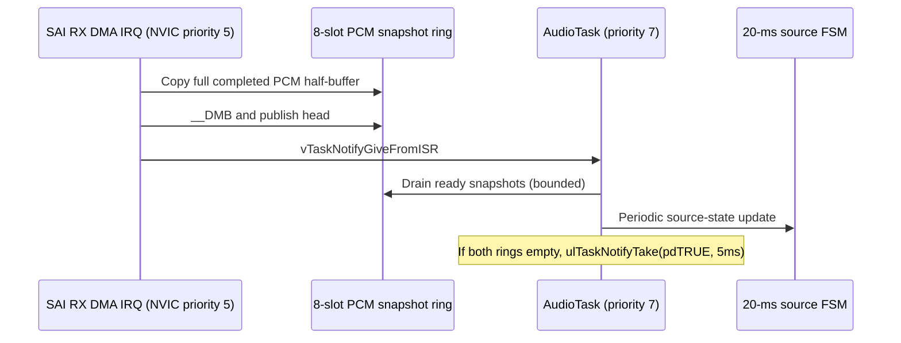

# G5 — FreeRTOS audio scheduling, correctness and performance

## Production audio handoff

The DMA interrupt is priority 5, equal to FreeRTOS's maximum syscall interrupt-priority ceiling. It calls the RTOS notification **only after** the PCM snapshot has been published. A notification does not carry the PCM; the existing single-producer/single-consumer ring still owns buffers.

The prior G4 worker polled once per tick when no input data existed. G5 waits for a DMA event and uses a **bounded** 5-ms timeout to maintain control and FSM updates even in silence. If snapshots remain, AudioTask remains ready so it can catch up. This is an architecture change, **not a measured STM32 speed improvement**.

| Resource | Single writer/owner | FreeRTOS coordination |
| --- | --- | --- |
| Capture ring head | SAI DMA ISR | Memory barrier + task notification |
| Capture ring tail | AudioTask | Bounded queue drain |
| Optional DSP/guardian | AudioTask | `GroupEvent` messages |
| Physical button FSM | ControlTask | Nonblocking 5-ms polling |
| Source FSM | AudioTask | Source-mode event from queue |
| CPU run-time profiler | Protected TIM2 / kernel traces | Existing R34 code unchanged |

## Verifying on physical hardware

At 48 kHz, 128 stereo frames span 2.667 ms. That is the capture-block cadence, **not a guaranteed deadline for every control operation**. Compare a G4 rollback build with G5 on the same Nucleo and clock. Disable the deliberate priority-7 spin; record at least five equal-length trials covering silence, BT, telecoil and source switch. Inspect time-to-wake, DSP worst-case execution, capture depth, underruns, context-switch profile, FSM deadline misses and speaker artefacts.

Run `bash Validation/run_host_validation.sh` for the portable C tests, mathematical filter comparisons, and `verify_rtos_contract.py` static checks. A successful host run is **not** an NVIC verification, Cortex-M4 build result, latency measurement or medical safety validation.

## Pending architecture work

The existing `demo_app.c` remains a large legacy integration file. Any extraction of DMA transport, supervisor or console modules requires a hardware-backed equivalence test. Avoid adding multiple FreeRTOS schedulers, moving TIM2 profiling onto encoder pins, calling blocking UART from an ISR, or promoting AI to AudioTask priority.
