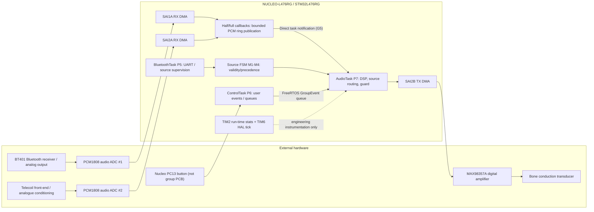

# Printable hardware + software integration diagram (A3 landscape)

Render this Mermaid with a vector-capable renderer and print **two A3 copies**; this repository file alone is *not* a physically printed diagram. **This draws current Nucleo target functions only.** Custom PCB path and PDM microphone remain unvalidated. Do not present the topology as a fabricated and tested full group board.

**Hardware accuracy warning:** This abstraction uses MCU-side logical labels and original analog frontend components. Confirm physical pin assignments, SAI wiring, exact component variants, supply and output routing from the assembled specimen before printing the *final* revision.

**Interface contracts to add beside diagram:** DMA PCM blocks 128 frames at nominal 48 kHz; 16-bit signed audio at processing interfaces; data ring ownership ISR producer/AudioTask consumer; FreeRTOS command queue ControlTask producer/AudioTask consumer; source validity may be inferred from nonzero PCM rather than actual Bluetooth connection; faults cause mute/degrade and timed recovery. Exact wire/clock pin numbers must come from the chosen board's validated pin map.
