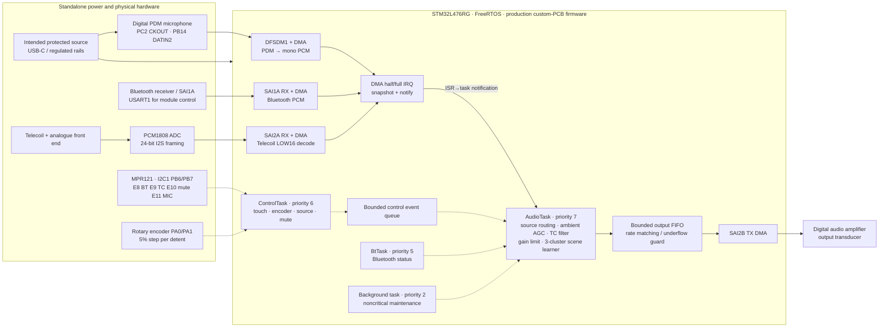

# G1 — printable system architecture

**Revision:** 03 November 2026 · **Target:** custom PCB and R24/R26 series (not the legacy root CubeIDE target) · **Format:** A3 landscape, print two copies.

This diagram separates the **data plane** (solid connections) and **control plane** (dashed connections). Peripheral mappings below come from the PCB-series code. It is a design/implementation map, **not measured electrical or real-time validation**.

## Interface and ownership summary

| Interface | Producer → consumer | Owner / scheduling contract |
| --- | --- | --- |
| PDM / DFSDM + DMA | Microphone → PCM blocks | Product-board driver; completed blocks handed to AudioTask, never processed inside ISR |
| SAI1A receive DMA | BT PCM1808/serial data → capture ring | DMA callback snapshots completed half; AudioTask consumes; Bluetooth decoding independent of TC |
| SAI2A receive DMA | TC PCM1808 → capture ring | Signed **LOW16** decode is established by PCB test; AudioTask applies TC cleanup |
| Physical controls | MPR121 + encoder → mode / volume | ControlTask polls/debounces, applies bounded policy; control events use queue |
| Bluetooth module control | USART1 ↔ module | BtTask and board-specific module interface; not the optional debug console |
| Diagnostic console | USART2 (optional) | **Disabled in operating build**; not required for audio or UI |
| Audio output | AudioTask → FIFO → SAI2B DMA | DMA output; no busy-waiting/serial printing in real-time ISR |
| Adaptive DSP / ML | PCM audio → bounded scene features | AudioTask sole owner; three online **unlabelled** clusters; no safety-critical event recognition |

## Confirm before the assessor demonstration

- Verify the *actual* operating image has no test-load tasks enabled and no diagnostic UART requirement.
- Confirm independent board power, sensor supply, touch/encoder operation, TC FILTER ON, and correct audio output.
- Measure task headroom/overrun and acoustic peak on a safe fixture; display software-unit tests separately from physical evidence.
- The current circuit files are the original KiCad design and have not been revised to match any later CAD mechanical placement.

**Historical diagram disclaimer:** Older Nucleo B1, LD2, and “microphone pending integration” diagrams belong to the legacy code baseline, not the current board demonstration.
