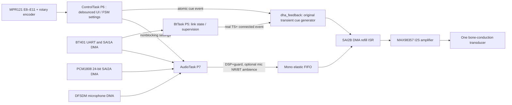

# Architecture / deterministic ownership

- **ISR** only copies/feeds DMA, refills speaker with bounded work, and mixes a short cue. No UART, heap allocation, RTOS blocking or `printf` inside the audio ISR.
- **ControlTask (priority 6)** alone mutates `G1UiState`, interprets touch/encoder, and posts desired settings/events. Long presses use `HAL_GetTick` elapsed time, never a blocking delay.
- **AudioTask (priority 7)** owns the audio DSP state, source transition/reset, optional mono effects, and queue production. Original fairness delay allows ControlTask access under continuous TC traffic.
- **BtTask (priority 5)** owns the Bluetooth UART status parser; the cue observes a `TS+` connected status, not merely a loud audio sample.
- **FreeRTOS** statically uses one heap_4 arena in SRAM2 and one linker-reserved diagnostic scratch. The DMA audio arrays stay in SRAM1.
- Default operating image does not **create** synthetic background stress or priority-7 spin tasks (`DHA_ENABLE_RTOS_STRESS=0`). These diagnostic facilities remain developer-only.

## Correctness rationale

Existing `ConnectivityService` continues to implement routing/mute/fault transitions; `G1Ui_Command` and `G1Ui_Touch` are deterministic edge-to-state reducers. The new percussive cue driver consumes atomic event bits; the new effects module is single-writer in AudioTask. The implementation avoids replacing proven hardware I/O with a speculative architectural rewrite.

## SRAM ownership

| Region | Start / end | Owner |
|---|---|---|
| SRAM1 | `0x20000000`–`0x20018000` | CPU state, non-RTOS globals, DMA buffers, main stack |
| SRAM2 heap | `0x10000000`–`0x10006000` | `heap_4.c` via `ucHeap`, 24 KiB |
| SRAM2 capture | `0x10006000`–`0x10008000` | raw/decoded recording (mutually exclusive), 8 KiB |

The linker reserves the regions; the startup code clears the FreeRTOS heap. Do not change the capture pointer back to `SRAM2_BASE` or force the RTOS heap to 32768 without redesigning the memory map.
