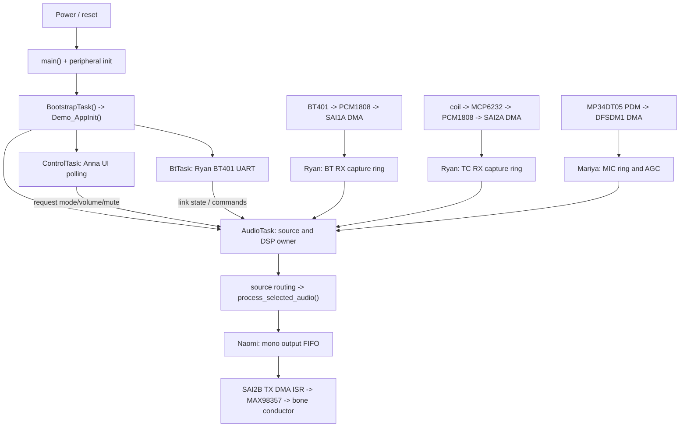

# R26.10: Four-subsystem firmware walkthrough

**Start here.** This documentation follows the original execution sequence—reset, peripheral setup, RTOS, user events, input DMA, source selection, DSP, output DMA and error recovery—then lets each team member follow their own subsystem from start to finish. **Four engineering subsystems are not four FreeRTOS tasks.**

> **Release/source distinction:** These explanations are grounded in the complete QR261104.10 CubeIDE release ZIP. GitHub's active firmware has not yet been synchronized with that ZIP. Some QR261104.10 filenames do not yet exist on GitHub main; consult the release ZIP for those implementations. Updating these documents does not change the firmware or validate CubeMX regeneration.

## Pick a subsystem

| Subsystem | Walkthrough | Hardware and boundary |
|---|---|---|
| **Anna — controls and monitoring** | **[Open Anna's guide](ANNA_CONTROLS.md)** | MPR121 I²C1 + encoder EXTI → logical mode/gain/mute requests → AudioTask |
| **Ryan — Bluetooth, telecoil and connectivity** | **[Open Ryan's guide](RYAN_CONNECTIVITY.md)** | BT401 USART1 / Bluetooth ADC SAI1A / telecoil ADC SAI2A → decoded PCM and source arbitration |
| **Mariya — microphone and DSP** | **[Open Mariya's guide](MARIYA_AUDIO_DSP.md)** | PDM mic DFSDM1 CH2/Filter0 + DMA1 Ch4 → 16-bit PCM, ambient AGC and optional common DSP |
| **Naomi — output and playback** | **[Open Naomi's guide](NAOMI_OUTPUT.md)** | Output FIFO → SAI2B DMA1 Ch7 → MAX98357 amplifier → bone conductor |

Also read **[Cross-subsystem interface contracts](INTERFACES.md)**, the original **[39-event whole-system execution trace](../FIRMWARE_EXECUTION_GUIDE_R26.md)**, and the main [repository README](../../README.md).

## Full execution timeline, with owners

| # | Event that triggers execution | Actual call chain | Subsystem interaction |
|---|---|---|---|
| **00** | Power/reset | `main()` → `HAL_Init()` → `Demo_EarlyInit()` | Shared startup |
| **01** | Startup continues | `SystemClock_Config()` → GPIO, DMA, UART, SAI init → `G1_BoardInit()` | Anna's touch/encoder and Mariya's DFSDM are prepared |
| **02** | Native scheduler starts | `Demo_StartNativeRTOS()` → `BootstrapTask()` → `Demo_AppInit()` → `Demo_ControlTask()` | Shared; default user source becomes **MIC** |
| **03** | ControlTask enters loop | `create_child_tasks()` → `StartAudioTask()` and `StartBtTask()` | One audio worker, one control worker and one BT UART worker |
| **04** | AudioTask observes requested mode | `dma_desired_topology()` → `start_dma()` (or `stop_dma()`) | Configures Ryan's inputs and Naomi's SAI TX; Mariya's DFSDM separately |
| **05A** | User touches E8/E9/E10/E11 | **Anna:** `G1_BoardPoll()` → `G1Ui_Touch()` → `product_ui_commit()` | Publishes mode/mute and restart flags; AudioTask applies them |
| **05B** | User rotates encoder | **Anna:** EXTI → `G1_BoardPoll()` → `G1Ui_Encoder()` | Publishes bounded Q15 gain; output renderer uses it |
| **06A** | BT401 reports status | **Ryan:** USART1 ISR → BT UART RX ring → `poll_bt_uart()` → `StartBtTask()` | Connection status and AT commands; **not PCM** |
| **06B** | BT or TC ADC DMA half completes | **Ryan:** SAI RX callback → capture ring → `process_bt_words()` / `process_tc_words()` | 128 stereo frames into signed PCM |
| **06C** | DFSDM DMA half completes | **Mariya:** `mic_push()` → `G1_MicTakeBlock()` → `G1Ambient_Process()` | 128 signed mono PCM frames |
| **07** | New source data / FSM step | **Ryan/shared:** `ConnectivityService_Step()`, source block handler | Selects permitted BT/TC programme; manual TC bypasses AUTO qualification |
| **08** | Chosen source block ready | **Mariya/shared:** `process_selected_audio()` → optional dynamics, group features/effects | 128 processed mono PCM frames |
| **09** | PCM producer completes a block | **Naomi/shared:** `output_queue_push()` | 4096-sample FIFO decouples DSP from speaker DMA |
| **10** | Speaker SAI2B TX DMA half completes | **Naomi:** TX callback → `speaker_fill_region_isr()` | 16-bit stereo-formatted samples to MAX98357 |
| **11** | Shortfall or fault occurs | Capture overrun, FIFO underrun, mic error, UART error | Count, bounded recovery/re-prime, or panic |

**Task ownership, not team count:** `BootstrapTask` begins native FreeRTOS at priority **3**, becomes `Demo_ControlTask` priority **6**; `StartAudioTask` priority **7** owns audio processing and DMA topology; `StartBtTask` priority **5** owns BT401 UART communication. The speaker and capture DMA callbacks are interrupts, not dedicated tasks.

### System flow

## Find the source in seconds

1. **Power-on/clock:** [`Core/Src/main.c`](../../Core/Src/main.c), [`Core/Src/rtos_bootstrap.c`](../../Core/Src/rtos_bootstrap.c).
2. **Runtime orchestration and all major callbacks:** [`Core/Src/demo_app.c`](../../Core/Src/demo_app.c). Search a symbol, *not* the entire giant file by eye.
3. **Anna:** [`Core/Src/g1_user_controls.c`](../../Core/Src/g1_user_controls.c); the MPR121/encoder physical driver is in [`Core/Src/g1_product_board.c`](../../Core/Src/g1_product_board.c).
4. **Ryan:** [`Core/Src/bt_profile.c`](../../Core/Src/bt_profile.c), [`Core/Src/connectivity_service.c`](../../Core/Src/connectivity_service.c), [`Core/Src/pcm_transport.c`](../../Core/Src/pcm_transport.c); R26.10 telecoil modules are in the release ZIP's `Core/Src/`.
5. **Mariya:** [`Core/Src/g1_ambient_dsp.c`](../../Core/Src/g1_ambient_dsp.c), [`Core/Src/audio_dynamics.c`](../../Core/Src/audio_dynamics.c), R26.10 `Core/Src/dfsdm.c`.
6. **Naomi:** [`Core/Src/speaker_output.c`](../../Core/Src/speaker_output.c), and the output queue/callbacks in [`Core/Src/demo_app.c`](../../Core/Src/demo_app.c).
7. **RTOS/queues:** QR261104.10 `Core/Inc/g1_rtos_contract.h` holds numerical contract constants; `demo_app.c` creates the genuine group-event FreeRTOS queue. The BT, TC, MIC, UART rings and speaker FIFO are **C-managed arrays**, not CMSIS/FreeRTOS message queues.

### Common pitfalls for the viva

- The **MPR121** is an I²C touch controller, **not** an I²C audio codec.
- The **BT401** uses USART1 for AT/status, but Bluetooth *sound* travels via analogue L/R → PCM1808 → SAI1A.
- The **microphone still uses DFSDM**; PDM isn't input through SAI.
- The **output is not a fourth FreeRTOS task**; SAI2B DMA interrupts invoke the refill callback.
- **100% local gain** is bounded by the firmware's Q15 digital ceiling, not a calibrated acoustic power rating.
- **FreeRTOS settings shown in the .ioc** are descriptive of native task creation; regenerating a second CMSIS scheduler or IRQ handler could conflict with application-owned code.
- A **quiet telecoil idle mode** does not prove good active-programme SNR.

### Document contract

Each member's guide follows *its own* power-on → event → function → signal/state → handoff → observable result sequence, with relevant source excerpts and failure branches. These are **subsystem responsibility labels**, not an unverifiable assertion that one person wrote every line of each integration file.

**Continue:** [Anna](ANNA_CONTROLS.md) · [Ryan](RYAN_CONNECTIVITY.md) · [Mariya](MARIYA_AUDIO_DSP.md) · [Naomi](NAOMI_OUTPUT.md) · [Interfaces](INTERFACES.md).
