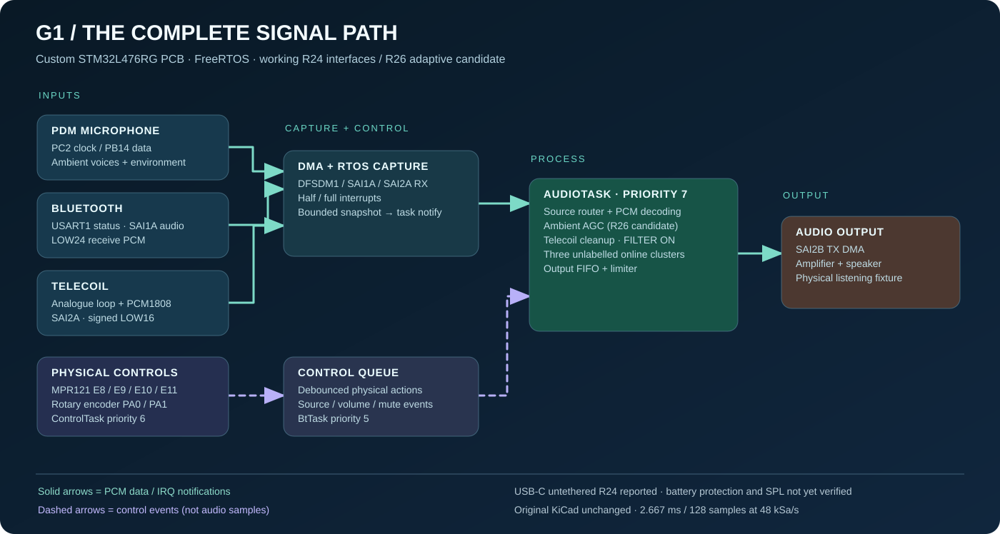

# G1 · Standalone adaptive hearing prototype

**STM32L476RG · custom KiCad PCB · FreeRTOS · microphone / Bluetooth / induction-loop audio · physical controls**

## Start with the R26.10 code walkthrough

**[Open the four-subsystem execution guide](Documentation/SUBSYSTEMS/README.md)** — follow the real startup-to-sound runtime flow, then dive into a member's source code:

[**Anna — controls**](Documentation/SUBSYSTEMS/ANNA_CONTROLS.md) · [**Ryan — BT/telecoil**](Documentation/SUBSYSTEMS/RYAN_CONNECTIVITY.md) · [**Mariya — microphone/DSP**](Documentation/SUBSYSTEMS/MARIYA_AUDIO_DSP.md) · [**Naomi — speaker output**](Documentation/SUBSYSTEMS/NAOMI_OUTPUT.md) · [**Interface contracts**](Documentation/SUBSYSTEMS/INTERFACES.md)

Each guide starts at the event that triggers its functions, shows annotated source excerpts and exact file paths, and traces the next task, queue, interrupt, hardware or team subsystem. The [original 39-event system execution guide](Documentation/FIRMWARE_EXECUTION_GUIDE_R26.md) remains available for the full chronological walkthrough. **Documentation baseline:** latest separately delivered QR261104.10 ZIP; repository firmware sources have not yet been synchronized to that release.

The diagram above represents real interfaces and task ownership, not fictional mechanical CAD or hardware measurements.

 

[**Explore the interactive website**](https://rv-crtl.github.io/Digital-Hearing-Aid-G1/) · [System architecture](Documentation/PRINTABLE_SYSTEM_DIAGRAM.md) · [Black-box demonstration plan](Documentation/BLACK_BOX_TEST_PLAN.md) · [Current evidence and requirements](Documentation/G1_CURRENT_SYSTEM_REQUIREMENTS.md) · [Hardware/KiCad](Hardware/README.md)

> **Prototype, not a certified hearing aid.** This repository contains original PCB design, software source, testing infrastructure and student-team engineering work. The maximum acoustic output has not been independently calibrated for use on or in the ear. Public access is not a general reuse licence; see [publication and contributor rights](Documentation/PUBLICATION_GATE.md).

## Firmware navigation and STM32CubeIDE import

**[Read the R26 boot-to-speaker function walkthrough](Documentation/FIRMWARE_EXECUTION_GUIDE_R26.md)** — chronological annotated code excerpts, physical hardware paths, per-source DSP functions, peripheral drivers, source routing, FreeRTOS tasks, speaker FIFO, diagnostics, and exact `Core/Src/` locations.

To download a **firmware-only ZIP from GitHub**, open [Actions → Export clean STM32CubeIDE project](../../actions/workflows/cubeide-clean-export.yml), choose **Run workflow**, and download the `STM32CubeIDE-clean-project` artifact from the completed run. Alternatively run `Tools/Export-CubeIDE.ps1 -OutputPath dist` in PowerShell from the repository checkout. These exports reflect the **repository revision being built**, not the separate QR261104.8 ZIP until the source-sync issue below is resolved.

For a source checkout, use **File → Import → Existing Projects into Workspace** and select the repository root containing `.project` and `.cproject`; do not import a historical reference firmware as a second project. The active application entry point is **`Core/Src/main.c`**, and the development configuration is described by the root `.ioc`. Commit history retains deleted recovery/prototype files if historical investigation is needed.

**Release synchronization:** to publish the supplied QR261104.8 ZIP into a local Git clone safely, use [`Tools/Sync-FirmwareRelease.ps1`](Tools/Sync-FirmwareRelease.ps1). Run it first with `-ZipPath <path-to-ZIP>` for validation and again with `-Apply` to replace the active firmware, create a Git commit and push to `main`. It requires a clean clone and your existing GitHub Git credentials. The QR261104.8 clean firmware archive distributed separately contains newer telecoil modules than the current repository revision. This repository should not be represented as the exact QR261104.8 release until its source and `.ioc` are synchronized and a native CubeIDE build passes. The guide describes QR261104.8 and marks differences where relevant.

## The real prototype

The physical target is a **standalone custom PCB**, not a Nucleo board. A ST-LINK is needed only for programming and optional engineering diagnosis, not for intended normal operation. The hardware incorporates an STM32L476RG, digital PDM microphone, MPR121 capacitive touch, rotary encoder, Bluetooth audio, a telecoil input with PCM1808 conversion, FreeRTOS and a speaker/audio-output chain. The bench-tested R24 firmware was reported to operate without Nucleo after a wiring issue was resolved.

The team subsequently developed **R26** with higher-sensitivity ambient audio, telecoil idle-noise reduction, adaptive gain, and incremental acoustic feature clustering. **R26 firmware is a candidate, not a confirmed on-PCB acceptance result.**

| Function | Evidence currently available | Important qualification |
| --- | --- | --- |
| Microphone → speaker | Operator-confirmed in R24; R26 DSP host tests | Distant pickup, distortion, safe SPL and ambient balance need measurement |
| Bluetooth → speaker | Operator-confirmed in R24 | Bluetooth module and source output remain subject to demonstration checks |
| Telecoil → speaker | Operator-confirmed with **PCM LOW16** and **FILTER ON** | Residual analogue hiss/weak-signal behaviour needs listening and bench measurements |
| MPR121 touch / encoder | Operator-confirmed, R21 control regression tests | Repeatability and user-response timing remain black-box criteria |
| Untethered USB-C power | R24 operator-confirmed after resolving external wiring | Battery source/protection/charging cannot be inferred from this result |
| Adaptive scene model | R26 portable C tests | **Three unsupervised clusters**, not a pretrained speech/car/pedestrian classifier |
| FreeRTOS / DMA | Static contracts and host tests | Final CPU load, timing, interrupts, underruns and SRAM headroom need recorded board evidence |

## Important: two firmware baselines

**Do not flash the root CubeIDE project assuming it is R26.** The root files currently include an earlier Nucleo-oriented group source baseline, augmented with portable R20–R26 DSP/control improvements. R26's complete custom-PCB project was distributed separately; a clean, native STM32CubeIDE 1.19.0 GCC build and intentional whole-project promotion are required before declaring it this repository's authoritative firmware. The runtime should not be assembled by casually combining half of one firmware revision with the other.

See [firmware integration and source ownership](Documentation/G1_CURRENT_SYSTEM_REQUIREMENTS.md) and [integration issue #27](https://github.com/RV-crtl/Digital-Hearing-Aid-G1/issues/27).

## Interactive engineering site

The [site](https://rv-crtl.github.io/Digital-Hearing-Aid-G1/) provides an interactive CAD explorer (3MF/GLB with local upload), source-linked **original KiCad schematics**, signal paths and task ownership, code references, and a demonstration checklist. All files under `Hardware/Original_KiCad/` remain unchanged.

The uploaded **November 2026 full multi-body assembly** contains 1,713 3MF mesh objects (460,021 triangles), including PCB, housing and separated structures. The *previous* 3MF stored at `docs/assets/g1-assembly.3mf` is an earlier revision. The newest upload can be opened through the site's **Open your 3D CAD** control without sending it to a server; its full binary is not yet tracked on GitHub. See [CAD provenance and viewing guide](Documentation/CAD_ASSEMBLY_AND_VIEWERS.md).

## Project navigation

| Area | Start here |
| --- | --- |
| Software / RTOS | [Core source](Core/Src) · [source ownership map](Documentation/CODE_MAP.md) |
| DSP and adaptive learning | [Ambient DSP](Core/Src/g1_ambient_dsp.c) · [online clusters](Core/Src/g1_scene_ml.c) · [telecoil cleanup](Core/Src/tc_cleanup.c) |
| Circuits / layout | [Original KiCad files](Hardware/Original_KiCad) · [hardware notes](Hardware/README.md) |
| Firmware import | [CubeIDE procedure](Documentation/GROUP_G1_IMPORT_AND_BUILD.md) · [R26 integration gate](https://github.com/RV-crtl/Digital-Hearing-Aid-G1/issues/27) |
| Demonstration | [System diagram](Documentation/PRINTABLE_SYSTEM_DIAGRAM.md) · [current requirements](Documentation/G1_CURRENT_SYSTEM_REQUIREMENTS.md) · [20-minute black-box test](Documentation/BLACK_BOX_TEST_PLAN.md) |
| Validation / CI | [Host validation](Validation/README.md) · [Actions](https://github.com/RV-crtl/Digital-Hearing-Aid-G1/actions) |
| Contributors / release | [CONTRIBUTING](CONTRIBUTING.md) · [SECURITY](SECURITY.md) · [publication gate](Documentation/PUBLICATION_GATE.md) |

## Working practices

Run `python3 Validation/run_host_validation.py`, `python3 docs/validate_site.py` and the relevant portable C tests before submitting a PR. **Green source-level CI does not mean ARM firmware compiled, a device booted, or acoustic performance was measured.** The correct demonstration image must start from its intended regulated power supply with ST-LINK and diagnostics disconnected; no synthetic stress/demo tasks should be enabled for operating mode.

Earlier G2/G3/G5/G11 and R-series materials remain in `Documentation/` for traceability, but **the current requirements and black-box plan linked above supersede their historical demonstration descriptions.** Avoid presenting historical statements about an unintegrated mic, Nucleo B1, or simulated user controls as the current PCB's features.
