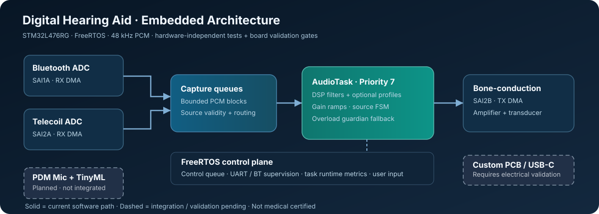

# Digital Hearing Aid

### STM32L476RG · FreeRTOS · multi-input audio · measured engineering

[](https://github.com/RV-crtl/Digital-Hearing-Aid-G1/actions/workflows/verify-g3.yml)


> **Engineering prototype / team project.** The current STM32CubeIDE target is **NUCLEO-L476RG**, with Bluetooth and telecoil PCM capture, DMA speaker output, a real FreeRTOS task structure, software source selection, optional DSP profiles, and a fault-pressure guardian. The checked-in custom PCB is a **separate, unvalidated target**. This is not a certified hearing aid or validated acoustic safety device.



## Choose your route

| Get started | Engineering and evidence | Collaboration |
| :--- | :--- | :--- |
| **[Import into STM32CubeIDE](Documentation/GROUP_G1_IMPORT_AND_BUILD.md)** | **[Find a function in the code](Documentation/CODE_MAP.md)** | **[Contribution standards](CONTRIBUTING.md)** |
| [Standalone product demonstration](Documentation/STANDALONE_SHOWCASE.md) | [Run host/MATLAB verification](Validation/README.md) | [Open issues](https://github.com/RV-crtl/Digital-Hearing-Aid-G1/issues) |
| [Current architecture](Documentation/ARCHITECTURE.md) | [Evidence and hardware gates](Documentation/VALIDATION_LADDER.md) | [Change history](CHANGELOG.md) |
| [Hardware/PCB design](Hardware/README.md) | [Requirement-by-requirement matrix](Documentation/REQUIREMENTS_EVIDENCE.csv) | [Pull requests](https://github.com/RV-crtl/Digital-Hearing-Aid-G1/pulls) |

**New contributor?** The [one-page repository guide](Documentation/REPOSITORY_GUIDE.md) explains the directory roles, build sequence, source ownership, and how to find the tested code.

## What actually works, and what is still engineering work?

| Subsystem | Current code | Evidence to date |
| --- | --- | --- |
| Bluetooth and telecoil digital capture and source FSM | Present | Portable FSM regression; original Nucleo playback needs final-assembly retest |
| FreeRTOS / bounded control queue / task runtime diagnostics | Present | Source guards; board scheduling/latency evidence outstanding |
| SAI/DMA output and PCM routing | Present | Implementation exists; speaker and transducer must be retested |
| HPF / compensation EQ / dynamics | Present | Production-C impulse vectors; independent Python mathematical verification; MATLAB script supplied |
| G1 listening profiles, WIND filter and auto loudness *heuristic* | Present | Host C tests, including identity bypass and transitions; **not trained AI** |
| Overload guardian | Present | Host regression verifies state policy; real DMA overload proof outstanding |
| Physical rotary and PDM mic integration | Partial prototypes | Custom board hardware and firmware integration pending |
| TinyML, USB audio, charging/balancing, production power and custom PCB firmware | **Not implemented / verified** | Requirements and hardware feasibility documented |

## Fast validation and performance smoke test

From repository root on a computer with GCC/Clang, Python 3 and Bash:

```bash
bash Validation/run_host_validation.sh
```

This builds and executes **production-source C tests**, exports filter vectors, checks the math independently, tests the source-selection FSM, encoder and overload guardian, audits KiCad dependencies, and writes a **host-only 128-frame DSP benchmark** to `Validation/results/profile_host_benchmark.csv`.

For MATLAB, after running the host script:

```matlab
addpath('Validation/matlab');
verify_audio_filters('Validation/results/audio_vectors.csv','Validation/results');
```

See the [validation ladder](Documentation/VALIDATION_LADDER.md) for exactly why **host CI does not prove successful ARM compilation, safe sound output, real PCB power behaviour, or medical performance**.

## Repo layout

```text
Core/            Real application, MCU/SAI/DMA and FreeRTOS (compiled)
Drivers/         STM32 HAL and CMSIS vendor dependencies
Recovery/        Copies restored after STM32CubeMX generation
Tests/           Portable C tests against production modules
Validation/      C vectors, independent Python/MATLAB, host benchmarks
Hardware/        Original supplied KiCad project and MCU pin map
Documentation/   Architecture, code map, tutorials, requirements and gates
References/      Group members' earlier prototypes (NOT compiled)
Dashboard/       Optional laptop-based development tooling
.github/         Automated checks and contribution/review workflows
```

**Keep the CubeIDE `.project`, `.cproject`, `.ioc` and prepare scripts at the repository root.** `Recovery/` is not a second build target. See [exact import/build instructions](Documentation/GROUP_G1_IMPORT_AND_BUILD.md) before opening the `.ioc`.

## Software design and priorities

- **AudioTask (priority 7):** exclusive owner of DSP and PCM audio control state. Queued user commands enter at safe task boundaries.
- **ControlTask (priority 6):** controls/serial processing and diagnostic snapshots; should not block critical audio work.
- **Bluetooth supervision (priority 5):** independent status handling.
- **Background tests (priority 2):** development-only workloads. Deliberate priority-7 saturation is **not normal product operation**.
- **Engineering goal:** use DMA and event/queue synchronization while measuring real worst-case timing—not merely adding more tasks.

The [code map](Documentation/CODE_MAP.md) takes you directly to the implementation symbols and explains which code can be safely changed without touching the verified TIM2/TIM6 runtime profiler.

## Hardware truth / release status

The supplied routed KiCad design is included for inspection and migration. The board has unresolved third-party schematic/footprint-library paths, outstanding KiCad ERC/DRC, unverified user-control wiring, and incomplete evidence for battery charging/balancing. The STM32 custom-board pin mapping **differs from the Nucleo firmware**.

Read [hardware constraints](Hardware/README.md), [board-porting checklist](Hardware/CUSTOM_PCB_PORTING_CHECKLIST.md) and [release gates](Documentation/RELEASE_CHECKLIST.md) before custom-board programming or a product-level performance claim.

---

**Team engineering repository.** Please submit changes via a branch + pull request, preserve test evidence by commit, and keep the original individual PD5 repository separate. Every claimed hardware PASS requires recorded conditions and measured results.
